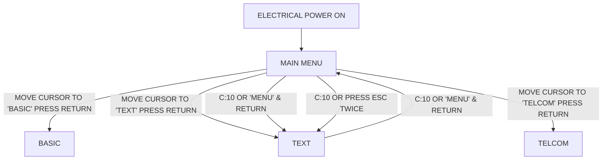
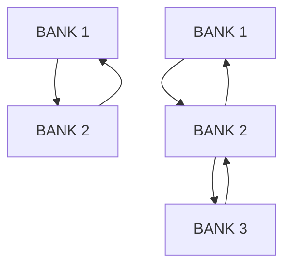
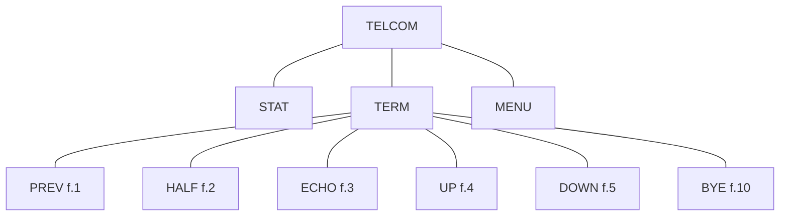
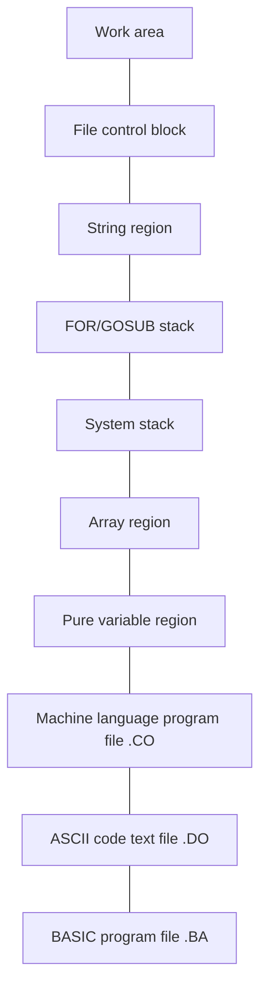
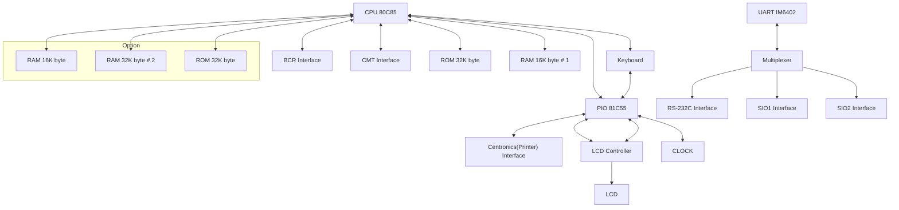

## PC-8201A

### USER'S GUIDE

photo: NEC PC-8201A laptop computer

logo: NEC

**PC-8201A-UM**
**PTS-210**

**WARNING:** This equipment has been certified to comply with the limits for a Class B computing device, pursuant to Subpart J of Part 15 of FCC Rules. Only peripherals (computer input/output devices, terminals, printers, etc.) certified to comply with the Class B limits may be attached to this computer. Operation with non-certified peripherals is likely to result in interference to radio and T.V. reception.

© 1983 NEC Home Electronics (U.S.A.), Inc.
Personal Computer Division
Nippon Electric Co., Ltd., Tokyo, Japan

All rights reserved. No part of this publication may be reproduced in whole or in part without the prior written permission of NEC Home Electronics (U.S.A.), Inc.

## **PC-820IA**

### **USER'S GUIDE**

## **TABLE OF CONTENTS**

| INTRODUCTION |                                                         | 1           |
| ------------ | ------------------------------------------------------- | ----------- |
| CHAPTER 1    | Description of the PC-8201                              | 1-1         |
|              | • Overview                                              | 1-1         |
|              | • Description of Parts                                  | 1-2         |
|              | • Batteries                                             | 1-6         |
|              | NiCAD Batteries                                         | 1-7         |
|              | Installation                                            | 1-8         |
|              | Battery Life Span                                       | 1-11        |
|              | AC Power Adapter                                        | 1-12        |
|              | • Power ON and OFF                                      | 1-13        |
|              | Back-up Power                                           | 1-14        |
|              | Automatic Shut Off                                      | 1-14        |
|              | • Memory Capacity                                       | 1-15        |
|              | Expanded Memory Capacity                                | 1-15        |
|              | Banks                                                   | 1-16        |
| CHAPTER 2    | Precautions                                             | 2-1         |
|              | • Overview                                              | 2-1         |
|              | • Cold & Warm Start                                     | 2-1         |
|              | • IPL (Initial Program Load)                            | 2-4         |
|              | • Reset Switch                                          | 2-5         |
|              | • Protect Switch                                        | 2-7         |
|              | • Care of the PC-8201                                   | 2-8         |
| CHAPTER 3    | Features & Functions of the PC-8201                     | 3-1         |
|              | • Overview                                              | 3-1         |
|              | • Screen Description                                    | 3-1         |
|              | • Keyboard                                              | 3-3         |
|              | Special Keys                                            | 3-4         |
|              | Function Keys                                           | 3-7         |
| CHAPTER 4    | Peripheral Devices                                      | 4-1         |
|              | • Overview                                              | 4-1         |
|              | • Interfaces                                            | 4-1         |
|              | Care of Cassette Tapes                                  | 4–4         |
|              | · Printer                                               | 4–5         |
|              | · Bar Code Reader                                       | 4–6         |
|              | · Modem                                                 | 4–6         |
|              | **CHAPTER 5** Operating the PC-8201                     | 5–1         |
|              | · MENU Overview                                         | 5–1         |
|              | Selection of Features                                   | 5–2         |
|              | Setting Time & Date                                     | 5–3         |
|              | BASIC                                                   | 5–6         |
|              | TEXT                                                    | 5–8         |
|              | TELCOM                                                  | 5–10        |
|              | · Files                                                 | 5–11        |
|              | · Commands                                              | 5–14        |
|              | · Load from & Record to a Cassette Tape                 | 5–1         |
|              | **CHAPTER 6** Basic                                     | 6–1         |
|              | · Overview                                              | 6–1         |
|              | · BASIC Language                                        | 6–1         |
|              | · Special Keys used in BASIC Mode                       | 6–2         |
|              | · Operation Modes                                       | 6–3         |
|              | · Function Keys                                         | 6–4         |
|              | · Sample Program                                        | 6–22        |
|              | **CHAPTER 7** Text                                      | 7–1         |
|              | · Overview                                              | 7–1         |
|              | · TEXT Mode                                             | 7–2         |
|              | · Cursor Operations                                     | 7–6         |
|              | · Function Keys                                         | 7–12        |
|              | · EDIT                                                  | 7–30        |
|              | **CHAPTER 8** Telcom                                    | 8–1         |
|              | · Overview                                              | 8–1         |
|              | · Starting TELCOM                                       | 8–2         |
|              | · Commands                                              | 8–4         |
|              | MENU                                                    | 8–1         |
|              | STAT                                                    | 8–1         |
|              | TERM                                                    | 8–1         |
|              | · Escape Sequences & Control Codes                      | 8–23        |
|              | • Appendix A – Specifications                           | A–1         |
|              | Hardware                                                | A–1         |
|              | Accesories                                              | A–7         |
|              | • Appendix B – Optional Equipment Avail<br/>for PC-8201 | B–1         |
|              | • Appendix C – Tables & Diagrams                        | C–1         |
|              | • Appendix D – Glossary                                 | D–1         |
|              | **INDEX**                                               | **INDEX–1** |


—i—

## **TABLE OF CONTENTS**

–ii–

## **TABLE OF CONTENTS**

-iii-/(—iv— blank)

## **INTRODUCTION**

The PC-8201 is a unique and practical computer. It is compact enough to be carried in a briefcase and offers many features and power of a large computer. It is portable and can be used anywhere.

The latest technology has been used in the development of the PC-8201, as seen in the Complementary Metal Oxide Semiconductor (CMOS), Read Only Memory (ROM), and Random Access Memory (RAM).

CMOS is a state-of-the art semiconductor used in battery operated systems, since it offers low power and low voltage operation. The ROM is used to store the programs that operate the PC-8201. The ROM cannot be "written into" or altered in any way, and it is not erased when the power of the PC-8201 is turned OFF. The RAM is the type of memory that can be altered. Information can be "written in" or "read out" very quickly. This memory is "saved" in the PC-8201 as long as the battery power remains adequate, or an electrical power source is connected to the unit.

The RAM is expandable to 96K bytes through the use of internal chips or external cartridges. Also, the PC-8201 has a Liquid Crystal Display (LCD) that is the largest found on any portable computer.

The PC-8201 has a full-size keyboard with a variety of special function keys. It offers the convenience of operating the machine with battery power anywhere. An AC adapter is available for use with 120 volt AC power, so that the NiCAD Battery Pack (PC-8201-90) can be recharged, and the charge of standard batteries can be conserved.

Built-in software features include Microsoft <sup>TM</sup> 's Ng2-BASIC programming language, wordprocessing, and telecommunications. Hardware features built into the PC-8201 include automatic power shut-off, a real-time clock, and a sound generator.

Interfaces allow the PC-8201 to communicate with various external devices such as printers, a telephone modem, etc.

-1-

## INTRODUCTION

The PC-8201 is intended for the computer novice, as well as for professionals. Anywhere there is a need for portable computing power, such as for school, work, or travel, the PC-8201 is the logical choice.

icon: NOTE **So convenience we omit the character "A" from each machine and peripheral (for example, PC-8201 instead of PC-8201A).**

This manual is divided into nine chapters.

**Chapter 1** is an overview of the PC-8201, with instructions for installation.

**Chapter 2** describes the cold and warm start procedures, along with how to free the computer during problem situations and how to care for the PC-8201.

**Chapter 3** gives a detailed description of the layout of the LCD screen and keyboard.

**Chapter 4** describes the available peripheral devices that may be operated with the PC-8201, along with explanations for connecting them.

**Chapter 5** starts you using the PC-8201, while explaining the different features and functions, including the three different software features. This chapter also describes files and how to handle them.

**Chapter 6** describes the Ng2-BASIC language used with the PC-8201 personal computer. This is the built-in programming language which allows you to write your own program.

**Chapter 7** outlines the TEXT feature of the PC-8201. This software feature allows the computer to be used as a word processor, and enables you to edit files.

**Chapter 8** describes the software feature TELCOM. This lets your PC-8201 communicate with other computers via a telephone modem.

-2-

INTRODUCTION

**Chapter 9** contains Appendices, with special sections that will help you to get the most from your PC-8201.

The Ng2-BASIC Reference Manual is included with the PC-8201 computer. It gives detailed explanations of the programming language used with the PC-8201 computer. The manual includes sample programs with easy-to-understand descriptions.

We recommend that you study the PC-8201 User's Guide to acquaint yourself with its capabilities and the various features available.

The PC-8201 is a friendly machine, so go ahead and get to know it!

### Symbols used in this manual:

icon: return key **RETURN KEY** input is required.

icon: note **NOTES** to be remembered.

icon: arrow **CAUTION** required when performing indicated procedures.

icon: hand pointing **REFERENCE** is made to another chapter, to the BASIC Reference Manual.

-3-/(4- blank)

icon: stylized number 1 in a grid

## **Description of**

## **the PC-8201**

## **CHAPTER 1**

### **DESCRIPTION OF THE PC-8201**

#### **Overview**

Start by carefully unpacking your PC-8201 personal computer from its carton.

The package includes:

1. PC-8201 Personal Computer
2. Soft Vinyl Case
3. PC-8201 User's Guide
4. Ng2-BASIC Reference Manual
5. Batteries
6. Cassette Cable (PC-8293)
7. Software Application Kit (Cassette Tape & Pamphlet)

If any item is missing from the carton please contact your Authorized NEC Dealer.

The next step you should take is to simply look at the various parts of the computer, as shown:

#### **Front View & Side View**

drawing: NEC PC-8201A computer with callouts for Liquid crystal display, Low Voltage Display LED, Battery case, Contrast adjustment knob, and Electrical power switch

1-1

Chapter 1

## **Description of Parts**

### **LIQUID CRYSTAL DISPLAY (LCD)**

The liquid Crystal Display is built into the PC-8201. It displays 8 lines, with 40 characters per line. The LCD will be referred to as "screen" throughout this manual.

### **LOW BATTERY LED**

The Low Battery LED (light emitting diode) lights up when the main batteries have a low charge. The AC Power Adapter (PC-8271A-01) may be connected or the batteries may be replaced when the Low Battery indicator lights up.

### **BATTERY CASE**

The Battery Case will hold four AA (1.5 volt) size batteries. An optional battery unit containing NiCAD (nickel-cadmium) batteries (PC-8201-90) may be used in place of the regular battery case.

### **CONTRAST ADJUSTMENT KNOB**

This knob is used to adjust the contrast of the screen, according to your viewing angle. Readjustment may be necessary if you change your position or move the PC-8201.

### **POWER ON/OFF SWITCH**

This switch simply turns the power to the PC-8201 ON or OFF.

1-2

Chapter 1

drawing: rear panel of a PC-8201 computer showing connectors and switches

## **AC ADAPTER CONNECTOR**

The optional AC Adapter (PC-8271A-01) is connected to the PC-8201 at this outlet.

## **PROTECT SWITCH**

This switch prevents data from being entered into Bank #2, if the memory has been expanded to include extra banks. The data within this bank is then protected from accidental loss.

## **RESET SWITCH**

The Reset Switch is used to perform a "Cold Start", or as part of a process to free the computer when "hung up". This switch should only be used as a last resort, since the memory of the PC-8201 will be erased.

## **SIO1 CONNECTOR**

This connection port is available for future expansion of peripherals.

## **SIO2 CONNECTOR**

Further expansion.

1-3

Chapter 1

## **BAR CODE READER (BCR) CONNECTOR**

This connector allows an optional Bar Code Reader to be connected to the PC-8201.

## **PRINTER CONNECTOR**

This port is used to connect the PC-8201 to NEC printers such as the Dot Matrix Printer (PC-8023-C), using the cable (PC-8294).

## **RS-232C CONNECTOR**

This connector is used to connect the PC-8201 to other devices that conform with the RS-232C interface standards. The devices could be printers, modems, etc. For instance, the RS-232C can be used in conjunction with a telephone modem and the software feature TELCOM to allow communication with another PC-8201 or another computer.

## **DATA RECORDER (CMT) CONNECTOR**

Data Recorders (PC-6082) and (PC-8281), or any ordinary cassette recorder may be connected to the PC-8201 through this connector. The cable (PC-8293) is used for the connection.

## **SYSTEM SLOT**

drawing: illustration of a system slot with a peripheral device being inserted

1-4

Chapter 1

The RAM Cartridge (PC-8206) is inserted into the system slot, on the left side of the PC-8201. This allows expansion of the memory.

## **BACK UP POWER SWITCH**

This switch controls the back-up battery system, which contains NiCAD batteries. The PC-8201 will not operate unless this switch is turned to ON.

drawing: technical illustration of a computer system with a callout for the Back Up Power Switch

1-5

Chapter 1

## **Batteries**

The PC-8201 is powered by four AA size (1.5 volt) batteries. An optional NiCAD Battery Pack (PC-8201-90) is also available for use in place of the regular battery pack.

In addition, there is also a back-up system which consists of internal NiCAD (nickel-cadmium) batteries which automatically switch on for emergency use. These batteries charge continuously whenever the computer is in normal operation.

While the PC-8201 is in a storage condition the back-up batteries can maintain the contents of the RAM for up to 30 days, depending upon how much RAM is in the unit. Keep in mind that these batteries cannot actively operate the PC-8201 for very long.

If the main batteries have a low charge, causing the back-up battery system to be used, the LOW BATTERY LED indicator on the PC-8201 will light up. You should change the batteries when this indicator lights up, since you can only operate the PC-8201 for about 20 minutes from this point. Storing the PC-8201 for a long time with a low charge will cause it to become inoperable.

icon: arrow **If you continue to operate the PC-8201 with the Low Battery indicator lit up for more than 20 minutes, the unit will become inoperable and you will lose all of the data stored in the RAM.**

icon: NOTE **Batteries should be replaced as soon as possible after the LOW BATTERY LED lights up. The power switch should always be turned OFF during change of batteries.**

1-6

Chapter 1

## **NiCAD (Nickel-cadmium) Batteries**

The optional NiCAD battery cartridge (PC-8201-90) can be used in place of the regular battery pack containing standard AA batteries. The advantage of using the NiCAD battery cartridge is that it may be recharged more than 500 times by using the AC Adapter (PC-8271A-01).

The insertion and removal of the NiCAD battery cartridge in the PC-8201 is done as described in the following section on battery installation, however the cartridge may not be opened. This battery cartridge is recharged continuously when the AC Adapter is connected to the PC-8201, even when the power switch is turned OFF.

The AC Adapter supplies electrical power to the PC-8201 via a wall outlet while the NiCAD battery cartridge is recharging. The recharging process is completed in approximately 48 hours. The NiCAD battery cartridge should have a full charge prior to using it for the first time.

The NiCAD battery cartridge should be recharged as soon as possible after the Low Battery LED lights up. Keep in mind that the NiCAD battery cartridge may not reach its full potential until the unit has been used and recharged 2 or 3 times. Once the NiCAD battery cartridge can no longer hold a charge, the entire cartridge must be replaced.

Careful handling of this cartridge is necessary for optimum performance. The connector terminal portion of the cartridge should never be touched, and the cartridge should never be dropped. The cartridge should be stored in an area with low humidity.

icon: arrow pointing right **The use of any AC Adapter other than the (PC-8271A-01) can cause serious damage to the NiCAD battery cartridge.**

1-7

Chapter 1

## **Battery Installation**

You can install the standard AA batteries in the regular battery pack by following the instructions below. This does not apply to the optional NiCAD Battery cartridge (PC-8201-90). The entire NiCAD Battery cartridge must be replaced by an Authorized NEC Dealer.

### **To install standard batteries:**

1. Place the PC-8201 face down on a stable and level surface, making sure there is no pressure on the LCD screen.

2. Turn power switch to OFF position:

drawing: power switch diagram showing OFF and ON positions

3. Place thumb of right hand at point B shown in the diagram and thumb of left hand at point A shown below:

drawing: diagram of the PC-8201 showing points A and B

1-8

Chapter 1

4. Push downward and outward with both thumbs to remove the battery case as shown:

drawing: technical illustration of a device showing the removal of a battery case with labels A and B

5. Remove the battery case completely and turn it over so that the tab is on the bottom:

drawing: technical illustration of a battery case turned over to show the tab on the bottom

1-9

Chapter 1

6. Insert a quarter into the slot as shown and gently pry off the top of the battery case:

drawing: illustration of a hand using a quarter to pry open the battery case of a PC-8201 device

icon: arrow pointing right **Do not attempt to open the optional NiCAD Battery Pack (PC-8201-90).**

7. Insert the four AA size batteries with positive and negative poles positioned exactly as shown in the illustration. All of the negative poles should be touching the springs in the battery case:

drawing: illustration of the battery compartment with four AA batteries installed

icon: arrow pointing right **If the batteries are not placed exactly as described, the PC-8201 could be damaged.**

1-10

Chapter 1

8. Snap the top of the battery case in place. Install the battery case as shown:

drawing: illustration of a computer with its battery cover being snapped into place

## Battery Life Span

Different types of batteries may be installed in the main battery case. The life span of different batteries will vary according to temperature and other conditions.

The approximate life span of different batteries:

* Alkali Batteries More than 18 Hours
* Standard Batteries More than 6 Hours
* Nickel-Cadmium Batteries More than 5.5 Hours

The NiCAD back up batteries have a life span of approximately 2½ years. At that time, you will be required to take the PC-8201 to an Authorized NEC Dealer for replacement.

icon: double arrow pointing right **Remember that when the back up batteries are replaced the RAM will be completely erased. It is recommended that important files and programs be saved on cassette tape prior to replacing these batteries.**

1-11

Chapter 1

## **AC Power Adapter**

The AC power adapter (PC-8271A-01) converts 120 volt AC power to 8.5 volt DC power, which is used to operate the PC-8201. This may be used when an outlet is available in order to prolong the life of the batteries.

icon: arrow **When connecting the AC power adapter to the PC-8201 ALWAYS plug the adapter into the wall outlet before connecting it to the unit. For disconnection the adapter should be unplugged from the PC-8201 first.**

icon: arrow **Be certain that you use the PC-8271A-01 adapter ONLY. Serious damage to the PC-8201 personal computer may be caused by the use of any other adapter.**

icon: NOTE **Before connecting the AC power adapter to the PC-8201, be sure to turn the computer and all peripherals OFF.**

1-12

Chapter 1

## Power ON and OFF

To turn power on, simply move the power switch to the ON position, after making sure that the Back Up Power switch is also ON. Move the regular power switch to the OFF position to turn the unit off:

drawing: power switch diagram showing OFF (0) and ON (1) positions

Once the power has been turned ON and the screen contrast has been adjusted, the display should always appear as illustrated:

```text
1983/01/01  00:00:00  (C) Microsoft #1
[REPLACED]  TEXT       TELCOM      --.--
--.--        --.--      --.--      --.--
--.--        --.--      --.--      --.--
--.--        --.--      --.--      --.--
--.--        --.--      --.--      --.--
--.--        --.--      --.--      --.--
Load        Save       Name       List  12374
```

Although you may eventually have more files than shown above, you should at least have the BASIC, TEXT, and TELCOM file names displayed on the screen.

If the screen does not look like this you should perform a "Cold Start", as described in Chapter 2.

1-13

Chapter 1

## **Back-Up Power**

As outlined in the section on batteries, the back up power source consists of internal nickel-cadmium batteries. The Back Up Power switch is on the bottom of the PC-8201. This switch must be in the ON position for the computer to be operated.

If the PC-8201 is stored unused for more than 30 days this switch should be set to OFF to prevent the total discharge of the batteries and deterioration in performance.

icon: NOTE **When the Back Up Power switch is turned OFF the RAM is completely erased, so it would be wise to copy important files or data onto cassette tape prior to turning OFF the back up power.**

## **Automatic Shut Off**

When the PC-8201 is ON and no key has been pressed for over 10 minutes, the unit's power will automatically be shut off to prevent excess discharge of the batteries. When the automatic shut off function has been activated the Power ON/OFF switch would have to be manually set to the OFF position before turning the PC-8201 back ON.

icon: pointing hand **The predetermined time period of 10 minutes for the automatic shut off can be altered using a BASIC language POWER command. The automatic shut off feature may be cancelled by the use of the POWER CONT statement when the AC power adapter is connected to the PC-8201. See the BASIC Reference Manual for explanations of these commands.**

icon: NOTE **The only time that the automatic shut off cannot be activated is when the PC-8201 is in the TERM mode of the TELCOM feature or when a BASIC program is being run. See Chapter 8 for details.**

1-14

Chapter 1

## **Memory Capacity**

The PC-8201 comes equipped with 16K bytes of internal RAM, and 32K bytes internal ROM. The memory of the PC-8201 can be greatly expanded by adding chips and cartridges.

### **Expanded Memory Capacity**

The internal RAM of the PC-8201 is expanded by adding CMOS 8K byte RAM chips (PC-8201-06).

icon: arrow pointing right **The RAM chips must be installed by your Authorized NEC Dealer. The warranty on the PC-8201 will be voided if the chips are installed by any unauthorized person.**

Optional cartridges may be used to expand the PC-8201 unit's memory. The PC-8206 RAM Cartridge has 32K bytes, making the total possible RAM available 96K bytes.

The RAM Cartridge has its own battery. The AC Power Adapter (PC-8271A-01) may be plugged into this cartridge in order to prolong the life of the battery. This AC Power Adapter is the same one used with the PC-8201. The approximate life span of the battery in the RAM Cartridge is 6 months. This battery may be replaced by you, following the instructions provided with the cartridge.

The files and programs stored in the RAM cartridge will be retained as long as the battery power is adequate. The cartridge may be removed and replaced at a later date, or inserted into another PC-8201 without loss of the contents.

The cartridge is inserted into the System Slot located on the left side of the PC-8201. Only one cartridge at a time may be inserted into the slot:

1-15

Chapter 1

drawing: illustration of a computer with a memory cartridge being inserted

icon: NOTE sign **When inserting a cartridge be certain that the power is turned OFF and push the cartridge completely into the slot.**

icon: pointing hand **Instructions provided with memory cartridges should be read thoroughly before installation.**

## Banks

The RAM in the PC-8201 is divided into units referred to as "banks". One bank can contain a maximum of 32K bytes of memory, while the RAM can be expanded to hold a maximum of three banks:

| R      | A      | M      |
| ------ | ------ | ------ |
| BANK 1 | BANK 2 | BANK 3 |
| 32K    | 32K    | 32K    |


1-16

Chapter 1

The Protect Switch can be used to inhibit data from being entered into Bank #2. Bank #3 is protected by a protect switch located on the RAM Cartridge (PC-8206). It is recommended that important files be saved in Banks #2 and #3, since Bank #1 is unprotected.

A maximum of 21 files can be entered into a single bank. (This number may be less if the individual files are long). The MENU can display only one bank at a time. The PC-8201 switches from one bank to another by using the BANK command, which corresponds to Function Key f.10. Pressing this switch will "toggle" between banks:

drawing: diagram showing MENU BANK 1, 2, 3 and Up to 21 files per BANK

icon: pointing hand **See the Command section of Chapter 5 for an explanation of the BANK command.**

icon: pointing hand **If an attempt is made to save more than 21 files in any bank, an error message or a "BEEP" sound will be generated. See the BASIC Reference Manual for an explanation of the error messages.**

1-17/(1-18 blank)

icon: decorative block pattern

## Precautions

## CHAPTER 2

### PRECAUTIONS

#### Overview

It is important that you become familiar with the information contained in this chapter. You will get the best performance from your PC-8201 and avoid unnecessary errors if you follow the precautions outlined here.

#### Cold & Warm Start

When the PC-8201 is normally turned ON, the contents of the RAM is not erased. When the previously saved files remain intact and available for use after the power is turned ON, the process is known as a "Warm Start".

A "Cold Start" clears all of the contents of the RAM, including any of your previously saved files. The time and date are even erased when a Cold Start is performed.

##### Warm Start:

The Warm Start is performed by simply turning the power switch ON. This is the method normally used, since it will usually be desirable to retain files saved in the RAM. The MENU is displayed on the screen after the Warm Start is performed.

CLEAR 256, -3200

2-1

Chapter 2

## **Cold Start:**

The following steps are performed for a Cold Start:

1. Turn the Back Up Power Switch to the ON position if it is not already. Then turn ON the main power switch.

2. Press the icon: SHIFT + icon: CTRL Key simultaneously.

3. Press the Reset Switch located on the back of the PC-8201.

The display will be erased for an instant after the Cold Start, and then a normal MENU display will appear on the screen. Since the RAM has been completely erased, the MENU display will not show file names other than those of BASIC, TEXT, and TELCOM. Those three primary files are not erased because they are located in the ROM:

| 1983/01/01 | 00:00:00 | (C) Microsoft #1 |            |
| ---------- | -------- | ---------------- | ---------- |
| 08:29:00   | TEXT     | TELCOM           | -. -       |
| -. -       | -. -     | -. -             | -. -       |
| -. -       | -. -     | -. -             | -. -       |
| -. -       | -. -     | -. -             | -. -       |
| -. -       | -. -     | -. -             | -. -       |
| -. -       | -. -     | -. -             | -. -       |
| Load       | Save     | Name             | List 12374 |


icon: arrow **Be certain that you want to erase all files before performing a Cold Start and pressig the Reset Switch. It should not be necessary to perform this procedure often.**

icon: NOTE **It is advisable to save important programs and files on cassette tape before performing a Cold Start.**

2-2

Chapter 2

## **Cold Start for Banks #2 and #3**

If the memory has been expanded to make Banks #2 and #3 available, a Cold Start must be performed for each of these banks after installation of the additional RAM.

This type of Cold Start is performed in the MENU mode. The steps for the Cold Start of Bank #2 are performed while displaying Bank #1, and the steps for the Cold Start of Bank #3 are performed while displaying Bank #2. The two steps of the Cold Start must be performed one right after the other, with no time lapse between the two. The icon: SHIFT Key is kept depressed during both steps:

1. Press the f.5 Function Key while keeping the icon: SHIFT Key depressed. The screen will clear for an instant at this time.

2. Press the icon: CTRL Key immediately after pressing the f.5 Function Key, while the icon: SHIFT Key remains depressed and the screen is clear.

This process will not work if the icon: SHIFT Key is released before step 2 is completed. The screen clears instantly after step 1, and step 2 must be performed during the instant that the screen is cleared, before a new screen is displayed.

If the Cold Start for Banks #2 and #3 does not work, try it again. It is possible that too much time lapsed between steps 1 and 2, even if you thought that they were performed quickly enough.

Bank #2 should be cleared of all files after the above Cold Start is performed successfully. To clear Bank #3, the process in steps 1 and 2 above are repeated exactly as in the Cold Start performed for Bank #2, with the exception that the procedure would be started from Bank #2.

2-3

Chapter 2

## IPL

The PC-8201 has a special feature called "IPL" (Initial Program Load). This feature allows you to have predetermined functions performed every time the PC-8201 is turned ON. For example, the PC-8201 could automatically go into a particular mode, such as BASIC, or it could automatically run a particular program each time it is turned ON. This is all done by the use of a special file generated in the TEXT Mode.

This feature is initiated by the "IPL Command File", containing the program that instructs the PC-8201 to perform the specified function when turned ON.

icon: pointing hand **See the Commands section of Chapter 5 for more details on constructing an IPL Command File or for setting up an IPL operation.**

2-4

Chapter 2

## Reset Switch

The Reset Switch is located on the back of the PC-8201. As mentioned previously, the Reset Switch should not be used often, since it will cause the programs and files stored in the RAM to be erased:

drawing: back panel of a PC-8201 computer with labels for connectors and switches

The Reset Switch is used during the Cold Start process and as part of a sequence for freeing the PC-8201 when "hung up".

When the PC-8201 appears to be "hung up", it does not respond when keys are input on the keyboard. This should not happen when using the built-in software features, but may occur while using customized programs.

2-5

Chapter 2

To resolve a "hung up" situation:

1. Press the icon: STOP **STOP** Key.

If the problem is not resolved:

2. Press the icon: SHIFT **SHIFT** + icon: STOP **STOP** Key simultaneously.

If the PC-8201 is still "hung up":

3. Press icon: CTL **CTL** + **Q** Key simultaneously.

If there seems to be no other solution to the problem:

4. Press the Reset Switch.

5. Press the Reset Switch, the icon: SHIFT **SHIFT** Key, and the icon: CTL **CTL** Key simultaneously.

Most times, steps 1 - 4 will be the only actions needed to resolve a problem.

icon: arrow **In any situation requiring you to perform steps 5 and 6, remember that the files contained in the RAM will be erased.**

2-6

Chapter 2

## Protect Switch

When the RAM of the PC-8201 has been expanded by the addition of CMOS 8K byte chips (PC-8201-06), or with a RAM Cartridge (PC-8206), extra memory banks become available for use.

The Protect Switch, set to the ON position, prevents data from being entered into Bank #2, so there is no way that the data in the bank could be "written over".

Bank #3 is protected by a similar protect switch located on the side of the RAM Cartridge (PC-8206). This protect switch is the only switch located on the cartridge.

The main Protect Switch on the back of the PC-8201 should be left ON whenever you want to protect vital data. If you want to access the data in Bank #2 then the Protect Switch must be turned OFF.

The protect switch on the RAM Cartridge operates in the same manner as the main Protect Switch.

icon: NOTE **When you are turning the protect switch of the RAM Cartridge ON be sure that the power of the PC-8201 is turned OFF.**

Bank #1 is unprotected. Since data could be "written over" in Bank #1, it is recommended that all important programs and files be stored in Banks #2 and #3.

2-7

Chapter 2

## Care of the PC-8201

1. Never expose the PC-8201 to extreme temperatures. Extreme cold could freeze the LCD display, causing permanent damage.

2. Do not leave the PC-8201 or peripheral devices in direct sunlight.

3. Never leave your PC-8201 in the car unattended for long periods, since temperatures are not controlled in a parked automobile.

4. Never leave the PC-8201 in the luggage compartment of a train, bus, or airplane, since temperatures are not controlled in those areas.

5. Never allow the PC-8201 to pass through airport X-Ray scanning equipment.

6. Avoid putting pressure on the LCD screen. Excessive pressure could cause permanent damage to the display.

7. Do not use harsh detergents or cleaning solutions on the PC-8201. Clean only with a slightly damp cloth.

8. Keep connection ports on the back of the PC-8201 covered with the plastic covers provided when not in use. Pins and connectors could easily be damaged if left uncovered.

9. Read the User's Guide thoroughly. Notice the precautions, special references, and special notes listed in the manual for best performance of the PC-8201.

2-8

image: pixel art graphic

## Features & Functions

## of the PC-8201

## CHAPTER 3

### FEATURES AND FUNCTIONS OF PC-8201

#### Overview

The layout of the screen and keyboard are described in this chapter, along with explanations for all of the Special Keys on the keyboard of the PC-8201. You will need to review this information, since there are variations of the layout and functions of keys from that on an ordinary typewriter.

#### Screen Description

When the electrical power of the PC-8201 is turned ON, the LCD screen will look like this:

```text
1983/01/01  00:00:00  (C) Microsoft #1
[BLACK BAR]  TEXT      TELCOM      --.
--.--         --.--      --.--      --.--
--.--         --.--      --.--      --.--
--.--         --.--      --.--      --.--
--.--         --.--      --.--      --.--
--.--         --.--      --.--      --.--
Load          Save       Name       List       12374
```

The screen display shown is referred to as the **MENU** mode. The first line at the top displays the date and time. The number in the upper right corner of the screen is the number of the memory bank in use. The RAM is divided into units referred to as "banks".

icon: pointing hand **See Chapter 5 for a detailed explanation of Banks.**

The second line displays the names of the three software features, **BASIC**, **TEXT**, and **TELCOM**. The bottom line of the screen displays the functions that can be executed in the **MENU** mode, corresponding to the five Function Keys.

3-1

Chapter 3

The number of bytes free in the memory bank in use is displayed in the lower right corner of the screen. Notice that the screen display will change when the icon: SHIFT Key is pressed as shown:

| 1983/01/01 | 00:00:37 | (C) Microsoft #1 |
| ---------- | -------- | ---------------- |
| SETIPL     | TEXT     | TELCOM           |
| SetIPL     | ClrIPL   | Kill             |
|            |          | Bank             |


The display of the last line changes to correspond with the Function Keys 6 through 10. These Function Keys are only accessed by pressing the icon: SHIFT Key and the Function Keys simultaneously.

The rest of the lines will be filled in with programs and file names that you have created and saved.

icon: hand pointing **It is possible that when you turn ON your PC-8201 a different display will appear on your screen, if you have used the SETIPL command. See Chapter 5 for details on the IPL feature.**

3-2

Chapter 3

## Keyboard

The keyboard of the PC-8201 has upper and lower case characters. It has Ordinary Keys like any typewriter, along with several special keys. The keyboard is arranged as illustrated:

drawing: PC-8201 keyboard layout diagram

The keyboard has Special Keys and Ordinary Keys. When Ordinary Keys are input a character is displayed on the screen. When Special Keys are input a function or command is executed.

The PC-8201 has a special repeat feature. Any character of an Ordinary Key can be repeated automatically when the key is pressed for more than 1 second. This function is very convenient at times. The following Special Keys can also be repeated:

icon: DEL BS key

**SPACE BAR**

icon: navigation key

3-3

Chapter 3

## **Special Keys**

**SHIFT** This key is the same as the SHIFT key on any typewriter. If an ordinary character key is pressed at the same time as the SHIFT Key, then capital letters and symbols are input. The SHIFT Key is also used to access Function Keys 6 through 10.

**CTRL** This key is referred to as the "CONTROL" Key. Special functions can be performed by using the CTRL Key in combination with Ordinary Keys. The functions performed vary according to the mode that the PC-8201 is in, such as BASIC mode, or TEXT mode.

icon: pointing hand **Refer to individual Chapters to determine the functions assigned to the CTRL Key for different modes.**

The CTRL + A Key is an example of how the instruction would be written in this manual. It is simply telling you to press both the CTRL Key and the A Key at the same time.

**GRPH** GRAPHICS symbols can be input by using the GRPH Key in combination with Ordinary Keys. Only the Ordinary Keys Z, X, and C have been pre-set with graphics symbols:

icon: Z with arrow icon: X with arrow icon: C with square

There are 125 other graphics symbols that may be defined through the use of a BASIC program.

icon: pointing hand **See the BASIC Reference Manual or Appendix C for a detailed explanation of how to define these graphics symbols.**

3-4

Chapter 3

**CAPS** This key will lock when pressed to allow input of all capital letters, as with any ordinary keyboard. The locked the icon: CAPS Key is bypassed when numbers or symbols such as the period, parentheses, exclamation point, etc., are input. This means that when you want to input the symbols shared by the those keys you must manually press the icon: SHIFT Key. The icon: CAPS Key is unlocked by pressing the key again.

**BS** The Back Space Key is used to erase characters directly to the left of the cursor. If there are characters or lines of text continuing past the point of the cursor position, then those characters or lines of text will be pulled backwards, and the characters before the cursor will be deleted.

**DEL** The DELETE Key is input by pressing the icon: DEL BS Key simultaneously with the icon: SHIFT Key. This key is used to erase characters at the point of the cursor position. The characters are pulled backwards towards the cursor and characters at the cursor position will be deleted each time the key is input.

**INS** The INSERT Key is used with the BASIC mode. You can access the INSERT mode by pressing this key. While in the insert mode you can insert characters into a line immediately before the cursor position. The insert mode is deactivated by pressing a Cursor Movement Key or pressing the icon: PAST INS Key again. Notice the cursor change to a bar instead of a block when in the INSERT mode.

**PASTE** The PASTE Key is input by pressing the icon: PAST INS Key and the icon: SHIFT Key simultaneously. This key allows the contents of the PASTE buffer to be input.

icon: pointing hand **Refer to Chapter 7 for explanations of the use of this function in the TEXT mode.**

3-5

Chapter 3

**STOP** The **STOP** Key is used to interrupt the execution of different commands, depending upon the mode, such as BASIC, TEXT, and TELCOM. To stop the operation of peripheral devices, press the <mark>SHIFT</mark> Key and the <mark>STOP</mark> Key simultaneously.

icon: pointing hand **Refer to individual chapters on software features for a full explanation of the different uses of the <mark>STOP</mark> Key.**

**ESC** When an Ordinary Key is input while pressing the **ESCAPE** Key, an escape sequence is run. This key is utilized differently in various modes.

icon: pointing hand **Refer to individual chapters for a full explanation of the different uses of the <mark>ESC</mark> Key.**

**TAB** This key is primarily used in the TEXT and BASIC modes. Desired tab positions are set and the <mark>TAB</mark> Key is input to advance the cursor to those positions.

icon: pointing hand **Refer to Chapter 7 for an explanation of the use of this key in the TEXT mode.**

## CURSOR MOVEMENT KEYS

These keys are the four triangular keys with arrows on them. They are used to move the cursor on the screen in the direction of the arrow. The icon: arrow key Keys function differently in the BASIC and TEXT modes.

icon: pointing hand **See Chapter 7 for details on the use of the Cursor Movement Keys while in the TEXT Mode.**

3-6

Chapter 3

## SPACE BAR

The Space Bar is the long narrow key centered on the bottom row of the keyboard. The Space Bar creates spaces as on any ordinary typewriter. The function of the Space Bar is different with each software feature, such as BASIC, TEXT, and TELCOM.

icon: pointing hand **See individual chapters for details on the use of the Space Bar while utilizing various modes.**

## RETURN

This key is usually called the RETURN key and is used to execute commands from the keyboard. It is also used to mark the end of lines used in BASIC or TEXT files. The function of the key differs with various software features.

icon: pointing hand **See individual chapters for an explanation of the use of the key with different software features.**

## Function Keys

The Function Keys have different functions according to the software feature in use, such as BASIC, TEXT, or TELCOM.

icon: pointing hand **Refer to individual chapters for explanations of the use of the Function Keys in different modes.**

Function Keys 1 through 5 are activated by pressing the respective keys. Function Keys 6 through 10 are activated by pressing the icon: SHIFT key **SHIFT** Key and the same Function Keys simultaneously.

3-7/(3-8 blank)

icon: pixelated number 4

## Peripheral Devices

## **CHAPTER 4**

### **PERIPHERAL DEVICES**

#### **Overview**

The peripheral devices available for use with the PC-8201 are described in this chapter. These devices greatly enhance the capabilities of the PC-8201.

#### **Interfaces**

The RS-232C Interface allows the PC-8201 to be utilized as a terminal. Through a telephone modem, the PC-8201 can communicate with:

* A large computer (host computer)
* Other PC-8201 computers
* Most letter quality (daisy wheel) printers

Options available when the RS-232C interface is used with the PC-8201 in the TELCOM mode are:

| BAUD RATE | 75 to 19200        |
| --------- | ------------------ |
| PARITY    | Odd, Even, or None |
| STOP BIT  | Single or Double   |
| DUPLEX    | Half or Full       |


4-1

Chapter 4

## Data Recorder

The Data Recorder is used for the purpose of saving BASIC programs or TEXT data files on cassette tape. The (PC-6082), (PC-8281), or any other cassette recorder may be used with the PC-8201 computer. The information to be saved on tape is sent to the recorder as audio signals. This stored data can then be reused at a later time.

The cassette recorder you choose to use with the PC-8201 should have the following basic features:

* EARPHONE jack
* REM (REMOTE) jack
* MIC (MICROPHONE) jack
* CAPSTAN head drive

The PC-8201 power switch should be OFF prior to connecting the recorder. The (PC-8293) cable is used to connect the recorder to the PC-8201.

1. Insert the three plugs of the cable into the appropriate jacks on the recorder:

drawing: diagram showing connections between a cable and a cassette recorder

icon: NOTE **Insert the RED plug into the jack labeled CMT IN (microphone jack), the BLACK plug into the jack labeled RMT (remote jack), and the WHITE plug into the jack labeled CMT OUT (earphone jack).**

4-2

Chapter 4

2. Plug the other end of the cable into the recorder connector socket on the rear of the PC-8201. Make sure that the notch on the end of the round connector is facing up:

Notch

3. Plug the recorder into a wall outlet if not using battery power.

Adjust the volume using the LOAD LEVEL control (or the VOLUME control.) Start at a midway point, which is "5" on the Data Recorder. The PC-8201 will not be able to identify the signals being sent by the recorder if this adjustment is not correct.

With ordinary cassette recorders it is necessary to experiment with different volume levels until the computer is able to pick up the signals. You can leave the volume control at the same setting once you have determined what level is best for your equipment.

During the loading of information from the recorder to the PC-8201, the LOAD (Play) button is depressed. When information is saved (recorded) on cassette tape the LOAD (Play) and SAVE (Record) buttons are depressed simultaneously. Since the recorder is set up to be activated by remote control, the tape will not revolve until the computer activates the recorder.

icon: NOTE **You should be aware that standard cassette tapes have a blank leader section of tape at the beginning. You should always forward the tape slightly to get the magnetic portion into position for use.**

4-3

Chapter 4

## **Care of Cassette Tapes**

The best quality high-bias cassette tape available will give the best results. Inferior quality tapes could lead to loss of information being stored on the tapes. Follow manufacturer's recommendations for care, temperature, and storage of cassette tapes. Additional recommendations:

icon: hand holding a cassette tape

1. Never touch the magnetic surface of the tape. Always handle the tape by the plastic case.

icon: cassette tape being inserted into a recorder

2. Always insert the tape into the recorder with the magnetic surface facing the front of the unit. Gently place the tape into the Cassette Tape Housing. Never force it in.

icon: pencil being used to tighten the tape on a cassette

3. The tape should be tightly wound in the cassette package at all times. If it should become unraveled or loosened, gently place a pencil into the play reel (not the take up reel) and slowly tighten the tape by turning the pencil clockwise.

drawing: cassette tape with punch tab removed

4. Tapes should be "write protected" if you want to protect particular information stored on tape from having new information written over it. To do this, the punch tabs are removed as illustrated. Be careful not to crack the case while removing the tabs. The punch tab protecting Side A of the tape is on the right when Side A is facing up. To later save new information on a write protected tape you simply cover the write protect tab area with a strong piece of cellophane tape. The tape is then functional for input or output.

drawing: cassette tape with punch tab covering the write protect area

4-4

Chapter 4

drawing: diagram of tape recorder heads with labels HEAD, HEAD CAPSTAN, and COTTON SWAB

5. The tape heads of the recorder should be cleaned periodically for optimum performance. A head cleaning tape may be used for this purpose.

If you do not use a head cleaning tape place a cotton swab saturated with alcohol (common rubbing alcohol) against the heads and capstan and gently clean the surface. Use another cotton swab to dry the surfaces. Wait 5 minutes for the surfaces to dry thoroughly before inserting a tape.

## **Printer**

The PC-8201 has a built-in parallel interface which allows you to connect a wide variety of commercially available parallel printers.

NECHE offers several printers including:

* PC-8023-C — 80 column dot matrix printer which features graphics capability, bi-directional printing, and multiple character fonts
* PC-6021 — 40 column thermal printer
* PC-8221 — Thermal printer which was designed for the PC-8201's features and compact size

icon: pointing hand **Please refer to the Owner's Manual for your particular printer for complete installation instructions.**

4-5

Chapter 4

## **Bar Code Reader (BCR)**

A Bar Code Reader can be connected to the PC-8201 personal computer for the purpose of inputting specific data very quickly. The Bar Code Reader has a light wand that is passed over a bar code. The data read by the Bar Code Reader is passed into the PC-8201.

icon: pointing hand **See instructions provided with the optional Bar Code Reader for details for use.**

## **Modem**

An optional modem may be connected to the PC-8201 for communication through a telephone line. A variety of modems, each with different capabilities, are available.

icon: pointing hand **Instructions provided with individual modems should be read thoroughly before installation.**

4-6

icon: pixelated graphic of a stylized character or symbol

## **Operating the**

## **PC-8201**

## CHAPTER 5

### OPERATING THE PC-8201

#### Menu Overview

The PC-8201 contains three software features, BASIC, TEXT, and TELCOM, whose files are handled by the MENU.

The use of files maintained by the MENU can be greatly expanded by writing customized programs.

icon: pointing hand **Consult the BASIC Reference Manual for an explanation on how to write these programs.**

The RAM in the PC-8201 can maintain multiple files of programs and texts. The arrangement of these files is performed by the MENU. This MENU provides the following functions:

* Change the name of a file
* Delete a file
* Copy a file
* Save a file on an external device
* Load a file from an external device
* Display file names
* Set or Clear IPL file
* Switching between available memory banks

5-1

Chapter 5

## **Selection of Features**

As noted above, there are three primary software programs which are displayed in the main **MENU**. The functions of each software feature are:

**BASIC** Used to create, modify, execute and customized **BASIC** programs.

**TEXT** Used to create and modify files, such as documents, memos, or any other type of text.

**TELCOM** Allows you to use the PC-8201 for multicomputer communication through a telephone modem with the RS-232C interface. The **TELCOM** feature, in conjunction with the RS-232C interface, also provides for communication between the PC-8201 and other peripheral devices.

When the PC-8201 is turned ON it is generally in the **MENU** mode. The selection of these features is done through the **MENU**:

flow_chart: flowchart of the main menu navigation



When the power switch of the PC-8201 is turned ON the word **BASIC** will be displayed in reverse image on the second line of the screen. This reverse image is known as the cursor of the **MENU**.

5-2

Chapter 5

This cursor is moved by using the four Cursor Movement Keys or the Space Bar. To use a feature or a customized program file stored in the PC-8201, the cursor is moved onto the appropriate name displayed on the screen. The selection is then made by pressing the icon: document key.

## Setting Time & Date

The real-time clock that is contained within the PC-8201 runs continuously through the use of internal NiCAD batteries, even when the power switch has been turned OFF.

The date and time are set by means of BASIC commands.

| 1983/01/01 | 00:00:00 | (C) Microsoft #1 |
| ---------- | -------- | ---------------- |
| BASIC      | TEXT     | TELCOM           |
| -. -       | -. -     | -. -             |
| -. -       | -. -     | -. -             |
| -. -       | -. -     | -. -             |
| -. -       | -. -     | -. -             |
| -. -       | -. -     | -. -             |
| -. -       | -. -     | -. -             |
| Load       | Save     | Name List 12374  |


The illustration above shows the screen display when the PC-8201 is turned ON. The word BASIC has a black background, in reverse image. Press the icon: document Key at this point and the screen should change to the display illustrated below. The PC-8201 is now in the BASIC mode:

```text
NEC PC-8201 BASIC Ver 1.0 (C) Microsoft
12374 Bytes free
Ok
█

Load "  Save "  Files  List  Run
```

5-3

Chapter 5

To set the date:

Use the following BASIC command, substituting the date values for the letters YY, MM, and DD and then press the icon: floppy disk Key:

```text
date$="YY/MM/DD"
```

YY represents the numbers of the last two digits entered for the current year, MM for the current month, and DD for the current date. A zero must be entered in front of a single digit month, day, or year.

icon: NOTE **Be sure the double quotation marks are typed in the command as shown.**

Some examples:

To show the date May 1, 1983, enter:

```text
date$='83/05/01"
```

For the date of December 24, 1982 enter:

```text
date$="82/12/24"
```

If an "Ok" message appears on the screen after you have made your entry you will know that you have performed the operation correctly:

```text
NEC PC-8201 BASIC Ver 1.0 (C) Microsoft
12374 Bytes free
Ok
date$="83/05/01"
Ok
█
Load "   Save "  Files   List   Run
```

5-4

Chapter 5

If **?SN ERROR** (Syntax Error) is displayed you have entered the command incorrectly. It may be a simple problem, such as omitting the double quotation marks. Check the format of the statement you have entered and repeat the process.

## To set the time:

Use the following BASIC command, substituting the time values for HH, MM, and SS, and then press the icon: arrow key Key:

```basic
time$="HH:MM:SS"
```

In this case the HH represents the current hour, MM the minutes, and SS the seconds. When the correct hour, minute, or second is a single digit a 0 must precede it.

### For example:

When the time is 2:07 PM and 30 seconds you would enter:

```basic
time$="14:07:30"
```

If the time is 8:45 AM exactly, enter:

```basic
time$="08:45:00"
```

The PC-8201 uses military time, which is a 24 hour clock:

```text
12374 Bttes free
0k
date$="83/05/01"
0k
time$="14:07:30"
0k
█
Load "   Save "  Files  List  Run
```

5-5

Chapter 5

The "Ok" message should appear if you have entered the time command correctly.

The date and time should now be properly displayed on the first line of the screen when it is in the MENU mode.

icon: pointing hand **Consult the BASIC Reference Manual for a description of the use of the BASIC commands used for setting the time and date.**

## BASIC

To select the BASIC feature, position the cursor onto the word "BASIC" and then press the icon: floppy disk key.

When the PC-8201 is in the BASIC mode the screen display will change as illustrated:

```text
NEC PC-8201 BASIC Ver 1.0 (C) Microsoft
12374 Bytes free
Ok
█
Load "   Save "  Files   List   Run
```

Type in the following statements, which will create a simple program in BASIC:

```basic
10 PRINT "The PC-8201 is a friendly computer!"
20 PRINT "It offers many features, including the
        . . . generation of sound,";
30 PRINT "  wordprocessing and . . . many more."
```

5-6

Chapter 5

icon: NOTE **Press the icon: floppy disk Key at the end of each statement. Some of the lines above will not fit onto one line of the PC-8201 screen, so they will appear differently than those shown above. Blank spaces inserted in the program lines above are indicated by ( _ ).**

To give the program a name and to save it in the RAM type:

Save "PC8201" icon: floppy disk

icon: NOTE **Be careful to leave one space after the word "Save" and make sure you put double quotation marks around the file name. If you type this command incorrectly an error message will be displayed.**

Now return to the MENU mode by pressing the f.10 Function Key. (The f.10 Function Key is utilized by pressing the icon: SHIFT Key and the f.5 Function Key simultaneously.):

| 1983/01/01 | 00:00:00 | (C) Microsoft #1 |           |       |
| ---------- | -------- | ---------------- | --------- | ----- |
| PC8201     | TEXT     | TELCOM           | PC8201.BA |       |
| — . —      | — . —    | — . —            | — . —     |       |
| — . —      | — . —    | — . —            | — . —     |       |
| — . —      | — . —    | — . —            | — . —     |       |
| — . —      | — . —    | — . —            | — . —     |       |
| — . —      | — . —    | — . —            | — . —     |       |
| — . —      | — . —    | — . —            | — . —     |       |
| Load       | Save     | Name             | List      | 12374 |


Notice that your file PC8201.BA has been saved and its name is displayed on the screen.

5-7

Chapter 5

Now move the cursor onto the file name "PC8201" and then press the icon: floppy disk Key. This will run your program and your screen should look like this:

```text
The PC-8201 is a friendly omputer!
It offers many features, including the
generation of sound, wordprocessing
and many more.
Ok

Load "   Save "  Files   List    Run
```

## TEXT

To select the TEXT feature, move the cursor onto the word "TEXT" and then press the icon: floppy disk Key.

When the PC-8201 is in the TEXT mode the screen display will appear as illustrated:

```text
File to edit? █
```

Type in the file name "PC8201" and then press icon: floppy disk. Your screen will now appear as follows:

```text
File to edit? PC8201█
```

5-8

Chapter 5

The screen is ready for input. Type in

The PC-8201 is a compact and smart computer. It offers many features, like BASIC language for programming, word processing capability and the ability to communicate to other machines by the use of a telephone modem. You also have access to a wide range of devices thru its interface ports.

To save the text file you have just created simply press the f.10 Function Key to return to the MENU. Your file will be saved automatically through this process.

Notice that the file name will appear on the MENU screen as shown:

| 1983/01/01          | 00:00:00 | (C) Microsoft #1 |           |       |
| ------------------- | -------- | ---------------- | --------- | ----- |
| ~~\[REDACTED]~~ | TEXT     | TELCOM           | PC8201.D0 |       |
| PC8201.BA           | -. -     | -. -             | -. -      |       |
| -. -                | -. -     | -. -             | -. -      |       |
| -. -                | -. -     | -. -             | -. -      |       |
| -. -                | -. -     | -. -             | -. -      |       |
| -. -                | -. -     | -. -             | -. -      |       |
| -. -                | -. -     | -. -             | -. -      |       |
| Load                | Save     | Name             | List      | 12374 |


5-9

Chapter 5

## **TELCOM**

To select the TELCOM feature move the cursor onto the word "TELCOM" and then press the icon: telephone Key.

When the PC-8201 is in the TELCOM mode the screen display will appear as illustrated:

```text
8I71XS
Telecom: █
              Stat   Term
```

icon: pointing hand **See Chapter 8 for further explanations of this feature.**

Return to the MENU by pressing the f.10 Function Key.

5-10

Chapter 5

## Files

When you have returned to the **MENU**, notice that the files **PC8201.BA** and **PC8201.DO** have been added to the display:

| 1983/01/01          | 00:00:00 | (C) Microsoft #1 |           |       |
| ------------------- | -------- | ---------------- | --------- | ----- |
| ~~\[REDACTED]~~ | TEXT     | TELCOM           | PC8201.DO |       |
| PC8201.BA           | -. -     | -. -             | -. -      |       |
| -. -                | -. -     | -. -             | -. -      |       |
| -. -                | -. -     | -. -             | -. -      |       |
| -. -                | -. -     | -. -             | -. -      |       |
| -. -                | -. -     | -. -             | -. -      |       |
| -. -                | -. -     | -. -             | -. -      |       |
| Load                | Save     | Name             | List      | 12374 |


The addition of these file names on the display indicates that they have been saved in the **RAM**.

A file can be saved in the **RAM** of the PC-8201 from the **MENU**, **BASIC** or **TEXT** modes. A file contained within the **RAM** will not be erased when the power switch is turned **OFF**, but will be saved in its original condition.

A file name consists of three parts:

* The main name, which must be no more than 6 characters in length.
* A period, used as a connector in the middle of the file name.
* The file type extension, added to the end of the file name, which is 2 characters long.

The file name can consist of any combination of characters, however the use of letters instead of numbers or symbols is recommended. You run the risk of getting the error message "?NM Error" (Name Error) when using characters other than ordinary letters. A legal file name must be entered if this message is displayed.

5-11

Chapter 5

The maximum number of files that can be stored in each of the three memory banks is 21, depending on the size of the individual files. If an attempt is made to store more than the maximum allowable in a bank, an error will occur. The message "?FL Error" (File Limit) will be displayed if you are in the BASIC mode. A "BEEP" sound will be generated indicating and error when in the TEXT mode, and the message "?Download Aborted" will be displayed if you are in the TELCOM mode.

The files are displayed on the screen in the following order:

Machine Language files

TEXT files

BASIC files

The contents of a text file can be examined directly from the MENU. It is also possible to execute BASIC programs and Machine Language programs in the same manner.

## EXAMPLE:

Move the cursor onto the word "PC8201.BA" and then press the icon: document Key. The PC-8201 is now in the BASIC mode and the previously created BASIC program "PC8201.BA" will be run. The screen will appear as shown:

```text
The PC-8201 is a friendly computer!
It offers many features, including the
generation of sound, wordprocessing
and many more.
Ok

Load "   Save "  Files  List   Run
```

Return to the MENU by pressing the f.10 Function Key.

5-13

Chapter 5

## Commands

There are eight commands accessible from the MENU. They are executed by pressing the corresponding Function Key. In most cases, a message will appear on the bottom line of the screen requesting a file name or other data to be entered when a command is utilized.

icon: NOTE **For f.6 through f.10 Function Keys, use the SHIFT Key and the Function Keys simultaneously.**

icon: pointing hand **There are commands available in the TEXT and TELCOM modes not described here. See Chapter 7 for TEXT commands and Chapter 8 for TELCOM commands.**

### COMMAND DESCRIPTIONS

#### f.1/LOAD

##### FUNCTION

Loads a file from a specific external device and saves it in RAM.

##### DESCRIPTION

To use LOAD:

1. Press the f.1 Function Key.

2. When the following message appears, indicate which file is to be loaded and specify from which external device it is being loaded from:

   Load from (file name)

3. When the "Save as" message appears, then indicate the name of the file that is to be saved in RAM:

   Save as (file name)

5-14

Chapter 5

icon: pointing hand **When you input these file names make sure you follow the naming conventions described in the section on files in this chapter.**

4.a) If you have indicated a file name that is new (different from the names of any files presently stored in the RAM), the following message will be displayed:

```
Ready?

The loading process will begin after the "Y" has been input.
```

b) If you have indicated a file name that is identical to another file name presently stored in the RAM, the following message will be displayed:

```
Sure?

If you type in "Y", the PC-8201 will begin to load and the contents of the original file will be erased.
```

If you do not want to erase the contents of the original file input any key except the "Y". The load command will then be cancelled, preserving the contents of the original file.

LOAD command designates the specific device and file:

```
(external device name):(file name)
```

The name of the external device can be designated:

```
CAS:Cassette tape

COM:RS-232C
```

icon: NOTE **If the name of the external device is omitted, it will default to "CAS:".**

5-15

Chapter 5

The file name can be designated when an external device "CAS:" is used. When using "CAS:" and the file name is omitted, the first file read from the cassette tape will be loaded.

When external device name "COM:" is used, specify the communication format instead of a file name. If the format is omitted, the communication will be performed in the current status (the first value indicated when TELCOM is selected).

The responses used for the load process, external device name, and the resulting file name are listed:

| **Response to**<br/>"**Load from**" | **External device**           | **Resulting File**<br/>Name          |
| ----------------------------------- | ----------------------------- | ------------------------------------ |
| **(no response**<br/>**entered)**   | **Cassette**<br/>**recorder** | **(no file name**<br/>**resulting)** |
| **TEST**                            | **Cassette**<br/>**recorder** | **TEST**                             |
| **CAS: TEST**                       | **Cassette**<br/>**recorder** | **TEST**                             |
| **COM**                             | **RS-232C**                   | **(current mode)**                   |
| **COM: 8171XN**                     | **RS-232C**                   | **(8171XN)**                         |


The file type must be attached to the file name in response to a "Save as" prompt. The system checks the file type and the following is performed:

1. When the external device has been designated as "COM:", the file type must be ".DO" (text file).

2. If the file type is ".BA", the BASIC file in binary format is loaded.

3. If the file type is ".DO", the text or BASIC file in ASCII format is loaded.

4. If the file type is ".CO", a machine language file is loaded.

5-16

Chapter 5

When the specified file name already exists, the contents of the original file are erased if "Y" is input after the "Sure?" message.

If "Y" is input in response to the "Ready?" message or the "Sure?" message, the PC-8201 will begin the search for a compatible file in the designated input/output device.

When the PC-8201 begins to search for a file that is on a cassette tape, one of the following messages will appear at the bottom of the screen when it locates a file:

```text
Skip: (name of file)
```

This means that it will skip this file and continue searching. When it does locate the correct file name, it will display:

```text
Found (name of file)
```

and load the file. If the file is loaded without difficulty, the **MENU** display will appear on the screen.

icon: NOTE **If you want to interrupt the loading process, please press the <u>SHIFT</u> Key and the <u>STOP</u> Key simultaneously.**

When the maximum number of 21 files are present in the RAM, any designation of additional file names through the "Save as" prompt will result in an error. This will also happen if the memory is filled up during the loading process. The best thing to do when this happens is to create extra space by erasing any unwanted file using the **KILL** command and then begin the loading process once again.

5-17

Chapter 5

## EXAMPLE:

1. Load a text file from cassette tape and save as a newly designated file named "PC8201.DO". Press the f.1 Function Key first. The prompt "Load from" will appear on the bottom line of the screen. Input "CAS:TEST" or "TEST" in response to the prompt:

| 1983/05/01 | 14:22:13 | (C) Microsoft #1 |
| ---------- | -------- | ---------------- |
| 3:58:00    | TEXT     | TELCOM           |
| PC8201.BA  | -. -     | PC8201.DO        |
| -. -       | -. -     | -. -             |
| -. -       | -. -     | -. -             |
| -. -       | -. -     | -. -             |
| -. -       | -. -     | -. -             |
| -. -       | -. -     | -. -             |
| -. -       | -. -     | -. -             |
| Load from  | TEST\_   |                  |


"Save as" will be displayed in place of the previous prompt:

| 1983/05/01 | 14:28:43 | (C) Microsoft #1 |
| ---------- | -------- | ---------------- |
| 3:58:00    | TEXT     | TELCOM           |
| PC8201.BA  | -. -     | PC8201.DO        |
| -. -       | -. -     | -. -             |
| -. -       | -. -     | -. -             |
| -. -       | -. -     | -. -             |
| -. -       | -. -     | -. -             |
| -. -       | -. -     | -. -             |
| -. -       | -. -     | -. -             |
| Save as    | \_       |                  |


"Ready?" will be displayed if you input the icon: floppy disk Key. Check to see that the cassette recorder is properly connected and the tape is set up for use. Input "Y" and the icon: floppy disk Key and the PC-8201 will then begin searching for the text file TEST on the cassette tape:

5-18

Chapter 5

| 1983/05/01                 | 14:29:04 | (C) Microsoft #1 |           |
| -------------------------- | -------- | ---------------- | --------- |
| ~~\[C:\\]~~            | TEXT     | TELCOM           | PC8201.D0 |
| PC8201.BA                  | –.–      | –.–              | –.–       |
| –.–                        | –.–      | –.–              | –.–       |
| –.–                        | –.–      | –.–              | –.–       |
| –.–                        | –.–      | –.–              | –.–       |
| –.–                        | –.–      | –.–              | –.–       |
| Save as PC8201.D0 Ready? Y |          |                  |           |


The PC-8201 will load the file when it has located it on the cassette tape and will create a file entitled "PC8201.D0". This file will be saved in the RAM of the PC-8201. The screen will then return to the regular MENU display.

5-19

Chapter 5

## **f.2/SAVE**

### **FUNCTION**

Saves a file from the RAM into a specified input/output device.

### **DESCRIPTION**

To use the SAVE command:

1. Move the cursor onto the file name to be saved and then press the f.2 Function Key.

2. Designate the external device on which the file is to be saved, in response to the following prompt:

   Save (file name) as

3. When you are designating a BASIC file to be saved on any external device other than the RS-232C, the PC-8201 will ask what storage format is to be used:

   B(inary) or A(scii)?

   Type "B" if the file is to be stored in binary format and "A" when it is to be saved in ASCII format. Press the icon: floppy disk Key alone to default to binary format.

4. A prompt for confirmation is then displayed:

   Ready?

   If you respond with "Y" or with the icon: floppy disk Key, the save process will start. When saving is successfully completed the screen will display the MENU.

5-20

Chapter 5

When "Save (file name) as" is displayed:

```text
(name of external device):(file name)
```

must be input. The possible external devices to be entered on the left side of the colon:

**CAS:** Cassette tape

**COM:** RS-232C

The name of the external device can be designated by the abbreviation "CAS:".

The name of a file is designated after an external device "CAS:" is input. If the name of a file is omitted it will be stored in the RAM under an identical file name.

**EXAMPLE: CAS:SAMPLE**

When the name of the external device is "COM:", this designates a data transmission format instead of a file name. If the data transmission format is omitted, the current mode is retained.

A text file ".DO" and a BASIC file ".BA" can be saved to any external device, but a machine language file cannot be saved through the use of the RS-232C interface.

If a BASIC program is saved in binary format, the time required to save it will be very short, and it can be stored using minimal storage space. A saved program can then be loaded into the PC-8201 at any time. If a program is saved in the ASCII format, it is possible to merge files using a BASIC command. In addition, after loading has been conducted using the LOAD command, various types of editing can be performed in the TEXT mode.

The save process will begin immediately after the final confirmation "READY?" is responded to by typing "Y" or pressing the icon: help Key. The screen will return to the normal MENU display when the save process is completed.

5-21

## Chapter 5

icon: NOTE **Press the <u>SHIFT</u> Key and the <u>STOP</u> Key simultaneously to interrupt and stop the save process.**

The following chart consists of the appropriate response to use with a prompt, the results of the response, type of external device, and the resulting file name:

5-22

Chapter 5

| **File Name** **Selected** | **Response to** **“Save (name** **of file) as”** | **External** **Device** | **Resulting** **file name** |
| -------------------------- | ------------------------------------------------ | ----------------------- | --------------------------- |
| **NOTE. DO**               | **(no response entered**                         | **Cassette recorder**   | **NOTE**                    |
|                            | **MEMO**                                         | **Cassette recorder**   | **MEMO**                    |
|                            | **CAS: MEMO**                                    | **Cassette recorder**   | **MEMO**                    |
|                            | **CAS:**                                         | **Cassette recorder**   | **NOTE**                    |
|                            | **COM: 8171XN**                                  | **RX-232C**             | **(8171XN)**                |
|                            | **COM:**                                         | **RS-232C**             | **(Current mode)**          |
| **MAZE. BA**               | **(no response entered)**                        | **Cassette recorder**   | **MAZE**                    |
|                            | **DEMO**                                         | **Cassette recorder**   | **DEMO**                    |
|                            | **CAS: DEMO**                                    | **Cassette recorder**   | **DEMO**                    |
|                            | **COM: 8171XS**                                  | **RS-232C**             | **(8171SX)**                |
|                            | **COM:**                                         | **RS-232C**             | **(current mode)**          |
| **TEST. CO**               | **(no response entered)**                        | **Cassette recorder**   | **TEST**                    |
|                            | **Test 1**                                       | **Cassette recorder**   | **TEST 1**                  |
|                            | **CAS: TEST 1**                                  | **Cassette recorder**   | **TEST 1**                  |


5-23

Chapter 5

## EXAMPLES:

1. To save the text file "PC8201.DO" on cassette tape under the name of "TEST":

In the MENU mode, move the cursor onto "PC8201.DO" and press the f.2 Function Key:

```text
1983/05/01 14:35:57      (C) Microsoft #1
BASIC      TEXT      TELCOM      [12257]
PC8201.BA  --.--      --.--      --.--
           --.--      --.--      --.--
           --.--      --.--      --.--
           --.--      --.--      --.--
           --.--      --.--      --.--
Load      Save      Name      List      12257
```

The bottom line of the screen will display a message requesting the name of the external device, as well as the name of the file:

```text
1983/05/01 14:36:21      (C) Microsoft #1
BASIC      TEXT      TELCOM      [12257]
PC8201.BA  --.--      --.--      --.--
           --.--      --.--      --.--
           --.--      --.--      --.--
           --.--      --.--      --.--
           --.--      --.--      --.--
           --.--      --.--      --.--
Save PC8201.DO as _
```

Type in the file name "TEST" and press the icon: floppy disk Key.

5-24

Chapter 5

The prompt "Ready?" will be displayed on the same line as the previous prompt:

```text
1983/05/01 14:36:28      (C) Microsoft #1
BASIC      TEXT      TELCOM      [C:][14:00]
PC8201.BA  --.--      --.--      --.--
  --.--      --.--      --.--      --.--
  --.--      --.--      --.--      --.--
  --.--      --.--      --.--      --.--
  --.--      --.--      --.--      --.--
Save PC8201.D0 as Ready? _
```

Type "Y" once the cassette recorder has been properly connected to the PC-8201 and the tape set up for use. The screen will return to the regular MENU display:

```text
1983/01/01 00:00:00      (C) Microsoft #1
[FILE NAME] TEXT      TELCOM      PC8201.D0
PC8201.BA  --.--      --.--      --.--
  --.--      --.--      --.--      --.--
  --.--      --.--      --.--      --.--
  --.--      --.--      --.--      --.--
  --.--      --.--      --.--      --.--
  --.--      --.--      --.--      --.--
Load      Save      Name      List      12374
```

The file has now been correctly saved on cassette tape.

2. To save the BASIC file "PC8201.BA" with a new name of "FILE" (this file is in ASCII format):

Move the cursor onto "PC8201.BA" and press the f.2 Function Key:

```text
1983/05/01 14:36:42      (C) Microsoft #1
BASIC      TEXT      TELCOM      PC8201.D0
[FILE NAME] --.--      --.--      --.--
  --.--      --.--      --.--      --.--
  --.--      --.--      --.--      --.--
  --.--      --.--      --.--      --.--
  --.--      --.--      --.--      --.--
  --.--      --.--      --.--      --.--
Load      Save      Name      List      12257
```

5-25

Chapter 5

The message will appear on the last line of the screer the same as it did in the previous example:

```text
1983/05/01 14:37:31      (C) Microsoft #1
BASIC      TEXT      TELCOM      PC8201.D0
[<mark>PC8201.D0</mark>]      --.--      --.--      --.--
      --.--      --.--      --.--      --.--
      --.--      --.--      --.--      --.--
      --.--      --.--      --.--      --.--
      --.--      --.--      --.--      --.--
Save PC8201.BA as _
```

Input "FILE" or "CAS:FILE" in response to the message:

```text
1983/05/01 14:37:31      (C) Microsoft #1
BASIC      TEXT      TELCOM      PC8201.D0
[<mark>PC8201.D0</mark>]      --.--      --.--      --.--
      --.--      --.--      --.--      --.--
      --.--      --.--      --.--      --.--
      --.--      --.--      --.--      --.--
      --.--      --.--      --.--      --.--
      --.--      --.--      --.--      --.--
Save PC8201.BA as CAS:FILE_
```

The PC-8201 will now ask if the file is to be saved in ASCII format or Binary format:

```text
1983/05/01 14:38:26      (C) Microsoft #1
BASIC      TEXT      TELCOM      PC8201.D0
[<mark>PC8201.D0</mark>]      --.--      --.--      --.--
      --.--      --.--      --.--      --.--
      --.--      --.--      --.--      --.--
      --.--      --.--      --.--      --.--
      --.--      --.--      --.--      --.--
      --.--      --.--      --.--      --.--
B(inary) or A(scii)? _
```

Input "A" since this file is in ASCII format. "Ready?" will be displayed for confirmation. The file will be saved when you input the icon: floppy disk Key. The screen will again return to the MENU display.

5-26

Chapter 5

## **f.3/NAME**

### **FUNCTION**

Change the file name.

### **DESCRIPTION**

To use the NAME command:

1. Move the cursor onto the name of the file to be renamed and then press the f.3 Function Key.

2. Enter the new file name in response to the following prompt, where "xxxxxx.xx" in this case is the file name to be changed:

   NAME xxxxxx.xx as

3. Type in a proper file name, press the icon: floppy disk Key, and the old name of the file will be changed to the new name. The new name will be displayed on the screen in place of the old name.

It is impossible to assign a file type such as ".DO", ".BA", or ".CO" when you are replacing an old file name with a new name. The new file will automatically assume the same file type extension as the old file.

A "BEEP" sound will be generated and the input will be rejected if one of the following has been entered:

1. If an attempt is made to designate a file name that is longer than 6 characters.

2. If you try to include a period or colon as part of the 6 character name.

3. If you assign an already existing name to a new file.

Most punctuation marks, other than the colon or period, may be used as part of a file name.

5-27

## **Chapter 5**

The PC-8201 will accept an identical file name for a new file if one file name is entered in upper case letters and the other in lower case letters.

If it becomes necessary to cancel a process while executing a file NAME command, you may perform one of the following procedures:

1. Press the icon: STOP Key.

2. Press the icon: CTRL Key + the C Key.

3. Press the icon: Q Key if the name you are assigning has not yet been input into the PC-8201.

5-28

Chapter 5

## **f.4/LIST**

### FUNCTION

LIST outputs the contents of a file to the printer.

### DESCRIPTION

To use the LIST command:

1. Move the cursor onto the name of the file to be printed and then press the f.4 Function Key.

2. The following prompt will be displayed:

   List width (nn) :

   "nn" is the default value and new line width may be entered at this time.

3. The final preparatory step consists of the PC-8201 displaying a question about user approval to continue to the next step.

   List (name of file) Ready?

   Type "Y" if the printer is properly connected to the PC-8201 and it is turned ON and the SEL (select) button has been pressed.

The cursor may be used to designate a file to be printed if the file is either a BASIC ".BA" or TEXT ".DO" file. If any other file is designated a "beep" sound will be generated and the input will be rejected.

The line width allowable for a text file must be greater than 9 but less than 133. The default value of the line width is displayed within parentheses. You may press the icon: document Key to use the default value displayed or input another value within the allowable limits. After designating another value, that value will automatically become the default value.

5-29

## Chapter 5

When the final confirmation message is displayed please verify the following items:

1. That the PC-8201 and the printer are correctly connected.

2. That the printer is turned ON and selected (SEL) pressed.

Once you are sure that the printer is ready, then type in "Y" or press the icon: printer Key. The printer will automatically begin printing the contents of the file.

If the printer is not properly connected to the PC-8201 or if the printing stops midway, then press any key.

The printing process will begin as soon as the connections between the printer and the PC-8201 are corrected.

When a malfunction does occur, or if you want to interrupt the printing, just press the icon: shift **SHIFT** Key and the icon: stop **STOP** Key simultaneously.

The LIST function has the following features when a file is being printed:

1. Automatic word-wrap feature

2. Dropping the lead spaces (dropping extra spaces at the beginning of lines)

The automatic word-wrap feature moves a word onto the next line when the word is going to extend past the margin setting.

icon: pointing hand **Refer to Chapter 7 TEXT for a detailed explanation of this function.**

The feature for dropping lead spaces disregards any unnecessary spaces at the beginning of a new line. In other words, if the first column of a line would be a space, then the space will be deleted and the line shifted to the left to fill in that space. However, if the line ends with a return code, the line will be printed as typed and no spaces dropped. (This would allow the beginning of a paragraph to be indented without the lead spaces being dropped.)

5-30

Chapter 5

icon: NOTE

**Please be aware of the following for a printed text file:**

1. The return code "⏎" is not printed.

2. The indentation remains as typed into the PC-8201 if the line ends with a return code.

## EXAMPLE:

1. Print the text file "PC8201.DO" with the printer. While in the MENU mode, move the cursor onto the file name and press the f.4 Function Key:

```text
1983/05/01 14:35:57      (C) Microsoft #1
BASIC      TEXT      TELCOM      [PC8201.DO]
PC8201.BA  -.-         -.-         -.-
         -.-         -.-         -.-
         -.-         -.-         -.-
         -.-         -.-         -.-
         -.-         -.-         -.-
         -.-         -.-         -.-
Load      Save      Name      List      12257
```

The prompt requesting you to specify line width will appear. Input the number 40:

```text
1983/05/01 14:51:39      (C) Microsoft #1
BASIC      TEXT      TELCOM      [PC8201.DO]
PC8201.BA  -.-         -.-         -.-
         -.-         -.-         -.-
         -.-         -.-         -.-
         -.-         -.-         -.-
         -.-         -.-         -.-
         -.-         -.-         -.-
List Width(40): 40_
```

5-31

Chapter 5

Press the icon: floppy disk Key. The prompt "Ready?" will appear. Be sure the printer is connected to the PC-8201 properly and it is "selected" (SEL button is depressed). Then input "Y" or the icon: floppy disk key:

```text
1983/05/01 14:51:56      (C) Microsoft #1
BASIC      TEXT      TELCOM      [^:08:25:10:00]
PC8201.BA  --.--      --.--      --.--
  --.--      --.--      --.--      --.--
  --.--      --.--      --.--      --.--
  --.--      --.--      --.--      --.--
  --.--      --.--      --.--      --.--
  --.--      --.--      --.--      --.--
List PC8201.D0 Ready? Y
```

The file should then be printed as "hard copy" from the printer:

```text
PC8201.D0
The PC-8201 is a compact and smart
computer. It offers many features, like
BASIC language for programming, word
processing capability and the ability to
communicate to other machines by the use
of a telephone modem. You also have
access to a wide range of devices thru
its interface ports.
```

There should be no difference from the file on the LCD display and the file printed on paper, except that the line feed symbols will remain on the display but will not be printed. The sixth line should be shifted one column, to the left, showing that the lead space has been properly dropped.

The lead space in the fourth line is not dropped because the previous line ended with a return code. The return code should not print out.

2. Print the file with a line width of 80. Input 80 when the prompt requests List width.

5-32

Chapter 5

Print the file the same as was done in the first example.

The indentation and automatic word wrap functions will operate with the 80 column line. For this reason the printed file will look very different from the file on the screen:

PC8201.D0
The PC-8201 is a comr
BASIC language for r
communicate to othr
access to a wide r

many features, like
lity and the ability to
ne modem. You also have
ports.

3. Print the BASIC file "PC8201.BA". Move the cursor onto the file name while in the MENU mode and then press the f.4 Function Key.

No prompts will appear on the screen except the "Ready?" prompt. Be sure your printer is connected and selected:

| 1983/05/01              | 15:04:31 | (C) Microsoft #1 |           |
| ----------------------- | -------- | ---------------- | --------- |
| BASIC                   | TEXT     | TELCOM           | PC8201.D0 |
| LIST PC8201.D0          | -. -     | -. -             | -. -      |
| -. -                    | -. -     | -. -             | -. -      |
| -. -                    | -. -     | -. -             | -. -      |
| -. -                    | -. -     | -. -             | -. -      |
| -. -                    | -. -     | -. -             | -. -      |
| -. -                    | -. -     | -. -             | -. -      |
| List PC8201.BA Ready? Y |          |                  |           |


5-33

Chapter 5

Input "Y" in response to the prompt or press the icon: floppy disk Key. The printed file looks like this:

```basic
PC8201.BA
10 PRINT " The PC-8201 is a friendly
    computer!"
20 PRINT " It offers many features,
    including the generation of sound, ";
30 PRINT " wordprocessing and many more."
```

5-34

Chapter 5

## **f.6/SETIPL**

### **FUNCTION**

The SETIPL command will set a predetermined group of instructions previously saved in a file, so when the PC-8201 is turned ON, those instructions are executed.

### **DESCRIPTION**

An IPL Command File is a series of commands or information that you would normally input from the keyboard.

The purpose for using an IPL file would be to save time or steps when you have a repeated series of operations that you want to be executed, each time the PC-8201 is turned ON. An IPL file can also protect your PC-8201 from unauthorized use by requiring the input of a password prior to use.

To use the SETIPL command:

1. Move the cursor onto the name of the file to be set as an IPL Command file.

2. Press the f.6 Function Key (SHIFT + f.1).

3. Turn OFF the power switch of the PC-8201.

4. Turn the power ON again and the designated IPL Command file will be executed.

Only a TEXT file ".DO" can be designated as an IPL Command file. After the SETIPL command has been used, the IPL Command file is displayed with "\*DO" attached to the IPL file name when it appears on the main MENU.

An IPL file can execute commands, or respond to commands with designated information. The three main commands that an IPL Command file can execute as the first command are BASIC, TEXT, and TELCOM.

5-35

## Chapter 5

Once any of these modes has been entered by using an IPL Command file, commands specific to those modes can be executed.

If an error occurs during the execution of these commands, then the IPL file will interrupt its operation and display a message appropriate to the error. The lines following the command causing the error will not be executed.

If an invalid file name is designated as an IPL file, a "BEEP" sound is generated when the power switch is turned ON, and the IPL process will not work.

If an IPL Command file already exists and another file has been designated as an IPL Command file, the original IPL Command file "*DO*" will revert to an ordinary text ".DO" file, allowing the newly designated file to become the IPL Command file. The IPL Command file will also return to its original form when the CLRIPL (Clear IPL) command is used.

### A SAMPLE OF AN IPL Command File:

The PC-8201 can be used for note taking during meetings, which is done in the TEXT Mode. An IPL command file can be designated to perform the steps of entering the mode and the file, each time a meeting is attended.

Select the MENU mode, move the cursor onto "TEXT" and then press the icon: J key key. Type "IPL.DO" for the file name, in response to the prompt "File to edit?", and then press the icon: J key Key. Then type the following lines while in the TEXT mode:

```text
TEXT
MEMO.DO
```

Notice the symbol (carriage return) is displayed each time the icon: J key Key is input in the TEXT Mode. In the above example, the command line "TEXT" instructs the PC-8201 to automatically enter the TEXT mode when the power is turned ON. The command line "MEMO.DO" answers the prompt "File to edit?" in the TEXT Mode and the contents of the MEMO.DO file is displayed on the screen.

5-36

Chapter 5

When typing IPL commands or information that the IPL feature will use, the ⎋ is used to separate the commands. This Return character tells the SETIPL command to ignore the spaces following the commands, in order to save memory space.

Up to a maximum of 64 characters (letters and numbers) can be contained within an IPL Command File. However, the ⎋ is calculated as 2 letters (carriage return and line feed).

## ANOTHER SAMPLE OF AN IPL FILE:

To create a file that requires the use of a password before accessing the PC-8201:

Select the MENU Mode, move the cursor onto "TEXT" and then press the ⎋ Key. Type "PASSWD.DO" for the file name, in response to the prompt "File to edit?", and then press the ⎋ Key. Then type the following lines while in the TEXT Mode:

```basic
BASIC
CLS:INPUT A$:IF A$< >"PC-8201" THEN POWER OFF
ELSE MENU
```

Now press the f.10 Function Key (SHIFT and f.5). This file will be saved in the RAM as the name "PASSWD.DO".

Now move the cursor onto the newly created file name "PASSWD.DO" and press the f.6 Function Key (SHIFT and f.1). The file is now a designated IPL Command file and will be displayed on the MENU screen as "PASSWD \*DO".

Turn the power switch of the PC-8201 OFF and then ON again. Type in "PC-8201" in response to the question mark, but do not type in the quotation marks. Press the ⎋ Key after your entry. The PC-8201 shifts into the MENU Mode and is ready for use.

Turn the PC-8201 OFF and then ON again, and type in "pc-8201" in lower case letters. After you press the ⎋ Key the PC-8201 will shut itself OFF because the correct password was not entered. Therefore, only authorized persons that know the correct password can access the PC-8201.

5-37

## **Chapter 5**

The password can be changed as frequently as desired, but remember it or keep a note for yourself as to what word has been designated. Also, the password can be increased in length to avoid any guessing from unauthorized persons.

5-38

Chapter 5

## f.7/CLRIPL

### FUNCTION

Reset an IPL Command File.

### DESCRIPTION

To use the CLRIPL command:

Press the f.7 Function Key. (SHIFT + f.2)

When the f.7 Function Key is pressed, and IPL Command File "\*DO" will revert itself to an ordinary text file ".DO", regardless of the location of the cursor:

| 1983/01/10 00:00:37      | (C) Microsoft #1  |
| ------------------------ | ----------------- |
| ~~SET~~*CLRIPL* TEXT | TELCOM PASSWD\*DO |
| ~~- . -~~            | ~~- . -~~     |
| ~~- . -~~            | ~~- . -~~     |
| ~~- . -~~            | ~~- . -~~     |
| ~~- . -~~            | ~~- . -~~     |
| ~~- . -~~            | ~~- . -~~     |
| ~~- . -~~            | ~~- . -~~     |
| ~~- . -~~            | ~~- . -~~     |
| SetIPL ClrIPL            | Kill Bank         |


### EXAMPLE:

Press the f.7 Function Key and the file name will revert to an ordinary file:

| 1983/01/10 00:00:37      | (C) Microsoft #1 |
| ------------------------ | ---------------- |
| ~~SET~~*CLRIPL* TEXT | TELCOM PASSWD.DO |
| ~~- . -~~            | ~~- . -~~    |
| ~~- . -~~            | ~~- . -~~    |
| ~~- . -~~            | ~~- . -~~    |
| ~~- . -~~            | ~~- . -~~    |
| ~~- . -~~            | ~~- . -~~    |
| ~~- . -~~            | ~~- . -~~    |
| ~~- . -~~            | ~~- . -~~    |
| ~~- . -~~            | ~~- . -~~    |
| SetIPL ClrIPL            | Kill Bank        |


5-39

Chapter 5

## **f.9/KILL**

### **FUNCTION**

Delete a file stored in the RAM.

### **DESCRIPTION**

To use the KILL command:

1. Move the cursor onto the name of the file to be erased and then press the f.9 Function Key ( <mark>SHIFT</mark> + f.4).

2. The following prompt will appear for confirmation, where "xxxxxx.xx" represents the name of the file to be deleted:

   **KILL xxxxxx.xx SURE?**

3. Enter a "Y" and the file will be deleted. (Use of the <mark>icon: document icon</mark> Key is not required in this procedure.)

Any file that contains ".BA", ".DO", or ".CO" as the file type can be the object of a KILL command. If a "Y" has been input correctly after the prompted message appears, the selected file will be erased from the RAM. The file name will then be eradicated from the MENU.

To cancel the execution of the KILL command, input any key other than a "Y".

### **EXAMPLE:**

To eliminate the "PC8201.DO" file, move the cursor onto the file name and press the f.9 Function Key:

5-40

Chapter 5

| 1983/05/01 15:38:44 | (C) Microsoft #1 |
| ------------------- | ---------------- |
| BASIC TEXT TELCOM   | PC8201.D0        |
| PC8201.BA           | — . —            |
| — . —               | — . —            |
| — . —               | — . —            |
| — . —               | — . —            |
| — . —               | — . —            |
| — . —               | — . —            |
| — . —               | — . —            |
| SetIPL              | ClrIPL           |
|                     | Kill             |
|                     | Bank             |


A prompt requesting confirmation will appear on the last line of the screen. Input "Y":

| 1983/05/01 15:38:07 | (C) Microsoft #1 |
| ------------------- | ---------------- |
| BASIC TEXT TELCOM   | PC8201.D0        |
| PC8201.BA           | — . —            |
| — . —               | — . —            |
| — . —               | — . —            |
| — . —               | — . —            |
| — . —               | — . —            |
| — . —               | — . —            |
| — . —               | — . —            |
| — . —               | — . —            |
| Kill PC8201.D0      | Sure? Y          |


The file is no longer displayed on the screen and it is erased from the RAM of the PC-8201:

| 1983/05/02 19:43:02 | (C) Microsoft #1 |
| ------------------- | ---------------- |
| BASIC               | TELCOM           |
| PC8201.D0           | PC8201.D0        |
| — . —               | — . —            |
| — . —               | — . —            |
| — . —               | — . —            |
| — . —               | — . —            |
| — . —               | — . —            |
| — . —               | — . —            |
| — . —               | — . —            |
| Load                | Save             |
| Name                | List             |
|                     | 12374            |


5-41

Chapter 5

## **f.10/BANK**

### FUNCTION

Switch from one bank to another bank. (Possible only while in the MENU mode.)

### DESCRIPTION

To use the BANK command:

Press the f.10 Function Key (SHIFT + f.5).

When the RAM is expanded to more than one bank, the existing bank number can be changed on the MENU screen by pressing the f.10 Function Key.

The switching occurs in the sequence illustrated, depending on the number of banks contained in the RAM:

flow_chart



The number displayed on the screen will always remain "1" if the memory has not been expanded to utilize Banks #2 and #3.

The current bank number is displayed in the upper right corner of the screen in this format:

\#n (n = bank number in use)

5-42

Chapter 5

## EXAMPLE:

If the memory of the PC-8201 has been expanded you may check the presence of the three available banks. Bank #1, with the file names stored in that bank displayed, is shown below:

| 1983/01/01 | 00:00:00 | (C) Microsoft #1 |
| ---------- | -------- | ---------------- |
| TEXT       | TELCOM   | PC8201.BA        |
| Load       | Save     | Name             |
|            |          | List             |
|            |          | 12374            |


Press the f.10 Function Key to display Bank #2, with the files contained in it, on the screen:

| 1983/01/01 | 00:00:00 | (C) Microsoft #1 |
| ---------- | -------- | ---------------- |
| TEXT       | TELCOM   | PC8201.D0        |
| Load       | Save     | Name             |
|            |          | List             |
|            |          | 12374            |


The same is done to display Bank #3, once again pressing the f.10 Function Key:

| 1983/01/01 | 00:00:00 | (C) Microsoft #1 |
| ---------- | -------- | ---------------- |
| TEXT       | TELCOM   | -.-              |
| Load       | Save     | Name             |
|            |          | List             |
|            |          | 12374            |


5-43

Chapter 5

## **Load < READ > from & Record < SAVE > to a Cassette Tape**

By utilizing the cassette recorder with the PC-8201, the operation of loading and recording can be performed in two different methods. One method uses the Function Keys while in the MENU mode, and the other method uses commands in the BASIC mode.

### **Loading (Read Out) from a cassette recorder to the PC-8201:**

When reading programs or text files to the PC-8201, the LOAD process is performed. Please be sure all cables have been connected to the PC-8201 and Data Recorder correctly.

icon: pointing hand **See Chapter 4 for details on installation of the recorder.**

While in the BASIC mode, you should type in the command "CLOAD" followed by the name of the desired file and then press the icon: floppy disk Key:

```text
CLOAD "DEMO"
```

icon: NOTE sign **Be sure you have a space between CLOAD and the file name and that you include double quotation marks around the file name.**

**If you do not type in a name, the first file available will be loaded.**

If in the MENU mode, press the f.1 Function Key and then type in the file name. The file name selected would be one of the previously saved files displayed on the screen.

icon: pointing hand **See the Commands section of Chapter 5 for information on loading from the MENU mode.**

For both methods, when the PC-8201 has been connected, the tape will start rotating as soon as the PC-8201 has been activated for loading. While the PC-8201 is engaged in the loading process, it will appear to have stopped operation completely. Operation of the

5-44

Chapter 5

PC-8201 will resume normally once the loading is completed.

icon: NOTE **If interruption of the loading is necessary, just press the** <u>**SHIFT**</u> **Key and the** <u>**STOP**</u> **Key at the same time to stop** **the recorder. Pressing the** <u>**STOP**</u> **Key alone will not stop** **the operation of the recorder.**

## Recording (Save) to a cassette tape from the PC-8201:

When a BASIC program or text file from the PC-8201 is to be recorded on a cassette tape, the process is known as SAVE. Please be sure all cables to the PC-8201 and Data Recorder have been connected correctly.

icon: pointing hand **See Chapter 4 for details on installation of the recorder.**

Forward the tape far enough to insure that the magnetic portion of the tape is in position, and that the blank leader portion of the tape will not be used.

Press both the Load (Play) and Save (Record) buttons at the same time to write onto the cassette tape. The recorder will not be activated until the following operation has been performed:

While in the BASIC mode, type in the command "CSAVE" followed by the name of the desired file and then press the icon: floppy disk Key:

```text
CSAVE "DEMO"
```

If in the MENU mode, press the f.2 Function Key and then type in the previously saved file name displayed on the screen.

icon: pointing hand **See the Commands section of Chapter 5 for details on saving while in the MENU mode.**

The cassette tape should then begin to rotate and sound signals will be transmitted to the recorder. Once again, the PC-8201 will appear to have stopped operation during the SAVE process. When the recording of the cassette tape has been completed, the recorder

5-45

## **Chapter 5**

will automatically stop rotating and the STOP button on the recorder should be manually depressed.

icon: pointing hand **See Chapter 4 for instructions on the installation of the Data Recorder if you have any difficulty in performing the LOAD and SAVE procedures.**

5-46

icon: stylized character or symbol in a grid

## **Basic**

## **CHAPTER 6**

### **BASIC**

#### **Overview**

The PC-8201 is provided with Ng2-BASIC as its programming language. This chapter describes simply the concept and the use of BASIC, with examples of various simple operations.

#### **BASIC Language**

A computer will remind you of a complicated and difficult machine. However, a regularly used small calculator is a type of computer, and its principle is essentially the same as a large computer. A major difference between a calculator and computers like the PC-8201 is that the calculator is usually limited in the kind of tasks it can perform.

A typical computer, as well as the PC-8201, can perform various operations and more sophisticated tasks. For example, it can execute a complicated calculation, create graphics, animate graphics, produce sound, etc.

To execute such varied functions and tasks, words (special language) are needed to direct commands and precise instructions to the computer. However, the computer cannot understand our human language.

Languages have been developed for the purpose of transmitting commands or instructions to the computer. One of the most common of the languages is called "BASIC", meaning "Beginner's All-purpose Symbolic Instruction Code".

The BASIC language that the PC-8201 uses is Ng2-BASIC. This programming language is easy to use and has the following advantages:

6-1

Chapter 6

1. The user can experiment with BASIC by trial and error while the language is being learned. Even a novice can easily operate the PC-8201 using BASIC.

2. The user can easily create and modify a program, which is a collection of commands written in BASIC.

3. It has a wide range of possible applications.

## Special Keys Used in BASIC Mode

It is important for you to become familiar with the keyboard. Since most of the keys are the same as an ordinary typewriter, only the Special Keys used in the BASIC mode will be outlined:

icon: STOP key **STOP** Forcibly stops the execution of a program, in direct mode.

icon: RETURN key **RETURN** The RETURN Key is used to execute a command or statement in direct or program mode.

**f.1—f.5** These keys are called the Function Keys, which represent frequently used command words. These Keys can also be used as f.6, f.10 by simultaneously pressing the **SHIFT** Key.

icon: CTRL key **CTRL** Used to input with particular control characters.

icon: DEL BS and PAST INS keys **DEL BS** **PAST INS** These are Screen Editing keys, used when a program on display has to be revised, added to, or modified.

6-2

Chapter 6

## **Operation Modes**

First of all, BASIC has to be started. Turn ON the power switch of the PC-8201. When the word "BASIC" appears in reverse image on the screen, press the icon: power key Key and the following display will be on the screen:

```text
NEC PC-8201 BASIC Ver 1.0 (C) Microsoft
12374 Bytes free
Ok
█

Load "  Save "  Files  List  Run
```

After the message "Ok" appears on the screen, the PC-8201 is in the BASIC mode and in the Direct Mode (command level). In this situation, Ng2-BASIC commands can be input through the keyboard.

### **Direct Mode**

If a BASIC statement is input without a line number, it is executed immediately when the icon: power key key is input. This operation is referred to as "execution in the direct mode".

### **Program Mode**

If a BASIC statement with a line number is input, it is stored in the RAM as a program. Once a program is stored it can then be executed by using the RUN command. The operation is referred to as "execution in the program mode".

icon: pointing hand **Consult the BASIC Reference Manual for details.**

6-3

Chapter 6

## **Bytes Free**

The number on the second line of the screen, and before the words "Bytes free", represents the amount of memory that is available in BASIC. The number is reduced each time a file is created in BASIC or TEXT mode.

When this number decreases to hundreds instead of thousands, be very careful that sufficient memory is available for use. You should delete any unneeded files, or save important files on an external device (a cassette tape). The operations outlined in this chapter will require approximately 3000 bytes of free memory.

icon: NOTE **Be aware that certain BASIC commands, such as DIM, require extra memory in order to run the program.**

## **Function Keys**

There are five commands displayed on the bottom line of the screen which correspond to the five Function Keys (f.1 through f.5). Press the icon: SHIFT Key and another set of five commands are displayed on the screen. These are the functions referred to as f.6 through f.10.

All of the ten Function Keys in the BASIC mode are different from the ten in the MENU mode, so do not confuse the two modes. Each command and its corresponding function will be described later in this chapter.

6-4

Chapter 6

## **To Clear Screen**

First clear the display screen by pressing the icon: CTRL Key and the "L" Key simultaneously. The display will appear as follows:

screenshot: computer screen showing menu options

## **Syntax Error**

Now type in the word "TALK":

screenshot: computer screen showing TALK and menu options

Nothing happens at all. Nothing will be accepted by the PC-8201 until the icon: J Key is input.

icon: NOTE **It is always necessary to press the icon: J Key as the last step in order to execute BASIC command in Direct Mode.**

Now press the icon: J Key.

"?SN Error" should be displayed on your screen. The phrase "Syntax Error" means that what has been input is incompatible with the grammar of the BASIC language and it cannot be executed.

6-5

Chapter 6

You should realize that we have performed two steps up to this point:

1. Some letter keys have been input and the PC-8201 has simply displayed what was input. The letters appear on the screen at the location of the cursor.

2. When the icon: document Key was input, the PC-8201 did not recognize all the characters on the display as a command and responded with a message.

## Beep

Since nothing but an error message has been displayed so far, you can now try to input a BASIC command. Type "BEEP" icon: document :

```text
TALK
?SN Error
Ok
BEEP
Ok
█
Load "  Save "  Files  List  Run
```

The PC-8201 should generate the "BEEP" sound.

Now try to input the word "SOUND 10000,100" icon: document :

```text
?SN Error
Ok
BEEP
Ok
SOUND 10000,100
Ok
█
Load "  Save "  Files  List  Run
```

6-6

Chapter 6

A lower and longer sound should be produced.

icon: NOTE **The cursor was output on the screen the same as in the first example, but since the screen became full the entire display moved up one line and the first line of the screen disappeared.**

## Repeating the Command

Any information and commands that remain on the screen can be used again. To input a line or command again, simply move the cursor to that particular line and press the icon: J Key.

Use the icon: down arrow Cursor Movement Key and move the cursor upward four times (four lines):

```text
?SN Error
Ok
BEEP
Ok
SOUND 10000,100
Ok

Load "  Save "  Files  List  Run
```

Now press the icon: J Key and once again the "BEEP" will be executed. The cursor will position at "S" in the word "SOUND". That is because that line is the next logical line after the "Ok" message:

```text
?SN Error
Ok
BEEP
Ok
SOUND 10000,100
Ok

Load "  Save "  Files  List  Run
```

6-7

Chapter 6

Now press the icon: cursor movement key Cursor Movement Key 7 times and press the "6" Key to change the "0" to "6". Then press the 5 Key and a lower sound than the one previously generated will be heard and the cursor will move down another line on the display:

```text
?SN Error
Ok
BEEP
Ok
SOUND 16000,100
Ok
Load "  Save "  Files  List  Run
```

icon: pointing hand **To understand why the sound generated at this time was lower than that of the previous time, consult the BASIC Reference Manual.**

## Space Bar

In the BASIC mode, characters are erased when the Space Bar spaces over them. The Space Bar can also be used to interconnect commands as a sentence of one line.

## Statement & Line

Here is a simple explanation about the difference between a statement and a line:

**STATEMENT** The smallest unit consisting of a BASIC command, plus different parameters associated with the command.
For example, (SOUND 10000,100, etc.).

**LINE** A joining of statements as a group of commands. A maximum of 250 characters per line is permitted on the PC-8201. This is also called a "multi-statement".

6-8

Chapter 6

## **Colon**

Up to now you have written lines with only one statement. Next you can work with an example where several statements are connected on the same line.

The colon is used to "delimit" (separate) multi-statements entered on the same line.

Your screen has various items on it, so clear it first by pressing the icon: CTRL Key + "L". Input the following characters and press the icon: J Key:

```text
BEEP : SOUND2000,10 : SOUND4000,20 : SOUND8000
,40
Load "  Save "  Files  List  Run
```

Several sounds will be generated and the "OK" message will appear. The colon is used to link one statement with another. Also in this example there is no space between successive numerical values, so there is no need to be concerned about whether or not spaces are present between statements in a given line.

icon: NOTE **The comma shown is part of the "SOUND" command.**

6-9

Chapter 6

## **Function Keys**

### **f.1/LOAD**

#### **SYNTAX:**

LOAD "〈 File Name〉 (,R)

#### **FUNCTION:**

Used to load a program file stored in the RAM into the memory of the PC-8201.

#### **DESCRIPTION:**

Programs are loaded into the memory from RAM by pressing the f.1 Function Key and entering 〈 file name〉 in response to the prompt "Load from". If the "R" option is specified, the program will be executed immediately after loading.

After a LOAD command is executed, the word "WAIT" will blink until the word "Ok" is displayed. Using the LOAD command will overlay whatever was loaded previously into the memory.

Once a program has been loaded into the memory, it is available for modification or for execution.

6-10

Chapter 6

## f.2/SAVE

### SYNTAX:

SAVE "<File Name> (,A)

### FUNCTION:

Used to save BASIC programs in the RAM of the PC-8201.

### DESCRIPTION:

This statement saves BASIC programs in the memory into a file designated with <file name>. Press the f.2 Function Key and type <file name> and press the icon: floppy disk Key in response to the prompt "Save". When a file by that name already exists, the original file content is overwritten.

When the option "A" is specified, the program is saved in the ASCII format, and is then saved as a ".DO" TEXT file, instead of as a ".BA" BASIC file. When this option is not specified, the program is saved in Binary format. An ASCII SAVE requires more storage space than a Binary SAVE.

6-11

Chapter 6

## **f.3/FILES**

### **SYNTAX:**

FILES

### **FUNCTION:**

Used to list the name and type of all files for a particular memory bank in use.

### **DESCRIPTION:**

This command displays the name and File Type registered in the current bank. File information will output to the screen when the f.3 Key is input (or type in the word "FILES" and press the icon: document Key).

The FILES command is usually used after the SAVE command has executed, to verify that the saved program is indeed in the RAM.

6-12

Chapter 6

## **f.4/LIST**

### **SYNTAX:**

```text
LIST ( Line Number ) ( -Line Number )
```

### **FUNCTION:**

Used to display all or part of a program currently in the memory, on the screen.

### **DESCRIPTION:**

Before creating a new program, press the f.4 Function Key (or type the word "LIST" and then press the icon: document Key) to determine if another program is currently in the memory. If there is a program or data displayed on the screen, type the word "NEW" and then press the icon: document Key. The memory will be cleared and you can go ahead and type your program lines.

The LIST command is also used to list lines on the screen, allowing you to check them for accuracy.

The following table shows the lines that are listed on the screen, according to the ( line number ) entered:

| ( Line Number ) specified                            | Line Listed                 |
| ---------------------------------------------------- | --------------------------- |
| None (default)                                       | All                         |
| First ( Line Number ) only                           | Only that line              |
| First ( Line Number ) and Hyphen                     | That line and all following |
| Hyphen and 2nd ( Line Number )                       | First line to that line     |
| First ( Line Number ) Hyphen 2nd<br/>( Line Number ) | That range                  |


6-13

Chapter 6

## **f.5/RUN**

### **SYNTAX:**

```text
RUN ( Line Number )
RUN ( "File Name" )
```

### **FUNCTION:**

Executes the program currently in the memory.

### **DESCRIPTION:**

In the Program Mode, successive BASIC commands can be entered as units on a single line. These commands may be executed as a group (BASIC program) at any time by a RUN command.

The f.5 Key can be input to execute the RUN command if a program is currently in the memory. Input the word "RUN" to execute the command in all other described cases.

When ( file name ) is specified, after the RUN command is input, the program will first be loaded into the memory from the RAM. A blinking word "WAIT" is displayed during loading. The program is then executed after being loaded into the memory.

When ( line number ) is specified, the program is executed from that specified line (all other statements before that line are ignored). If ( line number ) is omitted, the program is executed from the first line of the program.

6-14

Chapter 6

## **f.6/EDIT**

### **SYNTAX:**

EDIT 〈 Line Number 〉 〈 −Line Number 〉

### **FUNCTION:**

Used to display a specified line for editing.

### **DESCRIPTION:**

This function is used in the same manner as in the TEXT mode. The PC-8201 can switch directly from the BASIC mode into the TEXT Mode by pressing the f.6 Key ( <mark>SHIFT</mark> and f.1), or by typing in "EDIT" and then pressing the <mark>↵</mark> Key.

icon: NOTE **When in the BASIC mode, you cannot switch to the EDIT function unless a file is in the memory.**

The EDIT function is used to modify a program, either when program execution is stopped by using the <mark>STOP</mark> Key, or when an error occurs. The editing may begin at the line that caused the error.

icon: pointing hand **The method for using the 〈 line number 〉 in EDIT is the same as the 〈 line number 〉 for the LIST command. Please refer to that section.**

When 〈 line number 〉 is omitted, the EDIT function copies the complete file to a working area for editing. If 〈 line number 〉 is specified, it displays the specified line(s) for editing. EDIT also moves the cursor to the top left corner of the screen (home position) and switches the PC-8201 into the INSERT mode.

Press the f.6 Key and then the functions for the TEXT mode will appear. Press the f.6 Key again, and the line will not display any more. This additional blank line can be used for editing.

6-15

Chapter 6

icon: pointing hand **Refer to Chapter 7 for the use of the TEXT Function Keys and editing rules.**

To leave EDIT and return to the BASIC mode:

1. Press the icon: ESC key **ESC** Key twice, or
2. Press the f.10 Function Key (icon: SHIFT key **SHIFT** and f.5).

The editing will be automatically saved. The blinking word "WAIT" is displayed upon returning to BASIC.

If the message "TEXT ILL-FORMED" is displayed, check the file syntax and format carefully.

6-16

Chapter 6

## **f.7/CONT**

### **SYNTAX:**

**CONT**

### **FUNCTION:**

Restarts the execution of a program that was previously stopped.

### **DESCRIPTION:**

The icon: STOP Key, icon: CTRL + C Key, or the **STOP** statement in BASIC are used to halt program execution. Once stopped, investigation of a possible error can be achieved in the direct mode. The **CONT** command is then used to re-start (continue) the program. The program will resume execution where the halt occurred. To continue program execution simply press the f.7 Key (icon: SHIFT and f.2) or input "CONT" and then press the icon: J Key.

The **CONT** command cannot be executed if the contents of the program have been altered after the **STOP** occurred.

6-17

Chapter 6

## **f.8/PRINT**

### **SYNTAX:**

PRINT ( Parameter )

### **FUNCTION:**

Used to display output

### **DESCRIPTION:**

The PRINT command is used to output data to the screen. It can also be operated in both the direct and program modes.

Before input of the ( parameter ) for PRINT command, you may do one of the following:

1. Press the f.8 Function Key ( icon: SHIFT and f.3).
2. Input the word "PRINT" and then icon: document.
3. Input "?" as an abbreviated form.

The displayed position for the parameter value or character strings is determined by the type of punctuation (colon, semicolon, comma, etc.) that is used. If ( parameter ) is omitted, a line feed is issued (print all blanks and skip a line).

A colon ": " is used to delimit multi-statements on the same line:

**SAMPLE:** Z=A+B:PRINT Z

In any PRINT statement, the ( parameter ) that is enclosed in the quotation marks (known as a character string) will be automatically output to a new line. A semicolon "; " inserted before a colon ": " will prevent the new line change:

**SAMPLE:** PRINT "ABC";:PRINT "DEF"

6-18

Chapter 6

The result will be "ABCDEF".

A comma ", " is used in a PRINT statement to separate printed items into 14 unit widths:

**SAMPLE:** PRINT "ABC",:PRINT "DEF"

The result will be "ABC(skips 11 blanks)DEF".

The comma is convenient to use when a table is to be created on the screen.

When using punctuation within the PRINT statement with a character string, you should take into consideration numeric constants, numeric variables, mathematical expressions, and letter variables.

icon: pointing hand **Refer to the BASIC Reference Manual for details on the PRINT command.**

6-19

## Chapter 6

### f.9/LIST.

#### SYNTAX:

LIST.

#### FUNCTION:

List last statement of a file.

#### DESCRIPTION:

This command is used to list the last statement of the file currently in the memory. Press the f.9 Function Key (SHIFT and f.4) to execute this command.

6-20

Chapter 6

## **f.10/MENU**

### **SYNTAX:**

MENU

### **FUNCTION:**

Returns the PC-8201 to the MENU mode.

### **DESCRIPTION:**

When in the BASIC mode, press the f.10 Function Key ( <mark>SHIFT</mark> and f.5) or input the word "MENU" and then press the icon: menu key Key. This process will return the PC-8201 to the MENU mode.

6-21

Chapter 6

## BASIC Sample Program:

This is a sample program that uses letters in the operation of the screen display. Letter variables and string functions could also be employed.

icon: pointing hand **See the BASIC Reference Manual for an explanation of variables and string functions.**

```basic
10 REM DISPLAY 1
20 CLS
30 A$="Ohhhh":N=1
40 FOR X=0 TO 32 STEP 8
50 LOCATE X,0
60 PRINT LEFT$(A$,N);
70 N=N+1
80 BEEP
90 NEXT X
100 END
```

| 0      | Oh     | Ohh   | Ohhh | Ohhhh |
| ------ | ------ | ----- | ---- | ----- |
| Load " | Save " | Files | List | Run   |


6-22

icon: stylized letter J in a grid

## **Text**

## **CHAPTER 7**

### **TEXT**

#### **Overview**

The TEXT mode is used to create and modify documents, such as memos, personal diaries, or any other type of text. The documents are stored in the PC-8201 memory or in an external device (a cassette tape), as TEXT files (.DO).

The use of the TEXT mode, in combination with the hardware and software features of the PC-8201, is unlimited. You can utilize the TEXT mode to create a document and then use the PRINT function of the MENU to print your document on a printer, use the TELCOM mode and a modem to transfer your document to your computer, printer, another machine, etc.

TEXT is a powerful, inexpensive wordprocessor that provides you with the following features:

* An LCD screen display with 8 lines of 40 characters per line
* Full screen line editing
* Easy cursor movement
* Repeat of keys while pressed down on the keyboard
* Automatic word wrap around
* Easy modification of lines or characters
* Easy addition of lines or characters
* Easy deletion of lines or characters
* Text split

7-1

Chapter 7

Editing of documents can actually be easy due to the commands contained within the TEXT mode.

## TEXT Mode

The TEXT mode may be selected from the MENU in the following ways:

* By placing the cursor over the word "TEXT" and then pressing the icon: document Key.
* By placing the cursor over a selected text file name with the ".DO" extension and then pressing the icon: document Key.

When entering the TEXT mode by placing the cursor over the word "TEXT", the following display will be on the screen of the PC-8201:

```text
1983/05/02 19:43:02      (C) Microsoft #1
BASIC      [█] TELCOM      -.-
           -.-
           -.-
           -.-
           -.-
           -.-
           -.-
Load      Save      Name      List      12374
```

If you want to modify an existing text file, enter the name of the file (document) to be edited. If you create a new file, the name that you wish to designate for the document is entered in response to the prompt "File to edit?". If nothing is input and the icon: document Key is pressed, the PC-8201 will return to the MENU mode.

icon: pointing hand **The naming conventions for creation of file names have been described in Chapter 5.**

icon: NOTE sign **Notice that the TEXT mode only has access to files with the extension ".DO". The file type extension is assumed to be ".DO" if it is not input.**

7-2

Chapter 7

**If you try to modify a file and you misspell the name, the PC-8201 will think you are entering the name of a new text file.**

If an illegal file name is input, the "BEEP" sound will be generated and the prompt "File to edit?" will reappear. You should then enter a correct file name.

If you are composing a new document, the screen will appear as illustrated:

icon: cursor in a text box

Now you are ready to start typing your text. If you are modifying an existing document or entering the TEXT mode by moving the cursor onto a specific file name and pressing the icon: document icon Key, the screen will be filled, starting with the first lines of your document.

At the end of your editing you can return to the MENU by pressing the f.10 Function Key (icon: SHIFT key and f.5 Keys pressed simultaneously), or by pressing the icon: ESC key Key twice.

icon: pointing hand **Refer to the EDIT section of this chapter for more details on the creation or modification of documents.**

## EXAMPLE:

You are now ready to start modifying your document.

Now try to create a sample text file called PC8201. The file type extension ".DO" will be assigned automatically.

7-3

Chapter 7

icon: NOTE **The file name "PC8201" was used earlier in Chapter 6. It may now be used again because that particular file was deleted in the example for the f.9/KILL function.**

Start from the MENU mode by moving the cursor over the word "TEXT" and press the icon: J Key:

```text
1983/05/02 19:43:02  (C) Microsoft #1
BASIC      [BLANK]      TELCOM      -.-
    -.-         -.-         -.-         -.-
    -.-         -.-         -.-         -.-
    -.-         -.-         -.-         -.-
    -.-         -.-         -.-         -.-
    -.-         -.-         -.-         -.-
    -.-         -.-         -.-         -.-
Load        Save        Name        List        12374
```

The prompt "File to edit?" will appear on the screen. Respond by typing in "PC8201":

```text
File to edit? PC8201█
```

After you input the icon: J Key the screen will appear as follows:

icon: 1

7-4

Chapter 7

Now you can start typing your document. Notice the cursor is now a black line instead of the block seen in the MENU mode. Input the following sentences without pressing the icon: return key Key. The word wrap feature will automatically wrap the words around to the next line if too long to fit on the current line:

The PC-8201 is a compact and smart computer. It offers many features, like BASIC language for programming, word processing capability and the ability to communicate with other machines by the use of a telephone modem. You also have access to a wide range of devices thru its interface ports.

Our screen display will appear as shown:

```text
The PC-8201 is a compact and smart
computer. It offers many features, like
BASIC language for programming, word
processing capability and the ability to
communicate to other machines by the
use of a telephone modem. You also have
access to a wide range of devices thru
its interface ports.⌫
```

icon: NOTE **Notice that there are two symbols displayed beside the blinking cursor, when you are in the TEXT mode. They are "◀" and "⌫".**

The "◀" marks the end of a file. No key input is allowed beyond this point. Any key input will be placed before this symbol. In other words, the input will be moved to the left of the symbol.

The "⌫" marks the end of a line. It is referred to as a "line feed" or "carriage return". Any key input beyond this symbol, within the same line, will be placed left of this symbol.

7-5

Chapter 7

Now press the f.10 Function Key. Do not worry about typing errors at this point. You will be in the MENU mode and your file name "PC8201" is saved and appears on the screen:

```text
1983/01/01  00:00:00  (C) Microsoft #1
[████████]  TEXT      TELCOM      PC8201.D0
PC8201.BA    -.-        -.-        -.-
        -.-        -.-        -.-
        -.-        -.-        -.-
        -.-        -.-        -.-
        -.-        -.-        -.-
        -.-        -.-        -.-
Load   Save      Name      List      12374
```

## Cursor Operations

The cursor in the TEXT mode is described as a flashing black underline. The cursor position is very important since every function within the TEXT mode revolves around it.

The cursor is moved around the screen by using the Cursor Movement Keys. The cursor operations also include moving the cursor to the top of a document or to the end of it.

### Cursor Keys

**FUNCTION:**

Used to move the cursor on the screen in the direction of the arrow on the individual keys. Also used in combination with the icon: CTRL Key and the icon: SHIFT Key to perform special functions.

**DESCRIPTION:**

In order to move the cursor across the screen horizontally, use the icon: left arrow to move the cursor one character to the left. The other Cursor Movement Keys are used to move the cursor to the right, up, or down. These Cursor Movement Keys will repeat automatically if you press them down for more than 1 second.

7-6

Chapter 7

## SPECIAL FUNCTIONS:

You can use the cursor keys in combination with the icon: CTRL Key or the icon: SHIFT Key to control the movement of the cursor within the text or the screen display area.

Descriptions of each special function of the cursor:

icon: CTRL + icon: down arrow will display the beginning of the document and move the cursor onto the first letter of the document.

icon: CTRL + icon: up arrow will display the end of the document and move the cursor onto the end of file symbol.

icon: CTRL + icon: right arrow will move the cursor to the beginning of the current line (where the cursor is located).

icon: CTRL + icon: left arrow will move the cursor to the end of the current line.

## **Screen Scrolling**

When you are at the bottom line of your text and you press the icon: up arrow Key, all the lines will move upward (scroll) one line with the top line moving off the screen and a new line appearing at the bottom of the screen. The screen does not scroll if you are at the end of your text.

If you are at the top of your document, you can scroll the screen downward by using the icon: down arrow. You can also scroll the screen by using the Cursor Movement Keys as follows:

If the cursor is positioned at the first character of the screen and this is not the top of the text, and the icon: right arrow Key is input.

If the cursor is positioned at the last character of the screen and this is not the end of the text, and the icon: left arrow Key is input.

7-7

Chapter 7

If you use the ⬆ Key when you are at the top of the document, and the cursor is positioned on the first character of the text, the cursor will not move.

If you use the ⬇ Key when you are at the end of the document, and the cursor is positioned on the last line of the screen, the cursor will not move.

If you use the ⬆ Key when the cursor is positioned at the last character of the last line of the file, the cursor will not move.

icon: SHIFT + ⬆ will move the cursor to the corresponding position of the first line. For example, if the cursor is at position 20 of the 2nd line, it will be moved to position 20 of line first line.

icon: SHIFT + ⬇ will move the cursor to the bottom of the screen.

icon: SHIFT + ➡ will move the cursor to the first character of a word, if it is positioned in the middle of a word. If the cursor is at the beginning of a word, this function will cause the cursor to move to the beginning of the previous word.

icon: SHIFT + ⬅ will move the cursor to the first character of the next word.

You can perform all of the cursor functions described above by using the icon: CTRL Key and particular letters simultaneously. The cursor functions available are listed:

7-8

Chapter 7

| CURSOR OPERATION | CTRL OPERATION | FUNCTION                                    |
| ---------------- | -------------- | ------------------------------------------- |
| SHIFT + ➔        | CTRL + A       | Moves the cursor one word to the left       |
| SHIFT + ⬇        | CTRL + B       | Moves the cursor downward one screen        |
| ⬅                | CTRL + D       | Moves the cursor one character to the right |
| ⬆                | CTRL + E       | Moves the cursor up one line                |
| SHIFT + ⬅        | CTRL + F       | Moves the cursor one word to the right      |
| CTRL + ➔         | CTRL + Q       | Moves the cursor to the left end of a line  |
| CTRL + ⬅         | CTRL + R       | Moves the cursor to the right end of a line |
| ➔                | CTRL + S       | Moves the cursor one character to the left  |
| SHIFT + ⬇        | CTRL + T       | Moves the cursor upwards one screen         |
| CTRL + ⬆         | CTRL + W       | Moves the cursor to the beginning of a file |
| ⬆                | CTRL + X       | Moves the cursor down one line              |
| CTRL + ⬇         | CTRL + Z       | Moves the cursor to the end of a file       |


7-9

Chapter 7

## Special Keys

Following is a description of all the special keys that can be used under the TEXT mode:

### BS/BACKSPACE

**FUNCTION:**

The Back Space Key is used to erase characters directly to the left of the cursor.

**DESCRIPTION:**

Press the icon: BS Key to activate the function. Each time the key is input, one character to the left of the cursor will be deleted and the remaining characters of the line will be pulled backward until a icon: left arrow is pulled to the cursor position.

The back space has a built-in feature that allows for the back space to be repeated if the key is pressed for more than 1 second.

### DEL/DELETE

**FUNCTION:**

The DEL Key will delete (erase) the character at the point of the cursor position.

**DESCRIPTION:**

The DEL Key is input by pressing the icon: SHIFT Key and the icon: DEL Key simultaneously. When the character at the cursor position is erased, the remaining characters to the right of the cursor will be moved one position to the left. The character immediately to the right of the cursor will then occupy the position directly under the cursor. The characters will be erased until a icon: left arrow is encountered.

7-10

Chapter 7

## **INS/INSERT**

### **FUNCTION:**

Constantly ON.

### **DESCRIPTION:**

When in the TEXT mode you will always be in the INSERT mode. The INSERT Key then has no function if it is input.

## **ESC/ESCAPE**

The ESC Key has only one function and it is described with the f.10 Function Key in this chapter.

## **CTRL/CONTROL**

### **FUNCTION:**

Whenever a specific Ordinary Key is input in combination with this key it will perform a specific function.

icon: pointing hand **See the BASIC Reference Manual.**

## **Automatic Word Wrap Around**

When you are at the end of a line and the PC-8201 detects that you have entered a word that will not fit within the margins, the whole word will be moved to the next line.

7-11

Chapter 7

## Function Keys

The TEXT mode has a special temporary work area in the RAM called the PASTE buffer. By using this region, you can copy the text situated in one portion into another location, or even another file. There are four commands, SELECT, CUT, COPY, and PASTE that will allow the use of the buffer. Also the TEXT mode offers two commands, FIND, and NEXT, which can be used to locate specific strings within a document.

Finally, there are two additional commands, KEYS and MENU which will allow you to display the command and to return to the MENU.

A variety of commands are used in the TEXT mode to accomplish these functions:

### TO LOOK UP A STRING:

| FIND | Looks up a string        |
| ---- | ------------------------ |
| NEXT | Looks up the next string |


### TO MOVE AND ERASE TEXT:

| SELECT | Designates a region for the CUT and COPY<br/>command functions                                                 |
| ------ | -------------------------------------------------------------------------------------------------------------- |
| CUT    | Transfers the portion designated by SELECT<br/>command to the PASTE buffer and erases it<br/>from the display. |
| COPY   | Transfers the portion designated by SELECT<br/>command to the PASTE buffer and retains it on<br/>the display.  |
| PASTE  | Transfers the contents of the PASTE buffer to a<br/>file.                                                      |
| KEYS   | On and off display of the command names.                                                                       |
| MENU   | Saves a file and returns the PC-8201 to the<br/>MENU mode.                                                     |


7-12

Chapter 7

## **f.1/FIND**

### **FUNCTION:**

The **FIND** command searches the document being edited for a designated string of characters.

### **DESCRIPTION:**

Press the f.1 Function Key to execute the **FIND** command. The seventh or eighth line of the screen, depending on whether or not the function commands on the eighth line are displayed, will have the following prompt displayed:

**String:**

The cursor will be flashing next to the prompt.

You are being requested to specify a string, up to 24 characters in length, that you want to find within the document. The string can include any letter or number keys, including spaces. It must not include quotation marks. If you attempt to input more than 24 characters the "BEEP" sound will be generated and the additional characters will be rejected.

If you had been previously searching for a string and you later input the f.1 Function Key again, the prompt "String:(previously selected string)" will appear on the screen. This is because the **FIND** command can be used in combination with the **NEXT** command to achieve consecutive searches of the same string.

If you want to change the string specified, press the f.1 Key and input your new string. If you press the f.1 Key and then the icon: document icon Key, nothing will happen and the old string is still retained.

icon: NOTE **Remember that the flashing cursor is indicating that you must input the characters of a string.**

7-13

Chapter 7

The only keys that will input during the string prompt are letter and number keys, the icon: J key Key, and the icon: SHIFT Key, the icon: STOP Key, the icon: CTRL + C, the icon: CTRL + M, line feed, and icon: CTRL + J.

To exit from the "String:" prompt, press the icon: J key Key or the icon: SHIFT Key and icon: STOP simultaneously.

## EXAMPLES:

Use your previously created document "PC8201.DO". While in the MENU mode, position the cursor over the file name "PC8201.DO" and press the icon: J key Key. Your screen will display the document. Now press the f.1 Function Key. Your screen will display:

```text
The PC-8201 is a compact and smart
computer. It offers many features, like
BASIC language for programming, word
processing capability and the ability to
communicate to other machines by the
use of a telephone modem. You also have
access to a wide range of devices thru
String:
```

Input "ports" and press the icon: J key Key. The screen will appear as illustrated:

```text
The PC-8201 is a compact and smart
computer. It offers many features, like
BASIC language for programming, word
processing capability and the ability to
communicate to other machines by the
use of a telephone modem. You also have
access to a wide range of devices thru
its interface ports.
```

7-14

Chapter 7

The cursor will be flashing under the "p" of the word "ports". Now input the f.1 Function Key again and the last line of the screen will display:

String:ports

This is because the PC-8201 remembers the last string, making consecutive searches easier. Consecutive searching is performed by the use of the NEXT command in combination with the FIND command.

Press the icon: document Key and the last line of your screen will display the message:

"No match"

This is because the search starts after the letter "p" of the word "ports", and the remainder of your text file does not contain that word. Now move the cursor one position to the left, so that it is positioned at the space just before the word "ports".

Again press the f.1 Function Key. The cursor will move to the position of the "p" in the word "ports" because it found the string being searched for in the FIND command.

Now press the f.1 Function Key and the icon: SHIFT Key simultaneously. The function commands will be displayed on the last line of the screen as illustrated:

```text
The PC-8201 is a compact and smart
computer. It offers many features, like
BASIC language for programming, word
processing capability and the ability to
communicate to other machines by the
use of a telephone modem. You also have
access to a wide range of devices thru
Find      Next      Sel      Cut      Copy
```

Repeat the previous steps at this point and you will notice that the prompt and message, "String:" and "No match" will be moved up to the seventh line of the screen.

7-15

Chapter 7

## f.2/NEXT

### FUNCTION:

This command is used in combination with the FIND command to perform consecutive searches of the same string.

### DESCRIPTION:

The NEXT command is activated by pressing the f.2 Function Key. The PC-8201 will execute a FIND command with the string previously designated. If no string was specified, a "No match" message will be displayed.

When you enter the TEXT mode and input the f.2 Function Key without designating a string through the FIND command, nothing will happen.

The rules applied to the NEXT command are the same as those for the FIND command.

### EXAMPLES:

Again select the file "PC8201.DO" from the MENU. Input f.1 and type in the word "the" in response to the prompt, and press icon: icon :

```text
String:the
```

The display will appear as shown:

```text
The PC-8201 is a compact and smart
computer. It offers many features, like
BASIC language for programming, word
processing capability and the ability to
communicate to other machines by the
use of a telephone modem. You also have
access to a wide range of devices thru
its interface ports.
```

7-16

Chapter 7

The cursor will be flashing under the letter "t" of the string "the ability".

Now input the f.2 Function Key and the cursor will flash under the "t" of the word "other". Input f.2 again and the cursor will be flashing under the "t" of the string "the use".

Input f.2 again and the message "No match" will be displayed, since there is not another "t" in the remainder of the document.

Return to the MENU by pressing the f.10 Function Key. Re-enter the TEXT mode and select your file "PC8201.DO". Input the f.2 Function Key. Nothing will happen since there was no string specified.

7-17

Chapter 7

## f.3/SEL

### FUNCTION:

The SELECT command allows you to select a portion of your document to be moved into a working area within the memory of the PC-8201. This working area is the PASTE buffer.

### DESCRIPTION:

Press the f.3 Function Key to activate the SELECT command. The Cursor Movement Keys are used to designate the area in which you can copy or move. The CUT command will move the portion of the file designated and erase it, while the COPY command will just copy the portion of the file into the PASTE buffer.

As mentioned, the cursor movements are used to define the area that you will SELECT.

### EXAMPLES:

Once again, select the file "PC8201.DC". We will SELECT the last sentence to COPY into the PASTE buffer. Use the Cursor Movement Keys to position the cursor under the "Y" of the word "You" and then input the f.3 Function Key. You are now in the SELECT mode.

Use the ⬅ Key to move the cursor to the right. As you can see, the characters that the cursor passed over become reverse image, with a black background. These characters have been selected for the move.

Now press the ➡ Key and you will see that the characters passed over by the cursor reverts back to the normal image, with a white background. If the ⬆ Key is input, the next 40 characters will be selected, starting with the one the cursor was positioned under. If you use the ⬇ Key, the 40 selected characters will revert back to normal.

7-18

Chapter 7

Input the icon: STOP Key to get out of the SELECT command mode, and then move the cursor under the "Y" of the word "You" and input the f.3 Function Key. Then press the icon: triangle Key twice. Notice that the second time 40 characters were not selected because the end of the document was reached with less than 40 characters remaining.

The screen will now appear as illustrated:

```text
The PC-8201 is a compact and smart
computer. It offers many features, like
BASIC language for programming, word
processing capability and the ability to
communicate to other machines by the
use of a telephone modem. [BLACKED OUT TEXT]
```

Now you can press the f.5 Function Key to copy that sentence into the PASTE buffer. After this, the last sentence is released for normal use.

You can also select a portion of a document by moving the cursor to the character next to the last character of the section you want to select and move the cursor key in reverse direction. For example, the icon: down triangle Key will now select 40 characters instead of the icon: up triangle Key.

If you are trying to select the top line of the document or the bottom line of the document by using the icon: up triangle or icon: down triangle Keys, you might select only some of the characters, depending upon the location of the cursor. In such a case, use the icon: right arrow or the icon: left arrow Keys to select the rest of the characters.

When you are executing the SELECT command and you try to edit the file, the SELECT command is deactivated. You can also deactivate the command by pressing the icon: STOP Key or the icon: CTRL + C Keys.

icon: NOTE **Whenever you SELECT a portion of a document to move to the PASTE buffer, remember that when the CUT or COPY command is executed it will write over the existing contents of the PASTE buffer.**

7-19

Chapter 7

## f.4/CUT

### FUNCTION:

This command, executed after a SELECT command, will move the selected section of the document into the PASTE buffer and then erases it from the document.

### DESCRIPTION:

Press the f.4 Function Key to execute the CUT command.

### EXAMPLE:

Use the same example as in the SELECT command. After you have selected the last statement of the "PC8201.DOC" document, press the f.4 Function Key. The screen will appear as illustrated:

```text
The PC-8201 is a compact and smart
computer. It offers many features, like
BASIC language for programming, word
processing capability and the ability to
communicate to other machines by the
use of a telephone modem. 1
```

To verify that we actually moved the last statement in the PASTE buffer, just press the PAST Key and icon: SHIFT Key simultaneously. The screen will revert back to the original display:

```text
The PC-8201 is a compact and smart
computer. It offers many features, like
BASIC language for programming, word
processing capability and the ability to
communicate to other machines by the
use of a telephone modem. You also have
access to a wide range of devices thru
its interface ports. 1
```

7-20

Chapter 7

icon: NOTE

**A distinction should be made between the <u>DEL BS</u> Key and the CUT command. When you DELETE a character by means of the DEL Key or BS Key, that character is not saved as with the CUT command.**

7-21

Chapter 7

## **f.5/COPY**

### **FUNCTION:**

The copy command performs the same function as the CUT except that it does not erase the SELECTED portion of a document.

### **DESCRIPTION:**

Input the f.5 Function Key to execute the COPY command.

### **EXAMPLE:**

Again use the same example as for the CUT and SELECT commands. After selecting the last sentence of the "PC8201.DO" document, press the f.5 Function Key. The screen will change to a normal background, and the SELECT mode will be deactivated.

To verify that we moved the contents to the PASTE buffer, move the cursor onto the "◀" and press the icon: F5 key and icon: SHIFT key Keys simultaneously. The screen will display:

```text
BASIC language for programming, word
processing capability and the ability to
communicate to other machines by the
use of a telephone modem. You also have
access to a wide range of devices thru
its interface ports. You also have access
to a wide range of devices thru its
interface ports. 1
```

7-22

Chapter 7

## **f.6/KEYS**

### **FUNCTION:**

This command displays the commands of the corresponding Function Keys, which appear on the last line of the screen.

### **DESCRIPTION:**

To activate this command, press the f.6 Function Key ( <mark>SHIFT</mark> and f.1). If the commands of the Function Keys are already displayed on the screen, then pressing the f.6 Key will clear the last line of the screen. This allows the last line to be utilized for text editing.

If the last line is used for text editing, then the following will happen:

* If the screen is full and the end of text and the cursor is at the last line of the text, all of the lines will move up one line with the top line moving off the screen. The bottom line will then display the names of the Function Keys.

* If the screen is full and at the beginning of the document, or the cursor is not at the bottom or top line, the Command line will push the last line of the text off the screen.

* If the screen is not full, then the following screen will be displayed:

```text
rocessing capability and the ability to
  communicate to other machines by the
use of a telephone modem. You also have
access to a wide range of devices thru
its interface ports.◄

  Find      Next      Sel      Cut      Copy
```

7-23

Chapter 7

The seven lines will be displaying your document. Notice that the last line is the same as in the case when the screen is full.

The screen appears as follows when the first five functions are displayed on the last line of the screen:

```text
Processing capability and the ability to
  communicate to other machines by the
use of a telephone modem. You also have
access to a wide range of devices thru
its interface ports.◄

Find      Next      Sel      Cut      Copy
```

When the icon: SHIFT Key is depressed, the names of functions 6 and 10 are displayed in the last line:

```text
Processing capability and the ability to
  communicate to other machines by the
use of a telephone modem. You also have
access to a wide range of devices thru
its interface ports.◄

Keys                                      Menu
```

You can always alternate between displaying or erasing the last line (command line) by pressing the f.6 Function Key.

7-24

Chapter 7

## **f.10/MENU**

### **FUNCTION:**

The MENU command allows you to return to the MENU screen.

### **DESCRIPTION:**

To execute the MENU command, input the f.10 Function Keys or the icon: ESC Key twice. The PC-8201 will save the edited document under the name you designated in the second step before entering the TEXT mode. The PC-8201 will return to the MENU after saving your document in the RAM.

If you omitted the ".DO" extension when you specified the file name, the PC-8201 will automatically assign the ".DO" extension.

When in the MENU mode, you will notice that the name of the file you were editing will appear on the screen:

```text
1983/01/01  00:00:00  (C) Microsoft #1
[REDACTED]   TEXT      TELCOM      PC8201.DO
PC8201.BA    -.-         -.-         -.-
    -.-       -.-         -.-         -.-
    -.-       -.-         -.-         -.-
    -.-       -.-         -.-         -.-
    -.-       -.-         -.-         -.-
Load   Save   Name   List   12374
```

7-25

Chapter 7

## **PAST/PASTE**

### **FUNCTION:**

This command will copy the contents of the PASTE buffer into your document.

### **DESCRIPTION:**

To execute this command first place the cursor one position to the left of the point where you want to start copying the contents of the PASTE buffer. Then press the PAST and <mark>SHIFT</mark> simultaneously. If the buffer is not empty its contents will be copied into the area to the right of the cursor. You can copy the PASTE buffer within the same document as many times as you want, as long as its contents remain intact.

### **EXAMPLE:**

When you have selected the "PC8201.DO" file as in the previous examples, the screen will appear as illustrated:

```text
The PC-8201 is a compact and smart
computer. It offers many features, like
BASIC language for programming, word
processing capability and the ability to
communicate to other machines by the
use of a telephone modem. You also have
access to a wide range of devices thru
its interface ports. 4      _
```

A paste buffer with the following contents:

```text
You also have
access to a wide range of devices thru
its interface ports.
```

7-26

Chapter 7

To copy the PASTE buffer, move the cursor to the position to the right of "◀", and then press the icon: PAST INS Key and icon: SHIFT . The screen will change as illustrated:

```text
BASIC language for programming, word
processing capability and the ability to
communicate to other machines by the
use of a telephone modem. You also have
access to a wide range of devices thru
its interface ports. You also have access
to a wide range of devices thru its
interface ports.↓
```

7-27

Chapter 7

## **RETURN KEY**

### **FUNCTION:**

Allows new line feed, performs text split, and inputs characters pressed on the keyboard.

### **DESCRIPTION:**

The icon: return key Key is also known as the ENTER Key. When in the TEXT mode, the icon: return key Key functions in two different ways. First, it is used to input commands or statements into the PC-8201 after they have been typed, similar to when the BASIC or TELCOM modes are utilized. It also allows a new line feed (carriage return or return code) and performs text split.

Upon entering the TEXT mode, notice that the cursor is always in the upper left corner of the screen (home position). To insert a new line, simply press the icon: return key Key and a new line (blank at this time) will be inserted preceding the line containing the cursor.

To add new blank lines anywhere on the screen, simply move the cursor to the desired position using the Cursor Movement Keys, icon: cursor movement keys, and pressing the icon: return key Key.

When the icon: return key Key is pressed after the first line is filled, the 41st character is occupied at the first position on the second line feed. This line continues until the icon: return key Key is pressed again. This establishes the end of the line symbol "←J". Most printers support up to a maximum of 133 characters per line. Any additional data may not be printed.

The icon: return key Key can also be used to perform text split. When editing memos, letters, etc. If a segment of a text line is to be moved onto a new line, the text split feature makes this process possible. Simply move the cursor by using the Cursor Movement Keys to the desired position (where the split is to start) and press the icon: return key Key. Notice that the segment to the right of the cursor, including the cursor position, is moved onto a new line.

7-28

Chapter 7

icon: NOTE **If the** icon: floppy disk **Key is pressed by accident, the process can be reversed by pressing the** icon: floppy disk with DEL BE **Key.**

7-29

Chapter 7

## EDIT

The EDIT mode is used to both compose a new document or to modify an existing document.

During an EDIT session (the time you start editing until the time the edited document is saved), you will be using a lot of the commands and special Keys that have already been described in this manual.

The use of the Ordinary Keys is the same as any typewriter, with the exception of your input being saved in the RAM of the PC-8201. Of course it is much easier to correct mistakes, rearrange the document and so on.

When you edit an existing text, the original text is not saved, so if you decide you want to go back into the original text, before modifications, it may not be possible. If one of the following situations is true you may be able to go back to the original file:

* You can save the document file on an external device (a cassette tape), before modifying the document in the RAM.
* You can move your document within the PASTE buffer by using the SELECT and COPY commands and then enter the TEXT mode with a different name. You can then use the PASTE command to save the original document under the new name.

Once you have secured the original document under a different file name, you can go ahead and modify.

While in EDIT it is possible that you could run out of space in the RAM. In such a case the message:

"Memory Full"

will be displayed on the seventh line if the function commands are displayed on the last line. It will be displayed on the last line if the function commands are not being displayed at the time.

7-30

Chapter 7

If you get the "Memory full" message, you will have to create some space in the RAM by moving or deleting (KILL) some of your files if you want to complete the editing of your document.

## **TAB KEY**

### **FUNCTION:**

Used to arrange columns in a chart or table.

### **DESCRIPTION:**

The following figure shows that the tab stops are set every eighth column on the screen. These tab stops are transparent to the display:

drawing: grid showing tab stops at columns 1, 9, 17, 25, and 33

Start a new line and press the **TAB** Key (or press **CTRL** + **I**). The cursor is automatically moved to the nearest tab position in the forward direction.

Any text that is located to the right of the cursor, and the cursor position, is moved to the right to the next tab position. For example, type in the following and move the cursor to column 5. Press the **TAB** Key. Figure 2 shows the result:

drawing: diagram showing the effect of the TAB key on text alignment

7-31

## **Chapter 7**

If the icon: DEL BS Key is used, the reverse process will occur and the original display will reappear.

When the tab is moved over, the vacant space caused by tab movement consists of a null code. The tab code then can be set before the tab location. When the tab code is erased, the cursor and the text will revert to the original locations:

drawing: diagram showing the effect of TAB and DEL keys on a sequence of characters

Characters can be input in sequence to the left of the null location.

In order to fully understand the icon: TAB Key uses and advantages, it is wise to experiment with the icon: TAB Key function using a test file. Now use the icon: TAB Key to input a simple chart as indicated below:

| PLAYER  | AT | BATS | HITS | WALKS | AVERAGE |
| ------- | -- | ---- | ---- | ----- | ------- |
| Smith   | 50 |      | 6    | 7     | 0.139   |
| Jones   | 30 |      | 9    | 4     | 0.346   |
| Brown   | 68 |      | 3    | 5     | 0.476   |
| Johnson | 70 |      | 25   | 8     | 0.403   |
| White   | 64 |      | 23   | 6     | 0.396   |
| Jackson | 54 |      | 15   | 4     | 0.300   |


7-32

icon: stylized graphic resembling the letter T or a maze

## **Telcom**

## **CHAPTER 8**

### **TELCOM**

#### **Overview**

TELCOM is a software feature that enables the PC-8201 to communicate with other computers through the use of a telephone modem with the RS-232C interface. When in the TELCOM mode, the RS-232C interface allows the PC-8201 to be used as a terminal. Therefore, the PC-8201 possesses strong communication capability to external equipment, thus making it an exceptional terminal:

* By designating only the parameter of STAT command, the communication format can be freely altered.

* By using an escape sequence, the capability of cursor movement can be easily controlled.

* Through the use of an "x" parameter, data communication can continue while printing output at a baud rate of up to 19200.

* Through the use of DOWNLOAD command, data received from the RS-232C circuit can be saved in the RAM of the PC-8201. Data can be sent to another computer for storage through the use of UPLOAD command.

The TELCOM software feature has three main commands:

**MENU**

**STAT**

**TERM**

The TERM mode has six subcommands that can be executed by pressing their respective Function Keys:

8-1

Chapter 8

f.1 PREVIOUS

f.2 HALF/FULL

f.3 ECHO

f.4 UPLOAD

f.5 DOWNLOAD

f.10 BYE

To operate in TELCOM, the PC-8201 must have an external modem, connection cable, and a telephone.

## Starting TELCOM

Move the cursor onto the word TELCOM in the MENU mode. Select this feature by pressing the icon: J Key. The following display will be on your screen:

```text
8I71XS
Telcom: ■

              Stat   Term
```

The "8I71XS" appearing on the first line is the parameter which displays the current data transmission format.

icon: pointing hand **Refer to the section in this chapter on STAT command for further details.**

8-2

Chapter 8

The word "TELCOM" appearing on the second line is a prompt (a message that requests user input). This indicates that the PC-8201 is entering the TELCOM mode, which takes precedence over the TERM (terminal) mode. TELCOM mode determines the data transmission format.

The PC-8201 reserves and uses the last line of the screen to display the STAT command input by the f.4 Function Key, and the TERM command input by the f.5 Function Key. Press the SHIFT Key and the "MENU" command will display on the last line of the screen. This is the f.10 Function Key (SHIFT and f.5).

When the prompt of "TELCOM:" is indicated, only these three commands are accepted:

**STAT** f.4 Function Key

**TERM** f.5 Function Key

**MENU** f.10 Function Key

The rest of the function keys are ignored. Any characters input with the [icon: bell] Key will cause the "BEEP" sound to be generated, signifying that an input error has occurred.

8-3

Chapter 8

## **Commands**

In addition to the three commands mentioned, there are also six commands available in the TERM mode:

flow_chart: hierarchy of telecom commands



When in the TELCOM mode, the three commands of STAT, TERM, and MENU can be input by pressing their Function Keys or directly input as words. However, when in TERM mode, you will have to utilize the command keys by pressing their function key. In the case of a command being input but not displayed, the command was not transmitted.

icon: NOTE **If the PC-8201 is in TERM mode, it should be noted that the PC-8201 communicates through the RS-232C line. For this reason you should be certain that it is hooked up to an RS-232C circuit. The modem is hooked up to the PC-8201 RS-232C interface.**

8-4

Chapter 8

## f.4/STAT

### FUNCTION:

This command changes the previous communication format to a new format, which will be saved as the default value.

### DESCRIPTION:

When STAT is input without adding any parameters, TELCOM indicates the current communication format. In order to change the communication format, utilize the STAT command with a six-character parameter attached after the command, as follows:

```text
STAT ( CPBSXS )
```

where CPBSXS stands for:

| C | Communications speed (BAUD RATE)           |
| - | ------------------------------------------ |
| P | Parity                                     |
| B | Word length                                |
| S | Stop bit                                   |
| X | Control according to "x" parameter         |
| S | Control according to shift in/out sequence |


Each different character of the parameter is controlled by a different feature of the communication format.

The following are the values for each different feature of the communication format:

| VALUE | COMMUNICATION SPEED(Baud Rate) |
| ----- | ------------------------------ |
| 1 :   | 75 bps                         |
| 2 :   | 110 bps                        |
| 3 :   | 300 bps                        |
| 4     | 600 bps                        |
| 5     | 1200 bps                       |
| 6     | 2400 bps                       |
| 7     | 4800 bps                       |
| 8     | 9600 bps                       |
| 9     | 19200 bps                      |


8-5

Chapter 8

**PARITY:**

| N | No Parity          |
| - | ------------------ |
| E | Even Number Parity |
| O | Odd Number Parity  |
| I | Parity bit ignored |


**WORD LENGTH:**

| 6 | 6 Bit Length |
| - | ------------ |
| 7 | 7 Bit Length |
| 8 | 8 Bit Length |


**STOP BIT:**

| 1 | 1 Stop Bit  |
| - | ----------- |
| 2 | 2 Stop Bits |


8-6

Chapter 8

## CONTROL ACCORDING TO "x" PARAMETER:

**X** : Affects Control

**N** : Does Not Affect Control

## CONTROL ACCORDING TO SHIFT IN/OUT SEQUENCE:

**S** : Affects Control

**N** : Does Not Affect Control

Parity bit ignore designation must be used with an 8 bit word length. When a parity error occurs during the operation of TELCOM, this error will not be recognized as an error. Data will still be considered good.

The capacity of the input buffer is up to 250 characters. When data is filled to within 23 characters in the buffer, the PC-8201 will output a CTRL + S code (19) and request a temporary cessation of data transmission from the other end.

When the buffer is empty, a CTRL + Q (17) is output and resumption of transmission will be requested. In the same manner when data is transmitted and a CTRL + S code is received, the PC-8201 will accept that code as a control signal and not as data. It will also stop transmission until a CTRL + Q code has been sent.

If you need the display to scroll by one line then preparation is required if data is to be transmitted to a printer. This is why if a data transmission control is not conducted by the X parameter during high speed data transmission, the buffer will immediately overflow and the transmitted data will be lost.

icon: pointing hand **See the Table of Control Codes in this chapter for details on the CTRL functions and the corresponding codes.**

8-7

Chapter 8

## PRECAUTIONS:

A data transmission format designated by STAT command cannot be changed once the electrical power switch has been turned OFF. A designated value will also be effective when the designation of "CPBSXS" is abbreviated with an OPEN "COM:" command in BASIC. On the other hand, when a new data transmission format is designated, the value (designated in BASIC) is effective in the TELCOM mode as well.

## EXAMPLES:

**STAT 8I71XS**

9600 bps
Parity ignored
Word length 7 bits
1 stop bit
Control affected by means of the X parameter
Control affected by means of SI/SO sequence

icon: NOTE **This is the value after a cold start.**

**STAT 3N72NN**

300 bps
No parity
Word length 7 bits
2 stop bits
Control unaffected by means of an X parameter
Control unaffected by SI/SO sequence

icon: pointing hand **Consult the instruction manual provided with the modem for details about its installation and use.**

8-8

Chapter 8

## f.5/TERM

### FUNCTION:

This command switches the PC-8201 from the TELCOM mode into the TERM mode, and preparations should be made to open the communication line.

### DESCRIPTION:

To use the PC-8201 as a terminal using the RS-232C line, the user must set or confirm the data transmission format after the TELCOM has been activated. Input the f.5 Function Key or input the word "TERM" and press icon: execute button to execute the TERM command. Be certain that the PC-8201 is in proper configuration for data transmission after execution of the TERM command.

There are six commands available in the TERM mode. Once in the TERM mode, each command is respectively assigned to a function key and input of the command is executed by pressing that function key:

1 PREVIOUS
2 HALF/FULL
3 ECHO
4 UPLOAD
5 DOWNLOAD
10 BYE

The f.6, f.7, f.8, and f.9 Function Keys are not used in the TERM mode.

### PRECAUTIONS:

In TERM mode, if data is not accepted for any reason, then a checked pattern is substituted for the characters displayed. The communication format is probably in error if numerous checked patterns appear on the screen. In such a case, return to TELCOM mode and confirm the designated format.

8-9

## Chapter 8

If nothing is displayed on the screen, the data transmission must be extremely different from the designated one.

The PC-8201 can transmit graphic characters if the word length is 8 bit (in the same manner where 7 bit length or SI/SO sequence is used). However, even if the data transmission unit on the other end is not equipped to accept graphics, it will be displayed on the screen of the PC-8201 just as if they were being normally transmitted.

With graphics characters in particular, a variety of figures can be displayed by using the proper device. There are also situations when a graphics character could be used as a function code. You should pay attention to the type of character set used by the communication equipment at the receiving end.

When the PC-8201 is used as a terminal with mainframe (large computers), there are instances using the cursor movement keys to revise the input. What is normally displayed on the screen of the PC-8201 is what has been input, so determine the PC-8201 cursor movement code as a single letter in terms of the mainframe computer, etc., because revision cannot be done. Afterwards when you do want to revise a letter that has been input, use the icon: DEL BS Key (character code 8).

icon: pointing hand **See the end of this chapter and Appendix C for the Character Code (ASCII) Table.**

8-10

Chapter 8

## **f.10/MENU**

### **FUNCTION:**

This command completes the TELCOM mode and returns the PC-8201 to the MENU mode.

### **DESCRIPTION:**

When the PC-8201 is in the TELCOM mode, the MENU command can be executed by two methods:

1. You may press the f.10 Function Key ( <mark>SHIFT</mark> and f.5).
2. You may also type in the word "MENU" and then press icon: icon.

The PC-8201 will be returned to the MENU mode in either case.

8-11

Chapter 8

## TERM SUBCOMMANDS:

### f.1/PREVIOUS

#### FUNCTION:

Display the previous screen (page).

#### DESCRIPTION:

In TERM mode, a screen (page) portion (8 lines x 2 screens) can be maintained as screen display. Only the second screen (page) can be displayed normally, however the lines that disappear from the screen due to scrolling are sent to the former first screen (page).

The PREVIOUS command is used to view the lines (up to eight:) just before they disappear from the screen by scrolling.

Press the f.1 Key in TERM mode to allow the first screen (page) to be displayed. Press the f.1 Key again to return to the second screen (page). The first screen is used for display purposes only, as data communication is not allowed here. Any keys input will cause the return to the second screen.

When the first screen is displayed, any data received is stored in the buffer and the operation to write into the second page is not performed. If communication is performed without being controlled by an "x" parameter, data is accumulated in the buffer and any overflow will be lost.

8-12

Chapter 8

## **f.2/HALF/FULL**

### **FUNCTION:**

Converts from Half Duplex to Full Duplex data transmission.

### **DESCRIPTION:**

If the f.2 Function Key is used to input the TERM command, the data transmission format switches from Half Duplex to Full Duplex (or vice-versa). This conversion is indicated by the command displayed as "Half" or "Full":

| 8I71XS       |      |
| ------------ | ---- |
| Telcom: Term |      |
| ■            |      |
| Prev         | Full |
| Up           | Down |


One replaces the other each time the f.2 Function Key is input:

| 8I71XS       |      |
| ------------ | ---- |
| Telcom: Term |      |
| ■            |      |
| Prev         | Half |
| Up           | Down |


In the Full Duplex communication, data transmitted by the PC-8201 must be transferred again from the equipment on the receiving end. Only the transmitted data from the receiving side is displayed on the PC-8201 screen. On the other hand, in Half Duplex communication, data transmitted from the PC-8201 does not require return communication from the receiving side. So the data displayed on the screen is the data input through the keyboard. This is

8-13

Chapter 8

known as "self-echo" which displays the transmitted data from the PC-8201.

When the PC-8201 is used as a terminal for mainframe (large computer), the Full Duplex format is used and when the PC-8201 is connected to another personal computer for data transmission the Half Duplex format is used.

icon: NOTE **The Half Duplex format indicates that transmitting and receiving cannot be executed simultaneously (namely, when one computer transmits, the other can only receive). While in Full Duplex format, transmission and reception are executed simultaneously. The PC-8201 has the capacity for a true Full Duplex communication. The format of the command can be switched even if the ECHO is being used.**

8-14

Chapter 8

## **f.3/ECHO**

### **FUNCTION:**

Transmitted data could be printed on a printer, if chosen.

### **DESCRIPTION:**

When in TERM mode, the position corresponding to the f.3 Function Key on the screen is blank. If you input the f.3 Function Key, the word "Echo" is displayed. Any data received after the f.3 Key is input is sent to a printer. If the f.3 Function Key is input again, the word "Echo" is erased from the display and data will not be sent to the printer:

screenshot: Terminal display showing 8171XS, Telcom: Term, and navigation buttons Prev, Full, Up, Down

The display after the f.3 Key has been input a second time:

screenshot: Terminal display showing 8171XS, Telcom: Term, and navigation buttons Prev, Full, Echo, Up, Down

Data received through the RS-232C circuit is stored in the buffer of the PC-8201 and then transmitted to the printer.

The data sent to the printer will not be lost because a "handshaking" can be conducted between the PC-8201 and the printer. However,

8-15

Chapter 8

data transmission is halted if the ECHO command is executed when the printer is not properly connected. In such a case, output to the printer can be interrupted if both the <u>**SHIFT**</u> Key and the <u>**STOP**</u> Keys are pressed simultaneously.

icon: arrow pointing right **If a slow speed printer is being used, the PC-8201 cannot process any subsequent data received until previously transmitted data is printed. It will instead accumulate data in the buffer. However, data is lost if control is not affected by an X parameter. Be sure to control communication by an X parameter when the PC-8201 is connected to a printer.**

8-16

Chapter 8

## **f.4/UPLOAD**

### **FUNCTION:**

Transmits a file in the RAM out to the RS-232C circuit.

### **DESCRIPTION:**

If the f.4 Function Key is input, the PC-8201 will display a prompt requesting the file name:

```text
8I71XS
Telcom: Term
File to Upload? █

Prev      Full           Up      Down
```

At this time, if the name of a file that does not exist in the RAM is input, an error message is displayed and the PC-8201 returns to the TERM mode:

```text
8I71XS
Telcom: Term
File to Upload? Memo
No file
Upload aborted
█

Prev      Full           Up      Down
```

Data transmitted by the RS-232C circuit must be alphanumeric (all letters or numbers with no symbols included). For this reason any file transmitting data is limited to file type ".DO" (in other words ".BA" and ".CO" files cannot be transmitted).

When a proper file name has been accepted by the PC-8201, data transmission begins immediately after the icon: send Key is input. The

8-17

Chapter 8

prompt "File to Upload?" and the file name input are not transmitted. The word "Up", corresponding to the f.4 Function Key, is indicated in reverse image on the screen while UPLOAD is executed. This means data is being loaded into the proper file in the RAM:

```text
8I71XS
Telcom: Term
File to Upload? DATA.D0
█

Prev      Full.      [UP] Down
```

While the file is transmitted, data cannot be input from the keyboard. However, data can be transmitted from the other end. Press the icon: SHIFT Key to interrupt transmission. When the contents of a file have been completely transmitted, the PC-8201 will revert to TERM mode.

8-18

Chapter 8

## **f.5/DOWNLOAD**

### **FUNCTION:**

Stores data received from the RS-232C line to a file in the RAM.

### **DESCRIPTION:**

When the f.5 Function Key is input, the PC-8201 will ask for a file name:

```text
8I71XS
Telcom: Term
File to Download? █
```

| Prev | Full | Up | Down |
| ---- | ---- | -- | ---- |


The newly created file will become a text file. Therefore if an extension other than ".DO" is assigned as file type, an error message will appear on the screen and it will return to the TERM mode:

```text
8I71XS
Telcom: Term
File to Download? GRAPH.CO
Download aborted
█
```

| Prev | Full | Up | Down |
| ---- | ---- | -- | ---- |


When a file name is designated and icon: document icon is input, the new file is created. If an existing file has the same file name as the new one, the original content is then overwritten by the new file.

In DOWNLOAD function, data received after the file name is input is stored into a file. The word "Down" corresponding to the f.5 Function Key is indicated in reverse image on the screen while

8-19

Chapter 8

DOWNLOAD is executed. This means that received data is continuously stored into a file. In all other cases the data received is displayed on the screen in the same manner as in ordinary TERM mode:

```text
8I71XS
Telcom: Term
File to Download? ADRS
█

Prev    Full           Up    ████
```

The DOWNLOAD configuration continues until the f.5 Function Key is input again. So when all necessary data has been stored in the file, press the f.5 Function Key and DOWNLOAD is completed.

An error could develop due to such causes as telephone line noise etc., when receiving the data. For the PC-8201, characters that produced an error will be replaced by a checked pattern and data transmission continues.

If the memory is inadequate for DOWNLOAD process, the "BEEP" sound is generated and a message appears on the screen. The PC-8201 will then revert to TERM mode:

```text
File to Download? ADRS
NEC Home Electronics, USA
1401 Estes Avenue
Elk Grove Village, Illinois 60007

Prev    Full           Up    Down
```

8-20

Chapter 8

The file will store data that was transmitted when the PC-8201 reverts to TERM mode. The data transmission stops when the DOWNLOAD process has been interrupted. Any data received by the PC-8201 will be displayed on the screen (but not stored in the file). Pay attention to any "Download aborted" message displayed.

8-21

Chapter 8

## f.10/BYE

### FUNCTION:

This TERM subcommand withdraws the PC-8201 from the TERM mode and returns it to the TELCOM mode.

### DESCRIPTION:

If the f.10 Function Key ( <mark>SHIFT</mark> and f.5) is input while the PC-8201 is in the TERM mode, the data transmission through the RS-232C circuit is stopped and the PC-8201 returns to the TELCOM mode. The BYE command can be used during either the UPLOAD or the DOWNLOAD commands.

icon: arrow pointing right **The BYE command leaves the TERM mode and returns only to the TELCOM mode. To get from the TERM mode back to the MENU mode, you will have to press the f.10 Function Key again. This inputs the MENU command in the TELCOM mode, then returning to the MENU mode.**

8-22

Chapter 8

| OPERATION | CHARACTER CODE     | FUNCTION                                                                                        |
| --------- | ------------------ | ----------------------------------------------------------------------------------------------- |
| ⮚         | **28**             | **Moves the cursor one** **character to the right**                                             |
| ⮙         | **29**             | **Moves the cursor one** **character to the left**                                              |
| ⮚         | **30**             | **Moves the cursor up one** **line**                                                            |
| ⮙         | **31**             | **Moves the cursor down** **one line**                                                          |
| ESC +     | CHARACTER CODE     | FUNCTION                                                                                        |
| E         | 27, 29             | **Clears Screen and moves the cursor to the top left corner of the screen (the home position)** |
| j         | 27, 106            | **Clear Screen**                                                                                |
| K         | 27, 75             | **Erases characters from cursor position to the end of line**                                   |
| J         | 27, 74             | **Erases characters from cursor position up to the end of the display**                         |
| I         | 27, 108            | **Erases characters on the line where the cursor is located**                                   |
| L         | 27, 76             | **Inserts a Line**                                                                              |
| M         | 27, 77             | **Deletes the line where the cursor is located**                                                |
| Y⟨y⟩⟨x⟩   |                    | **Moves the cursor to a designated location**                                                   |
| A         | 27, 65             | **Moves the cursor one line up**                                                                |
| B         | 27, 66             | **Moves the cursor one line down**                                                              |
| C         | 27, 67             | **Moves the cursor one character (one column) to the right**                                    |
| D         | 27, 68             | **Moves the cursor one character (one column) to the left**                                     |
| p         | 27, 112            | **Changes the screen into reverse display**                                                     |
| q         | 27, 113            | **Restores characters to normal (switches from reverse display)**                               |
| T         | 27, 84             | **Displays Function Keys**                                                                      |
| U         | 27, 85             | **Erases the display of Function Keys**                                                         |
| ESC +     | CHARACTER<br/>CODE | **FUNCTION**                                                                                    |
| V         | 27, 86             | **Inhibits scrolling (freezes the<br/>display)**                                                |
| W         | 27, 87             | **Scrolling is permitted**                                                                      |
| P         | 27, 80             | **The cursor is displayed**                                                                     |
| Q         | 27, 81             | **The cursor is not displayed**                                                                 |


These functions can be used when the PC-8201 is used as a terminal, and it is highly interchangeable in comparison to ordinary terminals because it has escape sequence in display operations.

An Escape Sequence involves the performance of a designated function according to any array of letters which follow the Escape code (ESC:27). It is input by pressing the icon: ESC Key and pressing a letter key. The methods of using the icon: CTRL and icon: SHIFT Keys are entirely different, so do not confuse these special methods with normal functions of the icon: CTRL and icon: SHIFT Keys.

An Escape Sequence is also effective in BASIC.

The following Escape Sequences can be used with the PC-8201:

8-24

Chapter 8

8-25

Chapter 8

8-26

Chapter 8

## **ESC + Y < y > < x >**

The cursor position is designated vertically and horizontally by two characters which are subsequent to icon: ESC + Y.

Capital letters from character code 32 are used in the designation. A blank (space) corresponds to the location 0, and (!) corresponds to 1, while (") corresponds to 2. For instance, to move the cursor to home position, input the following string:

```text
ESC, "Y", " ", " "
```

This means 27, 89, 32, 32 in character code.

icon: arrow **In TERM mode, when the icon: J Key is input, only the carriage return code (13) is transmitted while the change line code (10) is not transmitted. In the case where the carriage return code is received, the line is not changed. Though this does not cause a problem in communication with a host computer, when communicating with other computers the user must input icon: CTRL + J in order to actively perform the change of lines.**

No change line code will be transmitted when the UPLOAD command is executed. This is something to be fully aware of when a program is being created at the receiving end of the data transmission.

The interruption of data transmission is due to an error, which is avoided if "X" parameters are not used. The data being received can overflow in the buffer. No message will be generated in this case, so pay attention when the "X" parameter is used.

8-27/(8-28 blank)

## APPENDICES

## **APPENDIX A**

### **Specifications**

#### **Hardware of PC-8201**

| • Principal\<br/>dimensions:               | 300 mm length\<br/>215 mm width\<br/>35 mm front height\<br/>61 mm rear height                                                                                                                                                       |
| ------------------------------------------ | ------------------------------------------------------------------------------------------------------------------------------------------------------------------------------------------------------------------------------------ |
| • Weight                                   | 1.7 kg                                                                                                                                                                                                                               |
| • CPU                                      | 80C85                                                                                                                                                                                                                                |
| • Clock                                    | 2.4 MHz                                                                                                                                                                                                                              |
| • ROM                                      | 32K (standard)\<br/>32K (optional, connects at the IC socket)                                                                                                                                                                        |
| • RAM                                      | 16K (standard)\<br/>16K (optional, connects at the IC socket)\<br/>32K (optional, connects at the IC socket)\<br/>32K (optional, connects with the RAM cartridge)\<br/>32K (standard)\<br/>32K (optional, connects at the IC socket) |
| — RAM conversion is possible at every 32K. |                                                                                                                                                                                                                                      |
| • Keyboard                                 | 67 keys\<br/>5 function keys, and 5 more using the SHIFT key\<br/>4 cursor movement keys\<br/>58 additional keys                                                                                                                     |
|                                            | LCD                                                                                                                                                                                                                                  |
|                                            | \* \*\*Effective display area\*\*                                                                                                                                                                                                    |
|                                            | \* 191.2 mm length                                                                                                                                                                                                                   |
|                                            | \* 50.4 mm width                                                                                                                                                                                                                     |
|                                            | \* \*\*Resolution\*\*                                                                                                                                                                                                                |
|                                            | \* 240 x 62 dots                                                                                                                                                                                                                     |
|                                            | \* \*\*Dot size\*\*                                                                                                                                                                                                                  |
|                                            | \* 0.73 x 0.73 mm                                                                                                                                                                                                                    |
|                                            | \* \*\*Dot pitch\*\*                                                                                                                                                                                                                 |
|                                            | \* 0.8 mm                                                                                                                                                                                                                            |
|                                            | \* \*\*Display characters\*\*                                                                                                                                                                                                        |
|                                            | \* 40 characters per line x 8 lines                                                                                                                                                                                                  |
|                                            | \* \*\*Reverse display possible by means of escape sequence\*\*                                                                                                                                                                      |


**APX A-1**

APX A

APX A-2

APX A

## Electrical Power Section

* **Battery Case** — 4 alkali-manganese cells (3 AM-3 standard)
  * Non-rechargeable
  * Batteries can be exchanged
  * External dimensions:
    * 70 mm width
    * 80.5 mm depth
    * 19 mm thickness
  * Length of operation:
    * AM-3 Up to 18 hours (during constant use at normal temperatures)
    * SUM-3 Up to 6 hours (during constant use at normal temperatures)
  * Range:
    * DC 6 V 600 mA

* **Batteries for Emergency Operation** — 50 mA/h 3.6 V Ni-Cd batteries installed within the PC-8201
  * Trickle-chargeable from whatever batteries are used as the electrical power source for the basic unit
  * A battery discharge prevention switch is included
  * Emergency operation battery backup time limit:
    * Up to 7 days (with 64K RAM at normal temperatures)
    * Up to 26 days (with 16K RAM at normal temperatures)

* **Power Off** — Manual power-off by means of the electrical power switch
  * Controllable by means of a POWER command in BASIC
  * Automatic power shutoff when no key has been input after 10 minutes (this possible input period can be varied between 1 minute and 25 minutes)

APX A-3

APX A

* **Low Voltage Display LED** — The LED will light up when the electrical power decreases below a standard value.

* **Changing batteries** — After the basic PC-8201 unit has become inoperable
  With 7 days (with 64K RAM)
  With 26 days (with 16K RAM)

## **Operating Conditions**

* **Temperature** 0°C to 35°C (32° to 110°F)
* **Relative Humidity** 20% to 80%, noncondensing

APX A-4

APX A

## **Interface**

| RS-232C | Connector                 | DSUB 25 pin                                          |
| ------- | ------------------------- | ---------------------------------------------------- |
|         | Data length               | 6, 7, 8 bits                                         |
|         | Parity                    | None, Odd, Even                                      |
|         | Stop bits                 | 1, 2 bits                                            |
|         | Baud rates                | 75                                                   |
|         |                           | 110                                                  |
|         |                           | 300                                                  |
|         |                           | 600                                                  |
|         |                           | 1200                                                 |
|         |                           | 2400                                                 |
|         |                           | 4800<br/>9600<br/>19200                              |
| SIO2    | Connector                 | 6 pin DuPont BERG<br/>modular jack or<br/>equivalent |
|         | Transmission<br/>distance | 3 m Min.                                             |
|         | Data length               | 8 bits                                               |
|         | Baud rate                 | 19200                                                |
|         | Parity                    | None                                                 |
|         | Stop bits                 | 1, 2 bits                                            |
| SIO1    | Connector                 | 8 pin DuPont BERG<br/>modular jack or<br/>equivalent |
|         | Transmission<br/>distance | 3 m Min.                                             |
|         | Data length               | 8 bits                                               |
|         | Baud rate                 | 19200                                                |
|         | Parity                    | None                                                 |
|         | Stop bits                 | 1, 2 bits                                            |
| CMT     | Connector                 | 8 pin DIN plug                                       |
|         | Transmission<br/>distance | 1.5 m Min.                                           |
|         | Baud rate                 | 600                                                  |


APX A-5

## **APX A**

| File format           | N-BASIC compatible                                           |
| --------------------- | ------------------------------------------------------------ |
| Output level          | MIC level                                                    |
| • Printer             | Standard Centronics specifications                           |
| • Bar-code<br/>Reader | 9 pin DSUB connector (Recommended model:<br/>HEDN-3000/3050) |
| • System slot         | Used for plugging in RAM cartridge.                          |


**APX A-6**

APX A

## **Optional Accessories**

### • Nickel-cadmium battery cartridge PC-8201-90

— 500 mA/h
— Rechargeable by AC adapter or floppy disk interface
— Passage to the PC-8201 basic unit from the unit's electrical power source
— Duration of retention of charge:
Up to 48 hours
— Batteries not exchangeable
— External dimensions:
70 mm length
80.5 mm width
19 mm thickness

### • 32K byte RAM Cartridge PC-8206

— Contents: 32K bytes
— 8K byte RAM packs (4 separate packs contained within)
— Lithium battery included as backup power
— Duration of backup power: Up to 6 months (at normal temperatures)
— Write protect switch included
— Battery exchange can be conducted (so that the contents on the RAM cartridge will not be erased) when the AC adapter designed for and used with the basic PC-8201 unit is plugged into the jack on the side of the PC-8206 RAM cartridge. (Use only the AC adapter)
— External dimensions:
100.5 mm length
85 mm width
16 mm height

APX A-7

## **APX A**

### • AC Adapter

| — Standard output | 8.5 V 100 mA  |
| ----------------- | ------------- |
| — No-load output  | 11 V          |
| — Input voltage,  | 120 V + − 10% |
| frequency         | 50/60 Hz      |


**APX A-8**

## **APPENDIX B**

### **Optional Equipment Available with PC-8201**

#### **Ibe Interface Connectors**

* RS-232C 25 pin D SUB

drawing: 25 pin D SUB connector diagram

| Pin number | Signal name | Remarks                 |
| ---------- | ----------- | ----------------------- |
| 1          | GND         | Protective ground       |
| 2          | TxD         | Transmit data           |
| 3          | RxD         | Receive data            |
| 4          | RTS         | Request to send         |
| 5          | CTS         | Transmission authorized |
| 6          | DSR         | Data set relay          |
| 7          | GND         | Signal ground           |
| 8          | DCD         | Data carrier detect     |
| to         |             |                         |
| 20         | DTR         | Data carrier ready      |
| 22         | RD          | Bell detect             |
| 25         | ...         |                         |


APX B-1

APX B

* **SIO1** 8 pin DuPont BERG modular jack

drawing: SIO1 8 pin DuPont BERG modular jack with pin 1 and 8 labels

| Pin number | Signal name | Remarks                     |
| ---------- | ----------- | --------------------------- |
| 1          | GND         | Signal ground               |
| 2          | TxD         | Transmit data               |
| 3          | RxR         | Receive data                |
| 4          | RTS         | Request to<br/>receive      |
| 5          | CTS         | Transmission<br/>authorized |
| 6          | Vcc         | +5 V                        |
| 7          | NC          | Not connected               |
| 8          | NC          | Not connected               |


APX B-2

APX B

* **SIO2** 6 pin DuPont BERG modular jack

drawing: SIO2 6 pin DuPont BERG modular jack with pin 1 and pin 6 labels

| Pin number | Signal name | Remarks                     |
| ---------- | ----------- | --------------------------- |
| 1          | GND         | Signal ground               |
| 2          | TxD         | Transmit data               |
| 3          | RxR         | Receive data                |
| 4          | RTS         | Request to<br/>receive      |
| 5          | CTS         | Transmission<br/>authorized |
| 6          | Vcc         | +5 V                        |


APX B-3

## **APX B**

* **CMT** 8 pin DIN plug

drawing: 8 pin DIN plug diagram

| Pin Number | Position on Diagram                    |
| ---------- | -------------------------------------- |
| 1          | Right side, upper quadrant             |
| 2          | Bottom center                          |
| 3          | Left side, upper quadrant              |
| 4          | Right side, lower quadrant             |
| 5          | Left side, lower quadrant              |
| 6          | Right side, upper quadrant (next to 1) |
| 7          | Left side, upper quadrant (next to 3)  |
| 8          | Top center                             |


<table>
  <thead>
    <tr>
      <th>Pin number</th>
      <th>Signal name</th>
      <th>Remarks</th>
    </tr>
  </thead>
  <tbody>
    <tr>
      <td>1</td>
      <td>TxC</td>
      <td>TTL level output</td>
    </tr>
    <tr>
      <td>2</td>
      <td>GND</td>
      <td>Signal ground</td>
    </tr>
    <tr>
      <td>3</td>
      <td>GND</td>
      <td>Electrical power ground</td>
    </tr>
    <tr>
      <td>4</td>
      <td>MIC</td>
      <td>Output to a MIC</td>
    </tr>
    <tr>
      <td>5</td>
      <td>EAR</td>
      <td>Input from EAR</td>
    </tr>
    <tr>
      <td>6</td>
      <td>REM1</td>
      <td>Remote terminal</td>
    </tr>
    <tr>
      <td>7</td>
      <td>REM2</td>
      <td>Remote terminal</td>
    </tr>
    <tr>
      <td>8</td>
      <td>Vee</td>
      <td>+5V</td>
    </tr>
  </tbody>
</table>

**APX B-4**

APX B

## • BCR 9 pin D SUB

drawing: BCR 9 pin D SUB connector diagram

| Pin number | Signal name | Remarks       |
| ---------- | ----------- | ------------- |
| 1          | NC          | Not connected |
| 2          | Rx DB       | Receive data  |
| 3          | NC          | Not connected |
| 4          | NC          | Not connected |
| 5          | GND         | Signal ground |
| 6          | NC          | Not connected |
| 7          | GND         | Signal ground |
| 8          | NC          | Not connected |
| 9          | Vee         | +5V           |


APX B-5

APX B

## · Printer 26 pin connector using a flat cable

drawing: 26 pin printer connector diagram

| Pin number | Signal name | Remarks         |
| ---------- | ----------- | --------------- |
| 1          | STROBE      | WRITE strobe    |
| 3          | PD0         | Parallel data 0 |
| 5          | PD1         | Parallel data 1 |
| 7          | PD2         | Parallel data 2 |
| 9          | PD3         | Parallel data 3 |
| 11         | PD4         | Parallel data 4 |
| 13         | PD5         | Parallel data 5 |
| 15         | PD6         | Parallel data 6 |
| 17         | PD7         | Parallel data 7 |
| 19         | NC          |                 |
| 21         | BUSY        | Printer busy    |
| 23         | NC          |                 |
| 25         | SLCT        | Printer select  |
| 2          | GND         | Signal ground   |
| 4          | GND         | Signal ground   |
| 6          | GND         | Signal ground   |
| 8          | GND         | Signal ground   |
| 10         | GND         | Signal ground   |
| 12         | GND         | Signal ground   |
| 14         | GND         | Signal ground   |
| 16         | GND         | Signal ground   |
| 18         | GND         | Signal ground   |
| 20         | GND         | Signal ground   |
| 22         | GND         | Signal ground   |
| 24         | GND         | Signal ground   |
| 26         | NC          |                 |


APX B-6

**APX B**

## • System Slot

drawing: SYSTEM SLOT diagram with callouts 1, 2, 47, and 48

| Pin number | Signal name | Remarks                    |
| ---------- | ----------- | -------------------------- |
| 1          | VDD         | +5V                        |
| 2          | VDD         | +5 V                       |
| 3          | ADO         | Address/Data 0             |
| 4          | AD4         | Address/Data 4             |
| 5          | ADl         | Address/Data 1             |
| 6          | AD5         | Address/Data 5             |
| 7          | AD2         | Address/Data 2             |
| 8          | AD6         | Address/Data 6             |
| 9          | AD3         | Address/Data 3             |
| 10         | AD7         | Address/Data 7             |
| 11         | NC          | No Connection              |
| 12         | NC          | No Connection              |
| 13         | AB          | Address 8                  |
| 14         | A12         | Address 12                 |
| 15         | A9          | Address 9                  |
| 16         | A13         | Address 13                 |
| 17         | A10         | Address 10                 |
| 18         | A14         | Address 14                 |
| 19         | A11         | Address 11                 |
| 20         | A15         | Address 15                 |
| 21         | A16         | No Connection              |
| 22         | A18         | No Connection              |
| 23         | A17         | No Connection              |
| 24         | A19         | No Connection              |
| 25         | NC          | No Connection              |
| 26         | NC          | No Connection              |
| 27         | RD          | Read                       |
| 28         | WR          | Write                      |
| 29         | IO/M        | IO OR Memory               |
| 30         | ALE         | Address Latch Enable       |
| 31         | HOLD        | HOLD                       |
| 32         | HOLDA       | HOLD Acknowledge           |
| 33         | INTR        | INTERRUPT                  |
| 34         | INTA        | INTER Acknowledge          |
| 35         | RESET       | RESET                      |
| 36         | READY       | READY                      |
| 37         | ROME        | ROM Enable                 |
| 38         | E           | Enable                     |
| 39         | BANK#3      | RAM Cassette Select signal |
| 40         | NC          | No Connection              |
| 41         | HADAD       | High Address Disable       |
| 42         | LADRD       | Low 1\ddress Disable       |
| 43         | CLK         | Clock                      |
| 44         | POWER       | RAM Protect signal         |
| 45         | GND         | Ground                     |
| 46         | GND         | Ground                     |
| 47         | NC          | No Connec:ion              |
| 48         | NC          | No Connection              |


APX B—7

## **APX B**

APX B—8

APX B

APX B-9

APX B

## • Audio Cassette-Related

| Model number | Item name     | Function                                                                                                 |
| ------------ | ------------- | -------------------------------------------------------------------------------------------------------- |
| PC-6082      | Data Recorder | Audio cassette tape<br/>recorder for use with a<br/>personal computer                                    |
| PC-8281      | Data Recorder | Audio cassette tape<br/>recorder with automatic<br/>search function for use<br/>with a personal computer |


— It is possible to use any commercially-marketed audio cassette recorder.
Please use the **PC-8293 CMT** cable that is packed with the PC-8201 when you purchase it to connect it to an audio cassette recorder. The PC-8093 can also be used.

The following items are new products to be included in the PC-8201 series.

| Model number | Item name                                  | Function                                                                                                                     |
| ------------ | ------------------------------------------ | ---------------------------------------------------------------------------------------------------------------------------- |
| PC-8201-06   | RAM Expansion                              | The RAM can be expanded<br/>within the CPU by the<br/>addition of 8K byte<br/>increments                                     |
| PC-8201-90   | Exclusive<br/>nickel-cadmium<br/>batteries | Nickel-cadmium batteries<br/>for use with the PC-8201                                                                        |
| PC-8206      | RAM Cartridge                              | Plugged into the PC-8201<br/>System slot; contains 32K<br/>byte RAM                                                          |
| PC-8271-01   | AC Adapter                                 | AC Adapter for running the<br/>PC-8201 off of 120 V AC                                                                       |
| PC-8293      | CMT Cable                                  | 80 cm long CMT cable for<br/>use with the PC-8201                                                                            |
| PC-8294      | Printer Cable                              | Printer cable for use with<br/>the PC-8201                                                                                   |
| PC-8295-N    | RS-232C cable                              | Normal connection                                                                                                            |
| PC-8295-R    |                                            | Reverse connection                                                                                                           |
| PC-8299-6    | SIO2 cable                                 | 6 pin further expansion                                                                                                      |
| PC-8299-8    | SIO1 cable                                 | 8 pin further expansion                                                                                                      |
| PC-6021      | 40<br/>column<br/>thermal<br/>printer      | 40 column thermal printer<br/>(The PC-8294 cable<br/>required for use is<br/>sold separately.)                               |
| PC-6022      | Color plotter<br/>printer                  | 4 color conversion color<br/>plotter printer with<br/>ball point pens; 40 or 80<br/>column character printing                |
| PC-8023A-C   | Dot matrix                                 | 80 column, dot matrix<br/>printer with graphics<br/>capability (PC-8294 cable<br/>is sold separately)                        |
| PC-8023-01   | Ink ribbon<br/>cartridge                   | Ink ribbon cartridge for<br/>use in the PC-8023-C                                                                            |
| PC-8221      | Thermal dot<br/>matrix printer             | 40 or 80 column thermal<br/>dot matrix printer with<br/>graphics capability<br/>(The printer cable is attached<br/>to this.) |


**APX B-10**

APX B

APX B-11

APX B

## • Printer related

APX B-12

## **APPENDIX C**

### **Tables and Diagrams**

#### **Memory Maps**

1

flow_chart: Memory map diagram showing regions from 65535 to 8000



Changes according to MAXFILES

Changes according to CLEAR statement number 1 parameter

APX C-1

APX C

2

drawing: memory map diagram

* The addresses for RAM #2 and RAM #3 can be designated as either 0 through 32767 or 32768 through 65535.

* Each block can affect a bank conversion in 32K byte segments.

APX C-2

APX C

## **Character Code Table**

| *Decimal Character* |                                                                                 | *Decimal Character* | *Decimal Character* |
| ------------------- | ------------------------------------------------------------------------------- | ------------------- | ------------------- |
| 0                   | Control Code Table Comparison (Unique code that cannot be output as characters) | 18                  | 36 $                |
| 1                   |                                                                                 | 19                  | 37 %                |
| 2                   |                                                                                 | 20                  | 38 &                |
| 3                   |                                                                                 | 21                  | 39 ,                |
| 4                   |                                                                                 | 22                  | 40 (                |
| 5                   |                                                                                 | 23                  | 41 )                |
| 6                   |                                                                                 | 24                  | 42 \*               |
| 7                   |                                                                                 | 25                  | 43 +                |
| 8                   |                                                                                 | 26                  | 44 ,                |
| 9                   |                                                                                 | 27                  | 45 -                |
| 10                  |                                                                                 | 28                  | 46 .                |
| 11                  |                                                                                 | 29                  | 47 /                |
| 12                  |                                                                                 | 30                  | 48 0                |
| 13                  |                                                                                 | 31                  | 49 1                |
| 14                  | 32                                                                              | 50 2                |                     |
| 15                  | 33                                                                              | 51 3                |                     |
| 16                  | 34                                                                              | 52 4                |                     |
| 17                  | 35                                                                              | 53 5                |                     |


APX C-3

| APXC Decimal | Character | Decimal | Character | Decimal | Character |
| ------------ | --------- | ------- | --------- | ------- | --------- |
| 54           | 6         | 73      |           | 92      | ¥         |
| 55           | 7         | 74      | J         | 93      |           |
| 56           | 8         | 75      | K         | 94      |           |
| 57           | 9         | 76      | L         | 95      |           |
| 58           |           | 77      | M         | 96      | \         |
| 59           |           | 78      | N         | 97      | a         |
| 60           |           | 79      | 0         | 98      | b         |
| 61           |           | 80      | p         | 99      | C         |
| 62           |           | 81      | Q         | 100     | d         |
| 63           | ?         | 82      | R         | 101     | e         |
| 64           | @         | 83      | s         | 102     | f         |
| 65           | A         | 84      | T         | 103     | g         |
| 66           | B         | 85      | u         | 104     | h         |
| 67           | C         | 86      | V         | 105     |           |
| 68           | D         | 87      | w         | 106     |           |
| 69           | E         | 88      | X         | 107     | k         |
| 70           | F         | 89      | y         | 108     |           |
| 71           | G         | 90      | z         | 109     | m         |
| 72           | H         | 91      |           | 110     | n         |


APX C-4

APX C

| Decimal Character                                                                           |                                                                   |
| ------------------------------------------------------------------------------------------- | ----------------------------------------------------------------- |
| 111 \| o \| 130 \| ■ \| 149                                                                 | User-defined characters (Potential to be input from the Keyboard) |
| 112 \| p \| 131 \| User-defined characters (Potential to be input from the Keyboard) \| 150 |                                                                   |
| 113 \| q \| 132 \| User-defined characters (Potential to be input from the Keyboard) \| 151 |                                                                   |
| 114 \| r \| 133 \| User-defined characters (Potential to be input from the Keyboard) \| 152 |                                                                   |
| 115 \| s \| 134 \| User-defined characters (Potential to be input from the Keyboard) \| 153 |                                                                   |
| 116 \| t \| 135 \| User-defined characters (Potential to be input from the Keyboard) \| 154 |                                                                   |
| 117 \| u \| 136 \| User-defined characters (Potential to be input from the Keyboard) \| 155 |                                                                   |
| 118 \| v \| 137 \| User-defined characters (Potential to be input from the Keyboard) \| 156 |                                                                   |
| 119 \| w \| 138 \| User-defined characters (Potential to be input from the Keyboard) \| 157 |                                                                   |
| 120 \| x \| 139 \| User-defined characters (Potential to be input from the Keyboard) \| 158 |                                                                   |
| 121 \| y \| 140 \| User-defined characters (Potential to be input from the Keyboard) \| 159 |                                                                   |
| 122 \| z \| 141 \| 160 \| 159                                                               |                                                                   |
| 123 \| { \| 142 \| 161 \| 159                                                               |                                                                   |
| 124 \| \| \| 143 \| 162 \| 159                                                              |                                                                   |
| 125 \| } \| 144 \| 163 \| 159                                                               |                                                                   |
| 126 \| \~ \| 145 \| 164 \| 159                                                              |                                                                   |
| 127 \| \~ \| 146 \| 165 \| 159                                                              |                                                                   |
| 128 \| ▲ \| 147 \| 166 \| 159                                                               |                                                                   |
| 129 \| ◀ \| 148 \| 167 \| 159                                                               |                                                                   |
| 168 \| 187                                                                                  | 206                                                               |
| 169 \| 188                                                                                  | 207                                                               |
| 170 \| 189                                                                                  | 208                                                               |
| 171 \| 190                                                                                  | 209                                                               |
| 172 \| 191                                                                                  | 210                                                               |
| 173 \| 192                                                                                  | 211                                                               |
| 174 \| 193                                                                                  | 212                                                               |
| 175 \| 194                                                                                  | 213                                                               |
| 176 \| 195                                                                                  | 214                                                               |
| 177 \| 196                                                                                  | 215                                                               |
| 178 \| 197                                                                                  | 216                                                               |
| 179 \| 198                                                                                  | 217                                                               |
| 180 \| 199                                                                                  | 218                                                               |
| 181 \| 200                                                                                  | 219                                                               |
| 182 \| 201                                                                                  | 220                                                               |
| 183 \| 202                                                                                  | 221                                                               |
| 184 \| 203                                                                                  | 222                                                               |
| 185 \| 204                                                                                  | 223                                                               |
| 186 \| 205                                                                                  |                                                                   |
| 224 \| User-defined characters (Output by using the CHS$ function) \| 243                   | Characters (Output by using the CHS$ function)                    |
| 225 \| User-defined characters (Output by using the CHS$ function) \| 244                   |                                                                   |
| 226 \| User-defined characters (Output by using the CHS$ function) \| 245                   |                                                                   |
| 227 \| User-defined characters (Output by using the CHS$ function) \| 246                   |                                                                   |
| 228 \| User-defined characters (Output by using the CHS$ function) \| 247                   |                                                                   |
| 229 \| User-defined characters (Output by using the CHS$ function) \| 248                   |                                                                   |
| 230 \| User-defined characters (Output by using the CHS$ function) \| 249                   |                                                                   |
| 231 \| User-defined characters (Output by using the CHS$ function) \| 250                   |                                                                   |
| 232 \| User-defined characters (Output by using the CHS$ function) \| 251                   |                                                                   |
| 233 \| User-defined characters (Output by using the CHS$ function) \| 252                   |                                                                   |
| 234 \| User-defined characters (Output by using the CHS$ function) \| 253                   |                                                                   |
| 235 \| User-defined characters (Output by using the CHS$ function) \| 254                   |                                                                   |
| 236 \| User-defined characters (Output by using the CHS$ function) \| 255                   |                                                                   |
| User-defined characters (Output by using the CHS$ function) \| 237                          |                                                                   |
| User-defined characters (Output by using the CHS$ function) \| 238                          |                                                                   |
| User-defined characters (Output by using the CHS$ function) \| 239                          |                                                                   |
| User-defined characters (Output by using the CHS$ function) \| 240                          |                                                                   |
| User-defined characters (Output by using the CHS$ function) \| 241                          |                                                                   |
| User-defined characters (Output by using the CHS$ function) \| 242                          |                                                                   |


APX C-5

## **APX C**

APX C-6

APX C

APX C-7

## APX C

### Function Block Diagram

flow_chart: Function Block Diagram of the APX C system



APX C-8

## **APPENDIX D**

### **GLOSSARY**

| ASCII           | American Standard Code For Information Interchange.                                                                                                                                                                                         |
| --------------- | ------------------------------------------------------------------------------------------------------------------------------------------------------------------------------------------------------------------------------------------- |
| ARRAY           | A set of values arranged in a regular pattern such as in<br/>single-file or in two dimensions.                                                                                                                                              |
| BASIC           | Beginner's All purpose Symbolic Instruction<br/>Code. Easy to understand programming language.                                                                                                                                              |
| DATA            | The input values that a computer must have in order<br/>to solve a given problem.                                                                                                                                                           |
| DELIMIT         | Separate.                                                                                                                                                                                                                                   |
| FILE            | A collection of data to be used with a computer<br/>program. The program itself is often called a file.                                                                                                                                     |
| INPUT           | To press keys on the keyboard.                                                                                                                                                                                                              |
| K               | Kilobyte, which is used to measure memory capacity<br/>in the PC-8201. One teyped page, double spaced, is<br/>equivalent to about 2K.                                                                                                       |
| LINE<br/>NUMBER | An identifying number that is placed ahead of each<br/>BASIC statement in a program.                                                                                                                                                        |
| MEMORY          | A computer can store electronically within its mechanism several million characters of information at any<br/>given moment. In back up devices, computers can<br/>store up to several trillion characters for relatively<br/>immediate use. |
| OUTPUT          | The answers given by a computer program.                                                                                                                                                                                                    |


**APX D-1**

## **APX D**

**PROGRAM** A set of instructions telling a computer how to solve a given problem. The instructions are given in a programming language such as BASIC.

**RAM** Random Access Memory. The type of memory that can be altered, by means of saving files or new programs or running programs.

**RETURN KEY** A key on the terminal's keyboard that is used to enter a BASIC statement.

**RESERVED WORD** In BASIC, the first word of a statement that identifies the type of statement. For example: LET, IF, GOTO, PRINT, etc.

**ROM** Read Only Memory. The type of memory that stays intact even when the PC-8201's power is turned off.

**STATEMENT** A single instruction to the computer such as 10 LET P=42.6

**APX D-2**

## INDEX

| Aborted                                     | .8–17                 |
| ------------------------------------------- | --------------------- |
| Download                                    | .8–19                 |
| Upload                                      | .8–17                 |
| AC Adapter                                  | APX A–8               |
| Connector                                   | 1–3                   |
| Definition                                  | 1                     |
| AC Power Adapter                            | .1–12                 |
| ASCII Format                                | 5–20, 6–11            |
| Automatic Power Shut Off                    | .1–14                 |
| Back Up Power                               | .1–14                 |
| Back Up Power Switch                        | 1–5                   |
| BANK Command                                | .5–42                 |
| Banks                                       | .1–16                 |
| Bar Code Reader                             | 1–4, 4–5              |
| Bar Code Reader Connector                   | APX B–5               |
| BASIC                                       | 6–1                   |
| Operation Modes                             | 6–3                   |
| Overview                                    | 6–1                   |
| Starting Up                                 | 5–3                   |
| Battery                                     | APX A–3               |
| Case                                        | 1–2, APX A–3          |
| Description                                 | 1–6                   |
| Installation                                | 1–8                   |
| Life Span                                   | .1–11                 |
| Baud Rate                                   | 8–5                   |
| Beep                                        | 6–6                   |
| Binary Format                               | 5–20, 6–11            |
| BPS                                         | 8–5                   |
| BS (Back Space) Key                         | 3–5, 7–10             |
| BYE Command                                 | .8–22                 |
| Bytes Free                                  | 6–4                   |
| CAPS Key                                    | 3–5                   |
| Care of the PC-8201                         | 2–8                   |
| Cassette Tapes                              | 4–4, 5–44             |
| Care of                                     | 4–4                   |
| Recording to                                | .5-45                 |
| Cassette Recorder (Data Recorder)           | 4-2                   |
| Cassette Recorder Connector                 | APX B-4               |
| Character Code                              | APX C-3               |
| CLOAD Command                               | .5-44                 |
| CLRIPL Command                              | .5-39                 |
| CMOS                                        | 1                     |
| CMT Connector                               | APX B-4               |
| Cold Start                                  | 2-2                   |
| Commands                                    | .5-14                 |
| Communication Parameters                    | 8-2                   |
| Computer to Computer Communication (TELCOM) | 8-1                   |
| CONT Command                                | .6-17                 |
| Contrast Adjustment Knob                    | 1-2                   |
| Control Codes                               | .8-23                 |
| COPY Command                                | 7-12, 7-22            |
| CSAVE Command                               | .5-45                 |
| CTRL (Control) Key                          | 3-4, 7-11             |
| Cursor                                      | 7-6                   |
| Cursor Movement Keys                        | 3-6                   |
| Cursor Operation                            | 7-6                   |
| CUT Command                                 | 7-12, 7-20            |
| Data Recorder (Cassette Recorder)           | 4-2                   |
| Appropriate Types                           | APX B-10              |
| (CMT) Connector                             | 1-4                   |
| Installation                                | APX B-10              |
| Date                                        | 5-3                   |
| Display                                     | 5-3                   |
| Setting                                     | 5-3                   |
| DATE$                                       | 5-4                   |
| DEL (Delete) Key                            | 3-5, 7-10             |
| Direct Mode                                 | 6-3                   |
| DOWN (Download) Command                     | .8-19                 |
| Downloading Files                           | .8-19                 |
| Duplex                                      | .8-13                 |
| ECHO Command                                | .8-15                 |
| EDIT Command                                | .6-15                 |
| Enter Key                                   | .7–28                 |
| Escape Sequences                            | 3–6, 8–23             |
| ESC (Escape) Key                            | 3–6, 7–11             |
| Expanded Memory Capacity                    | .1–15                 |
| Files                                       | 5–11, 6–12            |
| Command                                     | .6–12                 |
| Deletion of                                 | .5–40                 |
| Names                                       | .5–11                 |
| Type                                        | .5–11                 |
| FIND Command                                | 7–12, 7–13            |
| FULL/HALF Command                           | .8–13                 |
| Function Keys                               | 3–7, 6–4              |
| Definition                                  | 3–7                   |
| Usage                                       | 6–4, 7–12, 8–1        |
| Graphics Symbols                            | 3–4                   |
| GRPH (Graphics) Key                         | 3–4                   |
| HALF/FULL Command                           | .8–13                 |
| Insert Mode                                 | .7–11                 |
| INS (Insert) Key                            | 3–5, 7–11             |
| Interfaces                                  | 4–1                   |
| IPL                                         | 2–4                   |
| IPL Command File                            | .5–36                 |
| Keyboard                                    | 3–3, APX A–1          |
| KEYS                                        | .7–23                 |
| Command                                     | .7–12                 |
| Function                                    | 6–2, 6–4              |
| Ordinary                                    | 7–11, 7–30            |
| Special                                     | 6–2                   |
| KILL Command                                | .5–40                 |
| LCD (Liquid Crystal Display)                | .1–2, APX A–2         |
| LIST Command                                | 5–29, 6–13            |
| In BASIC Mode                               | .6–13                 |
| In MENU Mode                                | .5–29                 |
| LIST Command                                | .6–20                 |
| LOAD Command                                | 5–14, 6–10            |
| Low Battery LED                             | 1–2                   |
| Memory Capacity                             | .1–15                 |
| External                                    | .1–15                 |
| Internal                                    | .1–15                 |
| MENU                                        | .7–25                 |
| Overview                                    | 5–1                   |
| Selection                                   | 5–2                   |
| Screen                                      | 3–1, 5–3              |
| MENU Commands                               | 6–21, 7–12            |
| In BASIC                                    | 6–21                  |
| In TEXT                                     | .7–25                 |
| In TELCOM                                   | .8–11                 |
| Mode                                        | 6–2                   |
| Direct                                      | 6–3                   |
| Operation                                   | 6–3                   |
| Program                                     | 6–3                   |
| Modem                                       | 4–6                   |
| N82-BASIC                                   | 1, 6–1                |
| NAME Command                                | 5–27                  |
| NEXT Command                                | 7–12, 7–16            |
| NICAD (nickel-cadmium) Batteries            | 1–7                   |
| Ok                                          | 5–4, 6–3              |
| Operation Mode                              | 6–3                   |
| Parity                                      | 8–5                   |
| PASTE Buffer                                | 3–5, 7–18             |
| PAST (Paste) Key                            | 3–5, 7–12, 7–26       |
| Power                                       | .1–13                 |
| ON/OFF Switch                               | 1–2                   |
| Turning ON                                  | .1–13                 |
| PREV (Previous) Command                     | 8–2                   |
| PRINT Command                               | .6–18                 |
| Program Mode                                | 6–3                   |
| Printer (PC-8023-C)                         | 4–5, APX B–6          |
| Connector                                   | 1–4, APX B–6          |
| Precautions                                 | 8-8                   |
| Protect Switch                              | 1-2, 2-7              |
| RAM                                         | APX A-1               |
| External Cartridge                          | APX A-7               |
| Real-time Clock                             | 1                     |
| Repeat Feature                              | 3-3                   |
| Reset Switch                                | 1-2, 2-5              |
| RETURN Key                                  | 3-7, 7-28             |
| ROM                                         | 1                     |
| RS-232C                                     | 4-1, APX B-1          |
| Connector                                   | 1-4, APX A-5          |
| Interface                                   | APX A-5               |
| RUN Command                                 | 6-14                  |
| SAVE Command                                | 5-20, 6-11            |
| Screen                                      | 3-1                   |
| Scrolling                                   | 7-7                   |
| SEL (Select) Command                        | 7-12, 7-18            |
| SETIPL Command                              | 5-35                  |
| SHIFT Key                                   | 3-4                   |
| SIO                                         | 1-3, APX B-2          |
| Connector                                   | 1-3, APX A-5, APX B-2 |
| Interface                                   | APX A-5               |
| SOUND Command                               | 6-6                   |
| Space Bar                                   | 3-7, 6-8              |
| Special Keys                                | 3-4, 6-2              |
| Stop Bit                                    | 8-5                   |
| Stop Key                                    | 3-6                   |
| STAT Command                                | 8-5                   |
| System Slot                                 | 1-4, APX B-7          |
| TAB Key                                     | 3-6, 7-31             |
| TELCOM                                      | 5-2, 5-10             |
| Access                                      | 5-2, 5-10             |
| Commands                                    | 8-4                   |
| Communication Parameters                    | 8-5                   |
| TERM (Terminal) Command                     | 8-9                   |
| Commands                                    | 7-2                   |
| Creation                                    | 7-2                   |
| Deletion                                    | 7-4                   |
| Editing                                     | 7-30                  |
| Function Keys                               | 7-12                  |
| Time                                        | 5-3                   |
| UP (Upload) Command                         | 8-17                  |
| Uploading Files                             | 8-17                  |
| Warm Start                                  | 2-1                   |
| Word Length                                 | 8-5                   |
| Wordprocessing                              | 1, 7-1                |
| "X" Parameter                               | 8-5                   |


INDEX–1

## INDEX

INDEX-2

INDEX

INDEX–3

## INDEX

INDEX–4

INDEX

INDEX-5

## INDEX

INDEX-6

photo: abstract textured image with horizontal lines

**NEC** 78111631