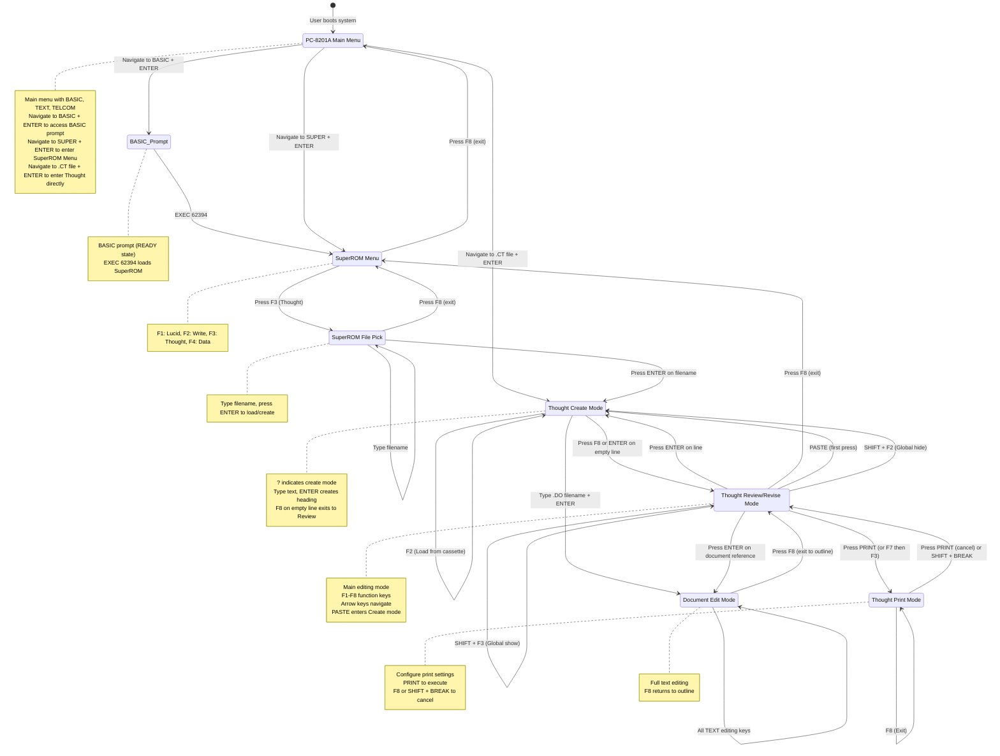

# THOUGHT Outline Processor - State Machine

This document describes the complete state machine for the THOUGHT outline processor, which is part of the SuperROM suite for the TRS-80 Model 100/200 and NEC PC-8201A.

## Overview

THOUGHT is an outline processor that manages hierarchical outlines containing headings, subheadings, and document references. The state machine captures all modes and transitions between them, particularly focusing on how keystrokes have different meanings in different modes.

### Important: Entering SuperROM and THOUGHT

On the PC-8201A, you cannot enter SuperROM or Thought directly from the Main Menu using function keys. The correct paths are:

1. **From Main Menu to SuperROM Menu:**
   - Navigate to BASIC using arrow keys, press ENTER
   - At BASIC prompt, type `EXEC 62394` and press ENTER
   - Or if SuperROM is already installed (previously EXEC'd), navigate to "SUPER" in menu and press ENTER

2. **From Main Menu to Thought (direct):**
   - If a Thought file (`.CT`) already exists, navigate to it using arrow keys
   - Press ENTER to open the file directly into Thought

3. **From SuperROM Menu to Thought:**
   - Press F3 to enter Thought
   - This takes you to the SuperROM File Pick screen

## Key Concepts

### What is a Mode?
A mode determines how keystrokes are interpreted:
- **Create Mode**: Typing creates new heading text; ENTER creates a new entry
- **Review/Revise Mode**: Typing edits existing text; arrow keys navigate
- **Document Mode**: Full text editing like TEXT application
- **Print Mode**: Configuring print output settings
- **File Pick Mode**: Selecting outline files to open

### Visual Indicators
| Symbol | Meaning |
|--------|---------|
| `?` | Create mode cursor indicator |
| `-` | Heading with visible children |
| `+` | Heading with hidden children |
| `.` | Document reference |
| `&` | Cloned heading |
| `↕` | Dragging mode |

---

## State Machine Diagram

## Detailed State Description

### 1. PC-8201A Main Menu State

**Description**: The default boot screen showing available programs (BASIC, TEXT, TELCOM, SUPER).

**Entering**:
- System power-on reset

**Exiting Transitions**:
| Event | Action | Target State |
|-------|--------|--------------|
| Navigate to BASIC + ENTER | Enter BASIC prompt | BASIC_Prompt |
| Navigate to SUPER + ENTER | Enter SuperROM Menu | SuperROM_Menu |
| Navigate to .CT file + ENTER | Open Thought with file | Thought_Create |

**Key Interpretation**:
| Key | Function |
|-----|----------|
| F1 | Lucid |
| F2 | Write ROM |
| F3 | Thought |
| F4 | Lucid Data |
| F8 | Exit to BIOS |
| Arrow keys | Navigate menu |
| ENTER | Select menu item |

---

### 1b. BASIC Prompt State

**Description**: The BASIC interpreter ready state after loading SuperROM.

**Entering**:
- From PC-8201A Main Menu via Navigate to BASIC + ENTER

**Exiting Transitions**:
| Event | Action | Target State |
|-------|--------|--------------|
| EXEC 62394 | Load SuperROM | SuperROM_Menu |

**Key Interpretation**:
| Key | Function |
|-----|----------|
| BASIC commands | Execute BASIC code |
| EXEC 62394 | Load SuperROM | Load SuperROM package |

---

### 2. SuperROM Menu State

**Description**: SuperROM's main menu with four integrated programs.

**Entering**:
- From PC-8201A Main Menu via Navigate to SUPER + ENTER
- From BASIC_Prompt via EXEC 62394

**Exiting Transitions**:
| Event | Action | Target State |
|-------|--------|--------------|
| Press F1 | Enter Lucid | Lucid (not modeled) |
| Press F2 | Enter Write ROM | Write ROM (not modeled) |
| Press F3 | Enter Thought | SuperROM File Pick |
| Press F4 | Enter Lucid Data | Data (not modeled) |
| Press F8 | Exit | PC8201A Main Menu |

**Key Interpretation**:
| Key | Function |
|-----|----------|
| F1 | Lucid |
| F2 | Write ROM |
| F3 | Thought |
| F4 | Lucid Data |
| F8 | Exit to Main Menu |

---

### 3. SuperROM File Pick State

**Description**: File selection screen for Thought outlines.

**Entering**:
- From SuperROM Menu when F3 (Thought) is pressed

** Exiting Transitions**:
| Event | Action | Target State |
|-------|--------|--------------|
| Type filename + ENTER | Load/create outline | Thought Create |
| Press F8 | Exit | SuperROM Menu |
| Press SHIFT + BREAK | Exit | SuperROM Menu |

**Key Interpretation**:
| Key | Function |
|-----|----------|
| Alphanumeric | Type filename |
| ENTER | Load/create file |
| F8 | Exit |
| SHIFT + BREAK | Exit |

---

### 4. Thought Create Mode State

**Description**: Creating new headings and subheadings in the outline. Indicated by `?` cursor.

**Entering**:
- From SuperROM File Pick after entering filename
- From Thought Review via ENTER on any line
- From PASTE in Thought Review (first press)

**Exiting Transitions**:
| Event | Action | Target State |
|-------|--------|--------------|
| Press F8 on empty line | Exit to Review | Thought Review |
| Press ENTER on empty line | Exit to Review | Thought Review |
| Type filename + ENTER | Create/edit document | Document Edit |
| Press F2 | Load from cassette | Thought Create (loads outline) |
| Arrow keys | Move create window | Thought Create (same state) |
| TAB | Change indent level | Thought Create (same state) |

**Key Interpretation**:
| Key | Function | Notes |
|-----|----------|-------|
| `?` | Cursor indicator | Shows create mode |
| Alphanumeric | Type heading text | Creates heading on ENTER |
| ENTER | Create entry | On text; exits to Review on empty |
| F8 | Exit/Enter | On text: create entry; On empty: exit to Review |
| UP/DOWN | Move create window | Navigate outline |
| LEFT | Reduce indent | Move left one level |
| RIGHT | Increase indent | Move right one level |
| SHIFT+UP | Move to nearest previous level | Navigate |
| SHIFT+DOWN | Move to nearest next level | Navigate |
| CTRL+UP | Move to top | Navigate |
| CTRL+DOWN | Move to end | Navigate |
| TAB | Increase indent | Create subheading |
| SHIFT+LEFT | Move word left | Navigate |
| SHIFT+RIGHT | Move word right | Navigate |
| CTRL+LEFT | Move to start | Navigate |
| CTRL+RIGHT | Move to end | Navigate |
| BKSP | Erase char left | Edit |
| SHIFT+DEL | Erase char right | Edit |
| CTRL+DEL | Erase line | Clear line |
| F2 | Load from cassette | Load .CT file |

---

### 5. Thought Review/Revise Mode State

**Description**: Main editing mode for viewing and modifying outline. Cursor is a wide bar.

**Entering**:
- From SuperROM File Pick after loading/creating an outline
- From Thought Create via F8 or ENTER on empty line
- From Document Edit via F8

**Exiting Transitions**:
| Event | Action | Target State |
|-------|--------|--------------|
| Press ENTER on line | Enter Create mode | Thought Create |
| Press F8 | Exit to SuperROM | SuperROM Menu |
| Press F1 | Find text | Thought Review (same state) |
| Press F2 | Hide children | Thought Review (same state) |
| Press F3 | Show children | Thought Review (same state) |
| Press F4 | Clone | Thought Review (same state) |
| Press F5 | Drag | Drag Mode (state) |
| Press F6 | Sort | Thought Review (same state) |
| Press F7 | Select range | Select Mode (state) |
| Press ENTER on document | Edit document | Document Edit |
| Press PRINT | Enter Print mode | Thought Print |
| SHIFT+F2 | Global hide | Thought Review (same state) |
| SHIFT+F3 | Global show | Thought Review (same state) |
| PASTE | Enter Create mode | Thought Create |
| Arrow keys | Navigate | Thought Review (same state) |

**Key Interpretation**:
| Key | Function | Notes |
|-----|----------|-------|
| `wide bar` | Cursor indicator | Shows review mode |
| UP/DOWN | Move cursor | Navigate outline |
| LEFT | Scroll screen left | Move to parent |
| RIGHT | Scroll screen right | Move to child |
| SHIFT+UP | Move to equal-level heading | Navigate |
| SHIFT+DOWN | Move to next sibling | Navigate |
| CTRL+UP | Move to top | Navigate |
| CTRL+DOWN | Move to end | Navigate |
| SHIFT+LEFT | Scroll left / hoist | View management |
| CTRL+LEFT | Hoist to top-left | View management |
| SHIFT+RIGHT | Move to child | Navigate |
| DEL BKSP | Erase char left | Edit |
| SHIFT+DEL | Erase char right | Edit |
| CTRL+DEL | Delete line | Deletes children too |
| F1 | Find text | Search outline |
| F2 | Hide children | Collapse subtree |
| F3 | Show children | Expand subtree |
| SHIFT+F3 | Global show | Expand all |
| SHIFT+F2 | Global hide | Hide all but root |
| F4 | Clone | Create duplicate |
| F5 | Drag | Enter drag mode |
| F6 | Sort | Sort children |
| F7 | Select | Select range |
| F8 | Exit | To SuperROM |
| ENTER | Create | Enter Create mode |
| PASTE | Paste | Enter Create mode |

---

### 6. Drag Mode State

**Description**: Entered from Review mode via F5 (Drag). The dragged entry is marked with `--`.

**Entering**:
- From Thought Review via F5 (Drag)

**Exiting Transitions**:
| Event | Action | Target State |
|-------|--------|--------------|
| Press ENTER | Drop and exit | Thought Review |
| Press ESC | Cancel drag | Thought Review |
| Arrow keys | Move dragged entry | Drag Mode (same state) |
| TAB | Change indent level | Drag Mode (same state) |

**Key Interpretation**:
| Key | Function | Notes |
|-----|----------|-------|
| `--` | Drag indicator | Shows dragging |
| Arrow keys | Move entry | Drag around |
| TAB | Change indent | Promote/demote |
| ENTER | Drop | Exit to Review |
| ESC | Cancel | Exit to Review |

---

### 7. Select Mode State

**Description**: Entered from Review mode via F7 (Select). Range is shown in reverse video.

**Entering**:
- From Thought Review via F7 (Select)

**Exiting Transitions**:
| Event | Action | Target State |
|-------|--------|--------------|
| Press ENTER | Exit select | Thought Review |
| ESC | Cancel select | Thought Review |
| Arrow keys | Extend selection | Select Mode (same state) |
| F4 | Sort | Sort selection |
| F5 | Copy | Copy selection |
| F6 | Cut | Cut selection |

**Key Interpretation**:
| Key | Function | Notes |
|-----|----------|-------|
| Reverse video | Selected range | Shows selection |
| Arrow keys | Extend range | Select more/less |
| ENTER | Exit | To Review |
| ESC | Cancel | To Review |
| F4 | Sort | Sort children |
| F5 | Copy | Copy to buffer |
| F6 | Cut | Cut to buffer |

---

### 8. Document Edit Mode State

**Description**: Full text editing for documents referenced in the outline.

**Entering**:
- From Thought Create when typing .DO filename + ENTER
- From Thought Review via ENTER on document reference
- From Thought Review via F6 (Text) on document reference

**Exiting Transitions**:
| Event | Action | Target State |
|-------|--------|--------------|
| Press F8 | Exit to outline | Thought Review |
| SHIFT + BREAK | Exit to SuperROM | SuperROM Menu |

**Key Interpretation**:
| Key | Function | Notes |
|-----|----------|-------|
| All TEXT keys | Edit text | Full text editing |
| F8 | Exit | To outline Review |

---

### 9. Thought Print Mode State

**Description**: Print configuration and execution mode.

**Entering**:
- From Thought Review via PRINT key
- From Thought Review via F7 then F3

**Exiting Transitions**:
| Event | Action | Target State |
|-------|--------|--------------|
| Press F8 | Cancel and exit | Thought Review |
| Press SHIFT + BREAK | Cancel and exit | Thought Review |
| Press PRINT | Execute print | Thought Print (same state) |
| F1 | Go (print) | Thought Print (executes) |
| F2 | Output destination | Configuration |
| F3 | Line spacing | Configuration |
| F4 | Page pause | Configuration |
| F5 | CRLF | Configuration |
| F6 | Set defaults | Configuration |
| F7 | Advanced options | Configuration |

**Key Interpretation**:
| Key | Function | Notes |
|-----|----------|-------|
| F1 | Go (print) | Execute print |
| F2 | Output | Destination selection |
| F3 | Line spacing | Toggle single/double |
| F4 | Page pause | Toggle page breaks |
| F5 | CRLF | Toggle line ending |
| F6 | Set defaults | Save new defaults |
| F7 | Advanced options | Margins, numbering, etc. |
| F8 | Exit | Cancel and exit |
| PRINT | Cancel | Exit to Review |

---

## State Transition Table

The following table shows all transitions between states:

| From State | Event | To State |
|------------|-------|----------|
| PC8201A_Menu | Navigate to BASIC + ENTER | BASIC_Prompt |
| PC8201A_Menu | Navigate to SUPER + ENTER | SuperROM_Menu |
| PC8201A_Menu | Navigate to .CT file + ENTER | Thought_Create |
| BASIC_Prompt | EXEC 62394 | SuperROM_Menu |
| SuperROM_Menu | F3 | SuperROM_File_Pick |
| SuperROM_Menu | F8 | PC8201A_Menu |
| SuperROM_File_Pick | ENTER on filename | Thought_Create |
| SuperROM_File_Pick | F8 | SuperROM_Menu |
| Thought_Create | F8 on empty line | Thought_Review |
| Thought_Create | ENTER on empty line | Thought_Review |
| Thought_Create | Type .DO + ENTER | Document_Edit |
| Thought_Create | Arrow keys | Thought_Create |
| Thought_Create | TAB | Thought_Create |
| Thought_Create | F2 | Thought_Create (load) |
| Document_Edit | F8 | Thought_Review |
| Thought_Review | ENTER | Thought_Create |
| Thought_Review | F8 | SuperROM_Menu |
| Thought_Review | F5 | Drag Mode |
| Thought_Review | F7 | Select Mode |
| Thought_Review | ENTER on document | Document_Edit |
| Thought_Review | PRINT | Thought_Print |
| Thought_Review | Arrow keys | Thought_Review |
| Thought_Review | F1-F4, F6, F7 | Thought_Review |
| Thought_Review | SHIFT+F2/F3 | Thought_Review |
| Drag Mode | ENTER | Thought_Review |
| Drag Mode | ESC | Thought_Review |
| Drag Mode | Arrow keys | Drag Mode |
| Select Mode | ENTER | Thought_Review |
| Select Mode | ESC | Thought_Review |
| Select Mode | Arrow keys | Select Mode |
| Select Mode | F4-F6 | Thought_Review |
| Thought_Print | F8 | Thought_Review |
| Thought_Print | SHIFT + BREAK | Thought_Review |
| Thought_Print | PRINT | Thought_Print (print) |
| Thought_Print | F1-F7 | Thought_Print (configure) |

---

## Keystroke Reference by Mode

### F3 Function Key Behavior

| Mode | F3 Behavior |
|------|-------------|
| PC8201A Menu | Thought |
| SuperROM Menu | Enter Thought (navigate to Thought) |
| SuperROM File Pick | (not shown - used for file pick) |
| Thought Create | Load from cassette (F2) |
| Thought Review | Show children (expand) |
| Drag Mode | (not shown) |
| Select Mode | (not shown) |
| Document Edit | (not shown) |
| Print Mode | Line spacing toggle |

### Shift+F3 Behavior

| Mode | Shift+F3 Behavior |
|------|-------------------|
| PC8201A Menu | (not shown) |
| SuperROM Menu | (not shown) |
| Thought Review | Global show (expand all) |
| Drag Mode | (not shown) |
| Select Mode | (not shown) |

### ENTER Key Behavior

| Mode | ENTER Behavior |
|------|----------------|
| PC8201A Menu | Select menu item |
| SuperROM Menu | Select menu item |
| SuperROM File Pick | Load/create outline |
| Thought Create | Create entry (or exit on empty) |
| Thought Review | Enter Create mode |
| Drag Mode | Drop and exit |
| Select Mode | Exit select |
| Document Edit | Insert line |
| Print Mode | (not shown) |

---

## Important Notes

1. **Mode Entry**: Most modes are entered via function keys (F3, F5, F7, PRINT) from Review/Revise mode

2. **Mode Exit**: F8 is the universal exit key for most modes

3. **Create vs Review**: The `?` vs wide bar cursor indicates the primary difference between Create and Review modes

4. **Drag Mode**: Entered via F5 in Review mode, exits via ENTER or ESC

5. **Select Mode**: Entered via F7 in Review mode, allows F4 (Sort), F5 (Copy), F6 (Cut)

6. **Document Mode**: Separate mode for editing `.DO` files referenced in outline

7. **Print Mode**: Full configuration before printing; can cancel with F8 or SHIFT + BREAK

8. **Clone Behavior**: When cloning (`&` indicator), changes propagate to all clones

---

## Files

| File | Extension | Description |
|------|-----------|-------------|
| Outline | `.CT` | Creative Thought outline file |
| Document | `.DO` | Document referenced in outline |
| Text | `.TX` | Alternative text file extension |

---

*Generated from THOUGHT manual and SuperROM documentation*
